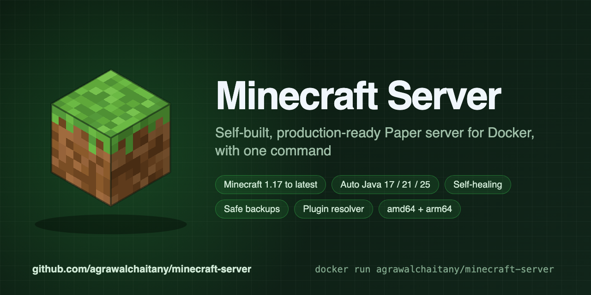

# Minecraft Server (Paper) for Docker

A self-built, production-ready **Minecraft: Java Edition** server on [Paper](https://papermc.io). One command, and it restarts itself, saves the world properly, backs up on a schedule, and refuses settings that would break it.

Built from scratch: no third-party server images or scripts. The only inputs are the official `eclipse-temurin` Java images and the official PaperMC, Mojang, Modrinth, and Hangar download services. Every jar is checksum-verified.

**Source, full docs, and issues:** [github.com/agrawalchaitany/minecraft-server](https://github.com/agrawalchaitany/minecraft-server)

## Quick start

```bash
docker run -d --name minecraft --restart unless-stopped \
  -p 25565:25565 -e EULA=TRUE -e MEMORY=2G \
  -v minecraft-data:/data \
  agrawalchaitany/minecraft-server:26.3
```

Connect to `localhost:25565`. Open the server console with:

```bash
docker exec -it minecraft rcon-cli
```

Setting `EULA=TRUE` accepts the [Minecraft EULA](https://aka.ms/MinecraftEULA).

## Docker Compose with scheduled backups

```bash
mkdir minecraft && cd minecraft
curl -fsSLO https://raw.githubusercontent.com/agrawalchaitany/minecraft-server/main/quickstart/compose.yaml
echo EULA=TRUE > .env
docker compose up -d
```

Backups are written to `./backups` every hour, and the newest 24 are kept.

## Tags

| Tag | Contents |
|---|---|
| `26.3`, `latest` | Minecraft 26.3 on Paper, Java 25, no plugins |

Platforms: `linux/amd64` and `linux/arm64` (Intel/AMD, Raspberry Pi 4/5, ARM cloud servers, Apple Silicon). The same image is on GitHub Packages as `ghcr.io/agrawalchaitany/minecraft-server`.

For another Minecraft version (1.17 to the latest) or plugins, [build from source](https://github.com/agrawalchaitany/minecraft-server#build-from-source): the right Java is chosen automatically, and plugins listed in `plugins.txt` are resolved to versions that work with your Minecraft and Java.

## Common settings

| Variable | Default | |
|---|---|---|
| `EULA` | `false` | Must be `TRUE` to start |
| `MEMORY` | `2G` | Java heap size |
| `ONLINE_MODE` | `true` | `false` lets players without an official account join |
| `MOTD` | `A reliable Paper server` | Server list message |
| `MAX_PLAYERS` | `20` | Player limit |
| `DIFFICULTY` | `normal` | `peaceful`, `easy`, `normal`, `hard` |
| `GAMEMODE` | `survival` | `survival`, `creative`, `adventure`, `spectator` |
| `TZ` | `UTC` | Time zone for logs and backups |

All settings: [Configuration](https://github.com/agrawalchaitany/minecraft-server/blob/main/docs/configuration.md).

## Features

- **Self-healing:** restarts after crashes and out-of-memory errors; a watchdog restarts a frozen server.
- **Safe shutdown:** every stop saves all worlds through the console first.
- **Consistent backups:** taken while players are online, verified, rotated, and never overlapping.
- **Safe restore:** checks the file, takes a safety backup, and extracts to a staging folder first.
- **Offline mode:** Mojang's username rules enforced, inventories kept when switching modes.
- **Guard rails:** every setting validated at startup with a clear message, so typos never cause crash loops.
- **Least privilege:** runs as a non-root user; the remote console is never exposed outside Docker.

## Links

- [Getting started](https://github.com/agrawalchaitany/minecraft-server/blob/main/docs/getting-started.md)
- [Backups and restore](https://github.com/agrawalchaitany/minecraft-server/blob/main/docs/backups.md)
- [Deployment](https://github.com/agrawalchaitany/minecraft-server/blob/main/docs/deployment.md)
- [Troubleshooting](https://github.com/agrawalchaitany/minecraft-server/blob/main/docs/troubleshooting.md)

Licensed under [MIT](https://github.com/agrawalchaitany/minecraft-server/blob/main/LICENSE). Not affiliated with Mojang Studios, Microsoft, or PaperMC. Minecraft is a trademark of Mojang Studios.
