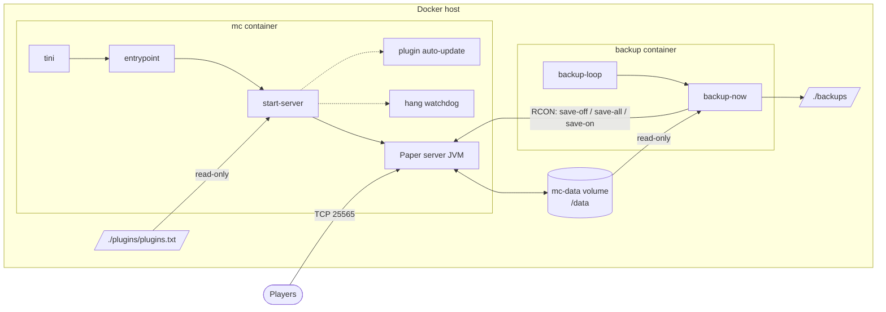
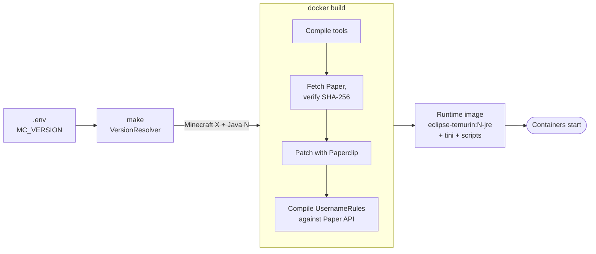
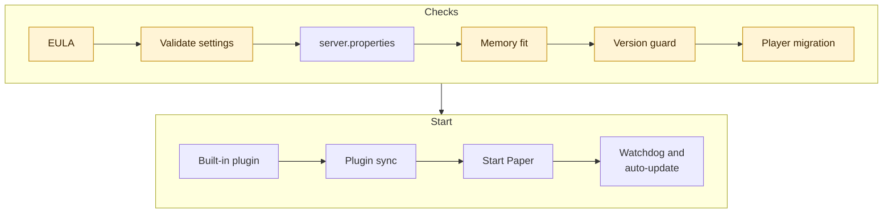

<!-- language-switcher -->
**English** · [हिन्दी](hi/architecture.md) · [Español](es/architecture.md) · [简体中文](zh-CN/architecture.md) · [Português (BR)](pt-BR/architecture.md) · [日本語](ja/architecture.md) · [한국어](ko/architecture.md)

#  Architecture

This page explains how the project is put together: what runs where, what happens at build time and at startup, and where data lives.

## The big picture



| Piece | What it is |
|---|---|
| **Image** `local/paper-server` | Built locally from `Dockerfile`. One image runs both containers. |
| **`mc` container** | The game server, plus helper processes (watchdog, optional plugin auto-update). |
| **`backup` container** | Same image, started with the `backup` command. Makes scheduled backups. |
| **`mc-data` volume** | Everything the server writes: worlds, configs, plugins, player data. Survives rebuilds. |
| **`./backups`** | Backup archives, on the host so you can copy them anywhere. |
| **`./plugins/plugins.txt`** | Your plugin list, mounted read-only into the server. |
| **RCON** | Minecraft's remote console. Used by the scripts to save the world and send commands. It is only reachable inside the Compose network and is never published to the host. |

## From `make up` to a running server




### 1. Resolve the version (on your machine)

`make` runs `VersionResolver` in a temporary `eclipse-temurin:25-jdk` container. It asks the PaperMC API which Paper release matches `MC_VERSION` and which Java that release needs, and picks the matching Java LTS (17, 21, or 25):

```
==> Minecraft 1.21.4 (Paper) on Java 21
```

The result is passed to the image build. Only Docker is needed on your machine.

### 2. Build the image

`Dockerfile` has two stages.

**Build stage** (`eclipse-temurin:25-jdk`):

1. Compiles the project's Java tools (`tools/*.java`) for Java 17, so they run on any server Java.
2. Runs `scripts/fetch-paper.sh`. It finds the newest stable Paper build for the chosen version, checks that the chosen Java is new enough, downloads the jar, and **verifies its SHA-256 checksum**.
3. Lets Paper's launcher (Paperclip) build the full server jar. This downloads the official Minecraft server from Mojang. The step is retried, because Paperclip can exit successfully even when its download failed.
4. Compiles the built-in `UsernameRules` plugin against the exact Paper API of that version.

**Runtime stage** (`eclipse-temurin:<17|21|25>-jre`):

- the verified Paper jar, the tools, the built-in plugin, and the scripts in `scripts/`
- `tini` as PID 1, so signals reach the server and zombie processes are cleaned up

### 3. Start the containers

Every container starts with `tini → entrypoint`. The entrypoint:

1. Fixes ownership of `/data` and `/backups` to `PUID:PGID` if needed.
2. Drops root privileges.
3. Runs the requested mode: `server`, `backup`, `backup-now`, or `restore`.

### 4. Server startup sequence (`start-server`)

Each step runs in order. Any failure stops the start with a clear message, instead of starting in a bad state.




Highlighted steps can stop the start with a clear message.

| # | Step | Details |
|---|---|---|
| 1 | Check EULA | Refuses to start unless `EULA=TRUE`. |
| 2 | Validate settings | RCON password, `MEMORY` format, numbers, time formats. See [Reliability](reliability.md#configuration-validation). |
| 3 | Write `server.properties` | Applies gameplay settings from `.env`. Always forces the port, listen address, and RCON settings. |
| 4 | Memory fit check | Refuses a heap that doesn't fit in the container's memory limit. |
| 5 | World version guard | Takes a backup before an upgrade and refuses downgrades. See [Minecraft versions](minecraft-versions.md). |
| 6 | Player data migration | If online/offline mode changed, moves player data to the new IDs. See [Online and offline mode](offline-mode.md). |
| 7 | Built-in plugin | Installs or removes `UsernameRules.jar` (`ENFORCE_USERNAME_RULES`). |
| 8 | Plugin sync | Applies staged plugin updates, and re-resolves `plugins.txt` if it, Minecraft, or Java changed. Never blocks startup. |
| 9 | Start Paper | Runs the JVM with the tuned flags. |
| 10 | Helpers | Starts the hang watchdog, and the plugin auto-update scheduler if enabled. |

### 5. Shutdown sequence

```
docker stop / make down / make restart
  → tini forwards SIGTERM
  → start-server sends "stop" over RCON (or SIGTERM to Java if RCON isn't up yet)
  → Paper saves every world and exits
  → container stops
```

Docker waits `STOP_TIMEOUT` (default 2 minutes) before force-killing.

## Data layout

Inside the `mc-data` volume (`/data`):

```
/data
├── world/                     # The world (name from LEVEL_NAME)
├── plugins/
│   ├── *.jar                  # Installed plugins
│   ├── <Plugin>/              # Each plugin's own settings
│   └── .managed/
│       ├── lock.tsv           # Which plugins plugins.txt installed, and which versions
│       └── pending/           # Staged plugin updates, applied on next start
├── server.properties, bukkit.yml, spigot.yml, config/   # Server configuration
├── ops.json, whitelist.json, banned-players.json        # Admin lists
├── .mc-version                # Minecraft version the world was last run on
├── .player-uuid-mode          # online/offline mode the player data matches
├── cache/, libraries/, versions/   # Rebuilt by Paper; excluded from backups
└── logs/                      # Server logs; excluded from backups
```

## Outside services

| Service | Used for | When |
|---|---|---|
| Docker Hub (`eclipse-temurin`) | Java images | Build |
| PaperMC API (`fill.papermc.io`) | Paper versions, downloads, checksums | Build, `make versions` |
| Mojang (`piston-data.mojang.com`) | Official server jar that Paper patches | Build, first start |
| Mojang (`api.mojang.com`) | Username → account ID | Only when switching to online mode with existing players |
| Modrinth, Hangar | Plugin metadata and downloads | Plugin install and update only |

No third-party server images or scripts are used. Every downloaded server and plugin jar is checksum-verified.

## Source layout

```
Dockerfile, compose.yaml, Makefile, .env.example
scripts/
  entrypoint.sh       Ownership fix, drop root, dispatch
  start-server.sh     Startup sequence, signal handling, watchdog, auto-update
  fetch-paper.sh      Resolve and verify the Paper download (build time)
  backup-now.sh       One consistent, locked, verified backup
  backup-loop.sh      Backup scheduler
  restore-backup.sh   Safe restore through a staging folder
  plugins, rcon-cli, mc-health   Thin wrappers around the Java tools
tools/                Dependency-free Java tools, compiled into mctool.jar
  McTool.java         Entry point; RCON client and server-list ping
  VersionResolver.java  Minecraft version → Paper release + Java
  PluginManager.java  plugins.txt resolver, downloader, and verifier
  PlayerMigrator.java Online/offline UUID migration
  Json.java, Yaml.java  Minimal parsers
plugins/
  plugins.txt         Your plugin list
  username-rules/     Built-in plugin source
docs/                 This documentation
  assets/             Banner and icons (hand-made SVG)
```
