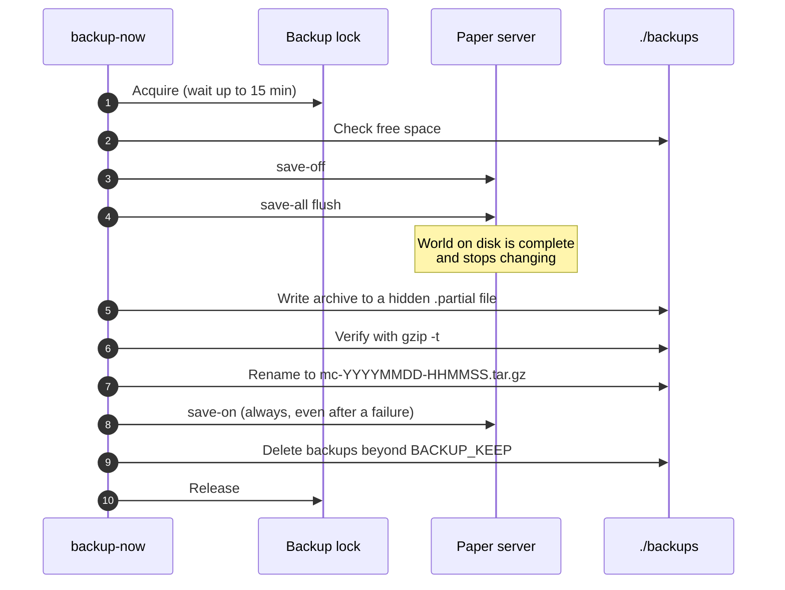
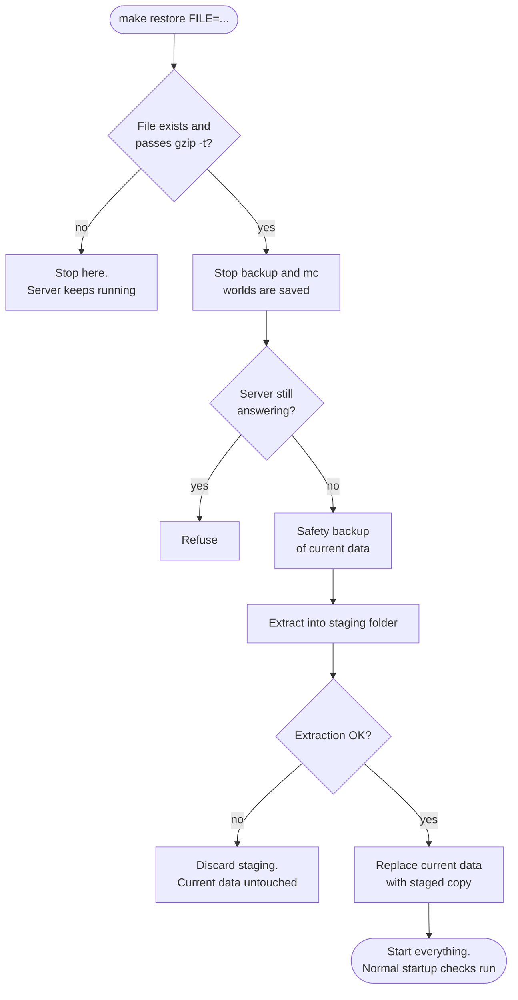

<!-- language-switcher -->
**English** · [हिन्दी](hi/backups.md) · [Español](es/backups.md) · [简体中文](zh-CN/backups.md) · [Português (BR)](pt-BR/backups.md) · [日本語](ja/backups.md) · [한국어](ko/backups.md)

#  Backups and restore

Backups run automatically, are consistent even while players are online, and are checked before they count. Restores are designed so that a mistake can't cost you the current world.

## At a glance

| | |
|---|---|
| **Schedule** | Every `BACKUP_INTERVAL` (default `1h`), by the `backup` container |
| **Kept** | The newest `BACKUP_KEEP` (default `24`) |
| **Where** | `./backups/` on the host, as `mc-YYYYMMDD-HHMMSS.tar.gz` (UTC time) |
| **Manual** | `make backup` |
| **List** | `make backups` |
| **Restore** | `make restore FILE=mc-….tar.gz` |

Backups are also taken **automatically before every risky operation**:

| Before… | Taken by |
|---|---|
| Upgrading the world to a newer Minecraft version | `start-server` |
| Migrating player data between online and offline mode | `start-server` |
| Applying plugin updates (`make update-plugins`, auto-update) | the update command |
| Restoring a backup (a "safety backup" of what's being replaced) | `restore` |

## What's in a backup

Everything needed to bring the server back exactly as it was: worlds, `server.properties` and other configs, plugins and their settings, player data, operator, whitelist, and ban lists, and the version markers.

Left out, because Paper rebuilds them or they're temporary:

| Excluded | Why |
|---|---|
| `cache/`, `libraries/`, `versions/` | Downloaded or generated by Paper on start |
| `logs/` | Not needed to restore; can be large |
| `plugins/.managed/pending/` | Staged plugin updates, re-created by the next update |
| `plugins/spark/tmp/` | Profiler temp files |

## How a backup stays consistent

A Minecraft world is thousands of files that the server rewrites constantly. Copying them mid-write can capture a half-saved chunk. Each backup therefore:



1. **Takes the backup lock.** Only one backup runs at a time, even across the `mc` and `backup` containers. Otherwise a second backup could turn autosave back on while the first is still reading. A backup waits up to 15 minutes for the lock.
2. **Checks disk space** (see below).
3. **Pauses autosave and flushes** over RCON: `save-off`, then `save-all flush`. Everything in memory is now on disk and stays still.
4. **Archives `/data`** into a hidden `.partial` file.
5. **Verifies the archive** with `gzip -t`. A corrupt archive is discarded and older backups are kept.
6. **Renames it into place.** A half-written backup never looks like a real one.
7. **Resumes autosave** with `save-on`. This also happens if anything above failed.
8. **Deletes the oldest backups** beyond `BACKUP_KEEP`.

Players can keep playing the whole time; nothing is announced or frozen.

If RCON can't be reached (for example, the server is stopped), the backup is taken without step 3 and says so. That's safe when the server isn't running.

## Disk space safety

A backup that fills the disk can also stop the server from saving the world, which risks corruption. Before starting, the backup estimates its size (the last backup's size plus 20%, or 60% of the data size for the first one) and refuses to run unless that much **plus 512 MB** is free:

```
ERROR: not enough disk space: about 102M needed plus 512M headroom, 20M free. Lower BACKUP_KEEP or free space.
```

The scheduled loop logs the failure and tries again at the next interval.

## Restoring

```bash
make backups                                   # pick one
make restore FILE=mc-20261030-175220.tar.gz
```

What happens, in order:



1. **On your machine, before touching anything:** the file must exist and pass `gzip -t`. A typo or corrupt file stops here, and the server keeps running.
2. The `backup` and `mc` containers are stopped (worlds saved).
3. The restore refuses to continue if the server still answers.
4. **A safety backup** of the current state is taken.
5. The backup is extracted into a **staging folder** next to the live data. If extraction fails (for example, a full disk), the current data is left untouched.
6. Only then is the current data replaced with the staged copy.
7. Everything starts again.

After a restore, the normal startup checks still apply:

- A backup made on a **newer** Minecraft version than the server runs is refused by the [downgrade guard](minecraft-versions.md#downgrading).
- A backup made on an **older** version is upgraded, with another backup first.
- A backup made in the other online/offline mode has its player data [migrated](offline-mode.md#player-data-across-modes).
- Plugins are re-synced to `plugins.txt`.

The safety backup is an ordinary backup. Normal rotation deletes it once it becomes older than the newest `BACKUP_KEEP` backups, so copy it elsewhere if you want to keep it.

## Restoring on a new machine

1. Set up the project on the new machine ([Getting started](getting-started.md)), using the **same `MC_VERSION`** as the backup or newer.
2. Copy the backup file into `./backups/`.
3. Run `make up` once, so the containers and volume exist.
4. Run `make restore FILE=…`.

## Off-site copies

Backups in `./backups` are on the same disk as the server. They protect against mistakes and corruption, but not against losing the machine. Copy them somewhere else regularly; see [Deployment](deployment.md#off-site-backups) for an example.

## Opening a backup by hand

Backups are ordinary `tar.gz` archives:

```bash
tar -tzf backups/mc-20261030-175220.tar.gz | head        # list contents
mkdir /tmp/old && tar -xzf backups/mc-….tar.gz -C /tmp/old ./world/
```
