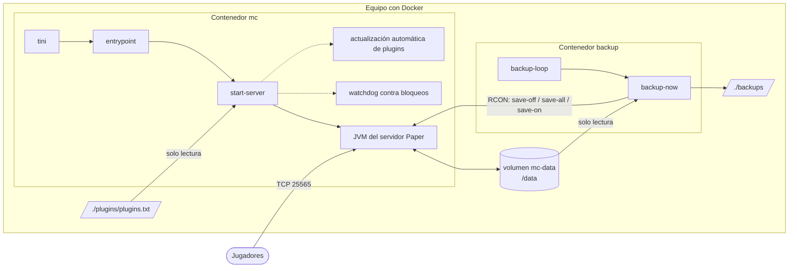
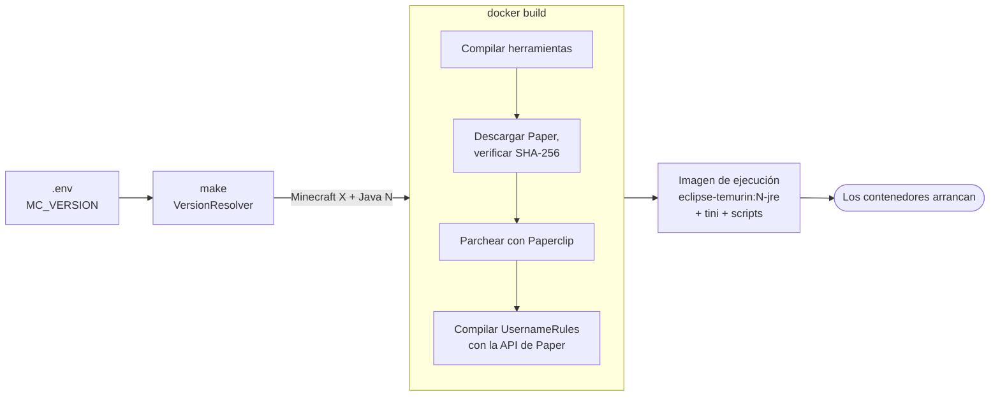
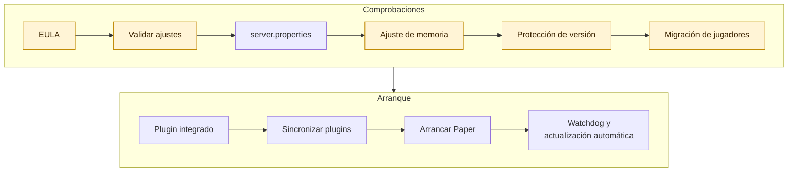

<!-- language-switcher -->
[English](../architecture.md) · [हिन्दी](../hi/architecture.md) · **Español** · [简体中文](../zh-CN/architecture.md) · [Português (BR)](../pt-BR/architecture.md) · [日本語](../ja/architecture.md) · [한국어](../ko/architecture.md)

#  Arquitectura

Esta página explica cómo está montado el proyecto: qué se ejecuta y dónde, qué ocurre al construir y al arrancar, y dónde viven los datos.

## Visión general



| Pieza | Qué es |
|---|---|
| **Imagen** `local/paper-server` | Se construye localmente a partir de `Dockerfile`. Una sola imagen ejecuta ambos contenedores. |
| **Contenedor `mc`** | El servidor de juego, más procesos auxiliares (watchdog, actualización automática de plugins opcional). |
| **Contenedor `backup`** | La misma imagen, arrancada con el comando `backup`. Hace las copias de seguridad programadas. |
| **Volumen `mc-data`** | Todo lo que escribe el servidor: mundos, configuración, plugins, datos de jugadores. Sobrevive a las reconstrucciones. |
| **`./backups`** | Los archivos de copia de seguridad, en el equipo para que puedas copiarlos a cualquier sitio. |
| **`./plugins/plugins.txt`** | Tu lista de plugins, montada en solo lectura dentro del servidor. |
| **RCON** | La consola remota de Minecraft. Los scripts la usan para guardar el mundo y enviar comandos. Solo es accesible dentro de la red de Compose y nunca se publica en el equipo. |

## De `make up` a un servidor en marcha




### 1. Resolver la versión (en tu máquina)

`make` ejecuta `VersionResolver` en un contenedor temporal `eclipse-temurin:25-jdk`. Pregunta a la API de PaperMC qué versión de Paper corresponde a `MC_VERSION` y qué Java necesita, y elige el Java LTS correspondiente (17, 21 o 25):

```
==> Minecraft 1.21.4 (Paper) on Java 21
```

El resultado se pasa a la construcción de la imagen. En tu máquina solo hace falta Docker.

### 2. Construir la imagen

`Dockerfile` tiene dos etapas.

**Etapa de construcción** (`eclipse-temurin:25-jdk`):

1. Compila las herramientas Java del proyecto (`tools/*.java`) para Java 17, de modo que funcionen con cualquier Java del servidor.
2. Ejecuta `scripts/fetch-paper.sh`. Busca el build estable de Paper más reciente para la versión elegida, comprueba que el Java elegido es lo bastante nuevo, descarga el jar y **verifica su checksum SHA-256**.
3. Deja que el lanzador de Paper (Paperclip) construya el jar completo del servidor. Esto descarga el servidor oficial de Minecraft desde Mojang. El paso se reintenta, porque Paperclip puede terminar con éxito aunque su descarga haya fallado.
4. Compila el plugin integrado `UsernameRules` contra la API de Paper exacta de esa versión.

**Etapa de ejecución** (`eclipse-temurin:<17|21|25>-jre`):

- el jar de Paper verificado, las herramientas, el plugin integrado y los scripts de `scripts/`
- `tini` como PID 1, para que las señales lleguen al servidor y se limpien los procesos zombi

### 3. Arrancar los contenedores

Cada contenedor arranca con `tini → entrypoint`. El entrypoint:

1. Corrige, si hace falta, la propiedad de `/data` y `/backups` a `PUID:PGID`.
2. Abandona los privilegios de root.
3. Ejecuta el modo pedido: `server`, `backup`, `backup-now` o `restore`.

### 4. Secuencia de arranque del servidor (`start-server`)

Cada paso se ejecuta en orden. Cualquier fallo detiene el arranque con un mensaje claro, en lugar de arrancar en mal estado.




Los pasos resaltados pueden detener el arranque con un mensaje claro.

| # | Paso | Detalles |
|---|---|---|
| 1 | Comprobar el EULA | Se niega a arrancar salvo que `EULA=TRUE`. |
| 2 | Validar ajustes | Contraseña RCON, formato de `MEMORY`, números, formatos de hora. Consulta [Fiabilidad](reliability.md#validación-de-la-configuración). |
| 3 | Escribir `server.properties` | Aplica los ajustes de juego de `.env`. Siempre fuerza el puerto, la dirección de escucha y los ajustes de RCON. |
| 4 | Comprobar que cabe la memoria | Rechaza un heap que no cabe en el límite de memoria del contenedor. |
| 5 | Protección de versión del mundo | Hace una copia antes de actualizar y rechaza bajadas de versión. Consulta [Versiones de Minecraft](minecraft-versions.md). |
| 6 | Migración de datos de jugadores | Si cambió el modo con/sin conexión, mueve los datos de jugadores a los nuevos ID. Consulta [Modo con y sin conexión](offline-mode.md). |
| 7 | Plugin integrado | Instala o quita `UsernameRules.jar` (`ENFORCE_USERNAME_RULES`). |
| 8 | Sincronizar plugins | Aplica las actualizaciones de plugins preparadas y vuelve a resolver `plugins.txt` si cambió él, Minecraft o Java. Nunca bloquea el arranque. |
| 9 | Arrancar Paper | Ejecuta la JVM con los flags ajustados. |
| 10 | Auxiliares | Arranca el watchdog contra bloqueos y, si está activado, el programador de actualizaciones automáticas de plugins. |

### 5. Secuencia de apagado

```
docker stop / make down / make restart
  → tini forwards SIGTERM
  → start-server sends "stop" over RCON (or SIGTERM to Java if RCON isn't up yet)
  → Paper saves every world and exits
  → container stops
```

Docker espera `STOP_TIMEOUT` (2 minutos por defecto) antes de forzar el cierre.

## Organización de los datos

Dentro del volumen `mc-data` (`/data`):

```
/data
├── world/                     # El mundo (nombre según LEVEL_NAME)
├── plugins/
│   ├── *.jar                  # Plugins instalados
│   ├── <Plugin>/              # Ajustes propios de cada plugin
│   └── .managed/
│       ├── lock.tsv           # Qué plugins y versiones instaló plugins.txt
│       └── pending/           # Actualizaciones preparadas, aplicadas en el siguiente arranque
├── server.properties, bukkit.yml, spigot.yml, config/   # Configuración del servidor
├── ops.json, whitelist.json, banned-players.json        # Listas de administración
├── .mc-version                # Versión de Minecraft con la que se ejecutó el mundo por última vez
├── .player-uuid-mode          # Modo con/sin conexión al que corresponden los datos de jugadores
├── cache/, libraries/, versions/   # Paper los regenera; excluidos de las copias
└── logs/                      # Logs del servidor; excluidos de las copias
```

## Servicios externos

| Servicio | Para qué | Cuándo |
|---|---|---|
| Docker Hub (`eclipse-temurin`) | Imágenes de Java | Construcción |
| API de PaperMC (`fill.papermc.io`) | Versiones de Paper, descargas, checksums | Construcción, `make versions` |
| Mojang (`piston-data.mojang.com`) | Jar oficial del servidor que Paper parchea | Construcción, primer arranque |
| Mojang (`api.mojang.com`) | Nombre de usuario → ID de cuenta | Solo al pasar a modo con conexión con jugadores existentes |
| Modrinth, Hangar | Metadatos y descargas de plugins | Solo al instalar y actualizar plugins |

No se usan imágenes ni scripts de servidor de terceros. Se verifica el checksum de cada jar de servidor y de plugin descargado.

## Organización del código

```
Dockerfile, compose.yaml, Makefile, .env.example
scripts/
  entrypoint.sh       Corregir propietario, dejar root, despachar el modo
  start-server.sh     Secuencia de arranque, señales, watchdog, actualización automática
  fetch-paper.sh      Resolver y verificar la descarga de Paper (al construir)
  backup-now.sh       Una copia consistente, con bloqueo y verificada
  backup-loop.sh      Programador de copias
  restore-backup.sh   Restauración segura mediante una carpeta temporal
  plugins, rcon-cli, mc-health   Envoltorios ligeros de las herramientas Java
tools/                Herramientas Java sin dependencias, compiladas en mctool.jar
  McTool.java         Punto de entrada; cliente RCON y ping de lista de servidores
  VersionResolver.java  Versión de Minecraft → versión de Paper + Java
  PluginManager.java  Resolución, descarga y verificación de plugins.txt
  PlayerMigrator.java Migración de UUID entre modo con y sin conexión
  Json.java, Yaml.java  Analizadores mínimos
plugins/
  plugins.txt         Tu lista de plugins
  username-rules/     Código del plugin integrado
docs/                 Esta documentación
  assets/             Banner e iconos (SVG hechos a mano)
```
