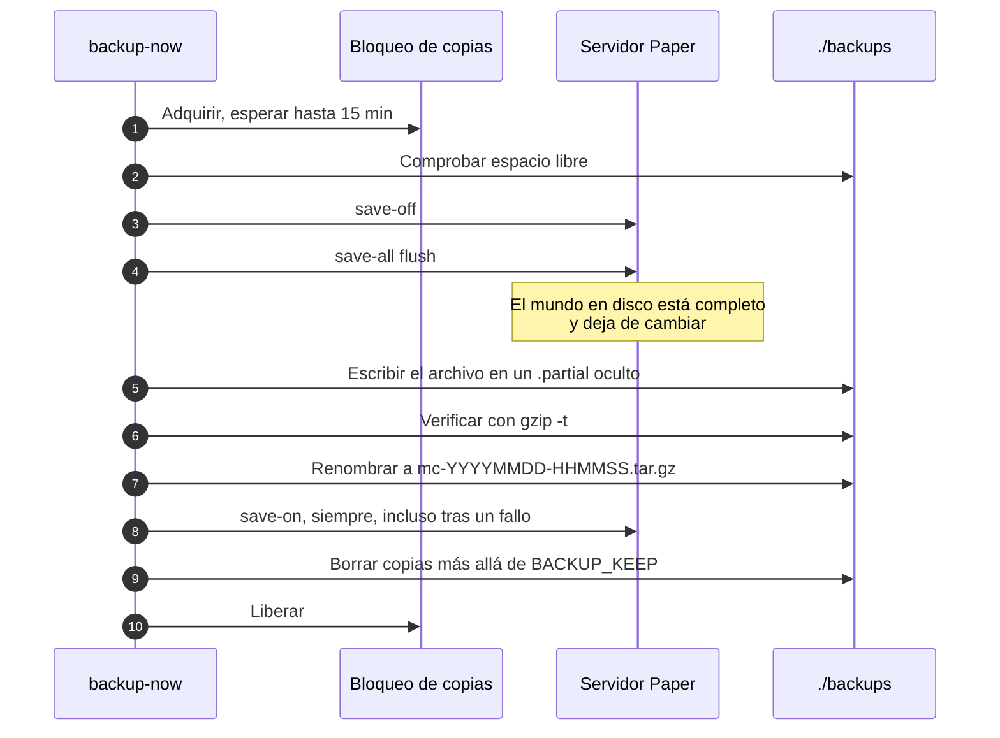
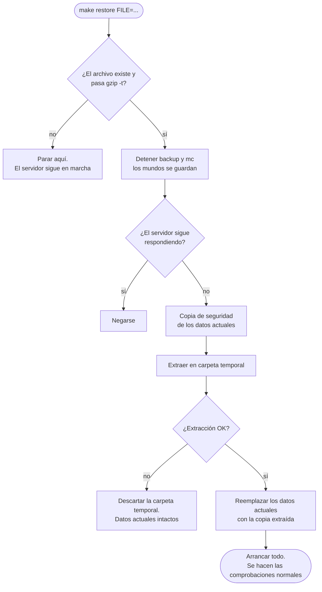

<!-- language-switcher -->
[English](../backups.md) · [हिन्दी](../hi/backups.md) · **Español** · [简体中文](../zh-CN/backups.md) · [Português (BR)](../pt-BR/backups.md) · [日本語](../ja/backups.md) · [한국어](../ko/backups.md)

#  Copias de seguridad y restauración

Las copias de seguridad se hacen automáticamente, son consistentes aunque haya jugadores conectados y se verifican antes de darse por buenas. Las restauraciones están pensadas para que un error no pueda costarte el mundo actual.

## De un vistazo

| | |
|---|---|
| **Programación** | Cada `BACKUP_INTERVAL` (`1h` por defecto), a cargo del contenedor `backup` |
| **Se conservan** | Las `BACKUP_KEEP` más recientes (`24` por defecto) |
| **Dónde** | `./backups/` en el equipo, como `mc-YYYYMMDD-HHMMSS.tar.gz` (hora UTC) |
| **Manual** | `make backup` |
| **Listar** | `make backups` |
| **Restaurar** | `make restore FILE=mc-….tar.gz` |

También se hacen copias **automáticamente antes de cada operación arriesgada**:

| Antes de… | La hace |
|---|---|
| Actualizar el mundo a una versión más nueva de Minecraft | `start-server` |
| Migrar datos de jugadores entre modo con y sin conexión | `start-server` |
| Aplicar actualizaciones de plugins (`make update-plugins`, actualización automática) | el comando de actualización |
| Restaurar una copia (una "copia de seguridad de seguridad" de lo que se reemplaza) | `restore` |

## Qué contiene una copia

Todo lo necesario para dejar el servidor exactamente como estaba: mundos, `server.properties` y demás configuración, plugins y sus ajustes, datos de jugadores, listas de operadores, lista blanca y baneos, y los marcadores de versión.

Se excluye, porque Paper lo regenera o es temporal:

| Excluido | Por qué |
|---|---|
| `cache/`, `libraries/`, `versions/` | Paper los descarga o genera al arrancar |
| `logs/` | No hacen falta para restaurar; pueden ser grandes |
| `plugins/.managed/pending/` | Actualizaciones de plugins preparadas; la siguiente actualización las vuelve a crear |
| `plugins/spark/tmp/` | Archivos temporales del profiler |

## Cómo se mantiene consistente una copia

Un mundo de Minecraft son miles de archivos que el servidor reescribe constantemente. Copiarlos a medio escribir puede capturar un chunk guardado a medias. Por eso cada copia:



1. **Toma el bloqueo de copias.** Solo se ejecuta una copia a la vez, incluso entre los contenedores `mc` y `backup`. Si no, una segunda copia podría volver a activar el autoguardado mientras la primera sigue leyendo. Una copia espera hasta 15 minutos por el bloqueo.
2. **Comprueba el espacio en disco** (ver más abajo).
3. **Pausa el autoguardado y vuelca** por RCON: `save-off` y luego `save-all flush`. Todo lo que había en memoria está ya en disco y no cambia.
4. **Archiva `/data`** en un archivo oculto `.partial`.
5. **Verifica el archivo** con `gzip -t`. Un archivo corrupto se descarta y se conservan las copias anteriores.
6. **Lo renombra a su nombre final.** Una copia a medio escribir nunca parece una de verdad.
7. **Reanuda el autoguardado** con `save-on`. Esto ocurre también si algo de lo anterior falló.
8. **Borra las copias más antiguas** que superen `BACKUP_KEEP`.

Los jugadores pueden seguir jugando todo el tiempo; no se anuncia ni se congela nada.

Si no se puede contactar con RCON (por ejemplo, porque el servidor está detenido), la copia se hace sin el paso 3 y lo indica. Es seguro cuando el servidor no está en marcha.

## Seguridad del espacio en disco

Una copia que llena el disco también puede impedir que el servidor guarde el mundo, con riesgo de corrupción. Antes de empezar, la copia estima su tamaño (el de la última copia más un 20 %, o el 60 % del tamaño de los datos para la primera) y se niega a ejecutarse salvo que haya libre esa cantidad **más 512 MB**:

```
ERROR: not enough disk space: about 102M needed plus 512M headroom, 20M free. Lower BACKUP_KEEP or free space.
```

El bucle programado registra el fallo y vuelve a intentarlo en el siguiente intervalo.

## Restaurar

```bash
make backups                                   # pick one
make restore FILE=mc-20261030-175220.tar.gz
```

Qué ocurre, en orden:



1. **En tu máquina, antes de tocar nada:** el archivo debe existir y pasar `gzip -t`. Una errata o un archivo corrupto se detiene aquí, y el servidor sigue en marcha.
2. Se detienen los contenedores `backup` y `mc` (los mundos se guardan).
3. La restauración se niega a continuar si el servidor sigue respondiendo.
4. Se hace una **copia de seguridad de seguridad** del estado actual.
5. La copia se extrae en una **carpeta temporal** junto a los datos en uso. Si la extracción falla (por ejemplo, con el disco lleno), los datos actuales quedan intactos.
6. Solo entonces se reemplazan los datos actuales por la copia extraída.
7. Todo vuelve a arrancar.

Tras una restauración siguen aplicándose las comprobaciones normales de arranque:

- Una copia hecha con una versión de Minecraft **más nueva** que la del servidor la rechaza la [protección contra bajadas de versión](minecraft-versions.md#bajar-de-versión).
- Una copia hecha con una versión **más antigua** se actualiza, con otra copia antes.
- A una copia hecha en el otro modo (con o sin conexión) se le [migran](offline-mode.md#datos-de-jugadores-entre-modos) los datos de jugadores.
- Los plugins se vuelven a sincronizar con `plugins.txt`.

La copia de seguridad de seguridad es una copia normal. La rotación habitual la borra cuando queda por detrás de las `BACKUP_KEEP` más recientes, así que cópiala a otro sitio si quieres conservarla.

## Restaurar en una máquina nueva

1. Instala el proyecto en la máquina nueva ([Primeros pasos](getting-started.md)), usando el **mismo `MC_VERSION`** que la copia o uno más nuevo.
2. Copia el archivo de la copia en `./backups/`.
3. Ejecuta `make up` una vez, para que existan los contenedores y el volumen.
4. Ejecuta `make restore FILE=…`.

## Copias fuera del servidor

Las copias de `./backups` están en el mismo disco que el servidor. Protegen contra errores y corrupción, pero no contra perder la máquina. Cópialas a otro sitio con regularidad; consulta [Despliegue](deployment.md#copias-fuera-del-servidor) para ver un ejemplo.

## Abrir una copia a mano

Las copias son archivos `tar.gz` normales:

```bash
tar -tzf backups/mc-20261030-175220.tar.gz | head        # list contents
mkdir /tmp/old && tar -xzf backups/mc-….tar.gz -C /tmp/old ./world/
```
