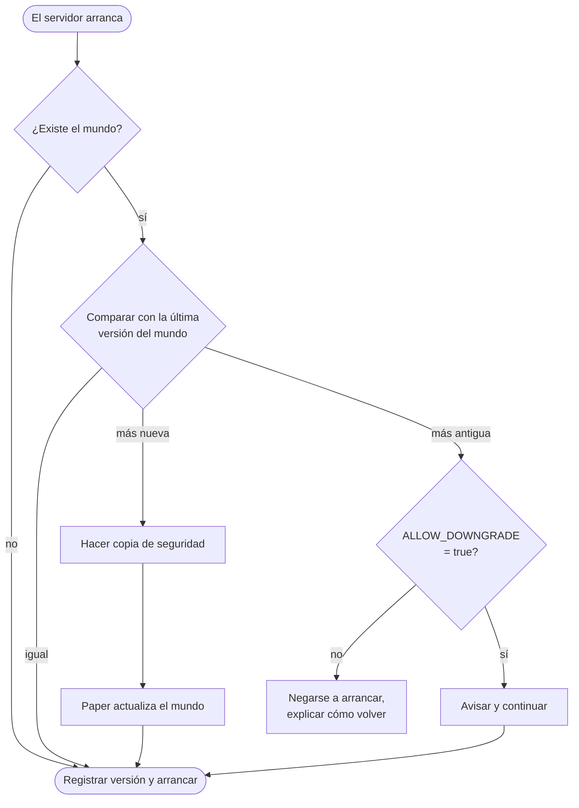

<!-- language-switcher -->
[English](../minecraft-versions.md) · [हिन्दी](../hi/minecraft-versions.md) · **Español** · [简体中文](../zh-CN/minecraft-versions.md) · [Português (BR)](../pt-BR/minecraft-versions.md) · [日本語](../ja/minecraft-versions.md) · [한국어](../ko/minecraft-versions.md)

#  Versiones de Minecraft

Puedes ejecutar cualquier versión de Minecraft desde la **1.17** hasta la más reciente. El Java adecuado se elige automáticamente y el mundo queda protegido cuando cambia la versión.

## Elegir una versión

Defínela en `.env` **antes de tu primer `make up`**:

```env
MC_VERSION=1.21.4
```

Valores válidos:

- `latest`: la versión de Minecraft más reciente que tenga un build **estable** de Paper. Se resuelve cada vez que se construye la imagen.
- una versión exacta, como `1.20.4`, `1.21.4` o `26.3`

Para ver qué hay disponible:

```bash
make versions
```

```
MINECRAFT  JAVA   PAPER SUPPORT
26.3       25     supported
26.2       25     deprecated
1.21.11    21     unsupported
...
```

La columna "Paper support" es el estado que indica PaperMC. Las versiones "unsupported" siguen funcionando, pero ya no reciben correcciones de PaperMC.

## Cómo se elige Java

Cada versión de Minecraft necesita un Java mínimo. `make` consulta la API de PaperMC y elige el Java LTS más antiguo que lo cumple, porque es con el que esa versión se construyó y probó:

| Minecraft | Java |
|---|---|
| 1.17 – 1.20.4 | 17 |
| 1.20.5 – 1.21.x | 21 |
| 26.x | 25 |

Después, la imagen se construye a partir de la imagen oficial de Java `eclipse-temurin` de esa versión. `make up` muestra la decisión:

```
==> Minecraft 1.20.4 (Paper) on Java 17
```

Para forzar un Java más nuevo, por ejemplo porque un plugin que necesitas está compilado para Java 21 pero usas la 1.20.4, pon `JAVA_VERSION=21` en `.env`. Se rechaza un Java demasiado antiguo para la versión de Minecraft elegida.

Minecraft **1.16.5 y anteriores** necesitan Java 8 u 11 y no están soportadas; `make` las rechaza con un mensaje claro.

## Qué pasa cuando cambia la versión

En cada arranque, el servidor compara la versión de Minecraft con la última con la que se ejecutó el mundo:



## Actualizar

1. Revisa si tus plugins soportan la nueva versión (opcional; se vuelven a resolver automáticamente).
2. Cambia `MC_VERSION` en `.env`.
3. Ejecuta `make up`.

En el primer arranque con la nueva versión:

```
[start-server] Upgrading world from Minecraft 1.20.4 to 1.21.4; taking a backup first
[backup] Saved /backups/mc-20261030-195423.tar.gz (51M)
[plugins] plugins.txt, Minecraft or Java changed: resolving plugins for Minecraft 1.21.4 on Java 21
[plugins] ~ WorldEdit 7.3.0 -> 7.4.2
```

- **Se hace una copia de seguridad antes de que Minecraft actualice el mundo.** Si la actualización sale mal, restáurala.
- **Los plugins se vuelven a resolver** para la nueva versión de Minecraft y de Java. Consulta [Plugins](plugins.md).

## Bajar de versión

Minecraft no puede abrir con seguridad un mundo guardado por una versión más nueva; se pueden perder o corromper chunks y objetos. Por eso el servidor registra en `/data/.mc-version` la última versión con la que se ejecutó cada mundo y se niega a arrancar una más antigua:

```
[start-server] This world was last run on Minecraft 1.21.4, but the server is now 1.20.4.
[start-server] Opening a world in an older version can corrupt it, so the server will not start.
[start-server] Set MC_VERSION=1.21.4 in .env (or restore a backup made on 1.20.4) and run 'make up'.
```

Para volver atrás de verdad:

1. Vuelve a poner `MC_VERSION` en la versión anterior.
2. Restaura una copia hecha **mientras se ejecutaba esa versión anterior** (`make restore FILE=…`), como la que se hizo automáticamente justo antes de actualizar.

Poner `ALLOW_DOWNGRADE=true` se salta la comprobación. Úsalo solo cuando sepas que el mundo es compatible, por ejemplo justo después de una actualización, antes de que nadie haya entrado.

## Quedarse en una versión

`MC_VERSION=latest` salta a nuevas versiones de Minecraft cada vez que se reconstruye la imagen (`make up` tras un cambio, o `make update`). Para un servidor del que dependen otras personas, **fija una versión exacta** cuando estés contento con ella:

```env
MC_VERSION=26.3
```

Así `make update` solo descarga builds más nuevos de Paper (correcciones de errores y de seguridad) de esa misma versión de Minecraft.

## Fijar un build de Paper

```env
MC_VERSION=1.21.4
PAPER_BUILD=232
```

`PAPER_BUILD` solo funciona con un `MC_VERSION` exacto, porque los números de build se cuentan por separado para cada versión. Útil sobre todo para quedarse en un build que funciona bien o para volver atrás desde uno defectuoso.

## Versiones probadas

Se han verificado la construcción y el arranque limpio en 1.17.1, 1.18.2 y 1.20.4 (Java 17), 1.21.4 (Java 21) y 26.3 (Java 25). También se han probado la actualización de 1.20.4 a 1.21.4 y la protección contra bajadas de versión.
