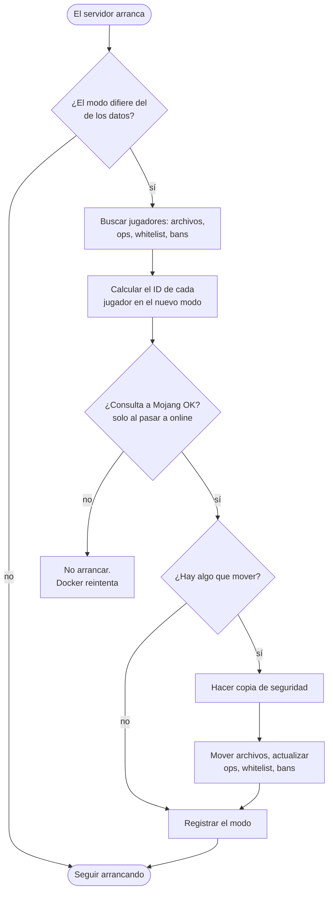

<!-- language-switcher -->
[English](../offline-mode.md) · [हिन्दी](../hi/offline-mode.md) · **Español** · [简体中文](../zh-CN/offline-mode.md) · [Português (BR)](../pt-BR/offline-mode.md) · [日本語](../ja/offline-mode.md) · [한국어](../ko/offline-mode.md)

#  Modo con y sin conexión

Por defecto, solo pueden entrar jugadores con una cuenta oficial de Minecraft. El modo sin conexión (offline) deja entrar a todos, incluidos amigos sin cuenta. Esta página explica cómo cambiar de modo, sus riesgos y las dos funciones que hacen más seguro el modo sin conexión: las **reglas de nombres de usuario** y la **migración de datos de jugadores**.

## El EULA y el modo con conexión son cosas distintas

| Ajuste | Qué significa | A quién afecta |
|---|---|---|
| `EULA=TRUE` | Tú, como operador del servidor, aceptas el EULA de Mojang. Es obligatorio para ejecutar el servidor. | A ti |
| `ONLINE_MODE` | Si los jugadores deben demostrar que tienen una cuenta oficial | A tus jugadores |

Los jugadores nunca ven ni aceptan el EULA. A los jugadores sin cuenta los bloquea el modo con conexión, no el EULA.

## Cambiar de modo

```env
ONLINE_MODE=false     # anyone can join
ONLINE_MODE=true      # official accounts only
```

Luego ejecuta `make up`. Puedes cambiar de un modo a otro cuantas veces quieras; los datos de los jugadores los acompañan (consulta [más abajo](#datos-de-jugadores-entre-modos)).

## El riesgo: los nombres de usuario no se verifican

En modo con conexión, Mojang garantiza que cada jugador es quien dice su nombre. En modo sin conexión, **cualquiera puede escribir cualquier nombre**, incluido el tuyo, y obtener tus permisos de operador y tu inventario.

- Haz operadores a los jugadores solo cuando haga falta.
- **Una lista blanca no te protege**: compara nombres, y los nombres se pueden falsificar.
- Para un servidor sin conexión público, añade un plugin de inicio de sesión que obligue a cada jugador a poner una contraseña la primera vez que entra.

## Reglas de nombres de usuario

El modo sin conexión normalmente acepta casi cualquier nombre. El plugin integrado `UsernameRules` aplica las mismas reglas que una cuenta de Mojang:

| Regla | Ejemplo rechazado |
|---|---|
| De 3 a 16 caracteres | `ab`, `ThisNameIsWayTooLong` |
| Solo `A–Z`, `a–z`, `0–9`, `_` | `bad name`, `bad-name`, `café`, `x.y` |
| Único sin importar mayúsculas | `steve` cuando `Steve` ya ha jugado |

El primer jugador que usa un nombre se queda con esa grafía. A los demás se les dice:

```
The username Steve is already taken.
If it is yours, log in as exactly "Steve".
```

Los rechazos quedan registrados en el log. El plugin no hace nada en modo con conexión, donde Mojang ya aplica estas reglas. Desactívalo con `ENFORCE_USERNAME_RULES=false`.

> [!NOTE]
> Si añades [Geyser/Floodgate](https://geysermc.org) para que entren jugadores de Bedrock, sus nombres suelen llevar un prefijo como `.Steve`, que estas reglas rechazan. En ese caso, pon `ENFORCE_USERNAME_RULES=false`.

## Datos de jugadores entre modos

Minecraft guarda el inventario, la posición, las estadísticas y los logros de cada jugador bajo un ID (UUID), y el ID es distinto en cada modo:

- **Con conexión:** el ID de la cuenta de Mojang
- **Sin conexión:** un ID calculado a partir del nombre de usuario

Sin ayuda, cambiar de modo dejaría a todos con el inventario vacío en el punto de aparición. En su lugar, en el primer arranque después de cambiar `ONLINE_MODE`, el servidor:



1. Encuentra a todos los jugadores a partir de sus archivos de datos y de `ops.json`, `whitelist.json` y `banned-players.json`.
2. Calcula el ID de cada jugador en el nuevo modo. Para el modo con conexión, consulta el nombre en Mojang.
3. **Hace una copia de seguridad.**
4. Mueve los archivos de datos de cada jugador al nuevo ID y actualiza las entradas de operadores, lista blanca y baneos.

```
[migrate-players] move Steve: a762f560-… -> 853c80ef-…
[migrate-players] keep Alex123: no official account with this name, data stays under its offline id
```

| Situación | Resultado |
|---|---|
| El jugador tiene cuenta oficial | Sus datos lo acompañan en ambas direcciones |
| El jugador no tiene cuenta y se pasa a con conexión | Los datos se quedan bajo el ID sin conexión. No puede entrar en modo con conexión, pero todo sigue ahí cuando vuelvas a cambiar. |
| El jugador tiene datos bajo los dos ID | Gana el archivo más nuevo. El más antiguo se mueve a `player-migration-conflicts/`; nunca se borra. |
| No se puede contactar con Mojang al pasar a con conexión | El servidor no arranca, para que los datos de nadie queden repartidos entre dos ID. Docker reintenta automáticamente. |
| Una restauración trae datos del otro modo | Se migran en el siguiente arranque, como un cambio normal |

A tener en cuenta:

- Los jugadores se emparejan por nombre. Si un jugador sin conexión usó un nombre que pertenece a la cuenta de otra persona, sus datos pasan a esa cuenta al cambiar a con conexión.
- Los datos que los plugins guardan por jugador (permisos, saldos de economía) no se migran.
- Pon `MIGRATE_PLAYER_DATA=false` para desactivar la migración.
