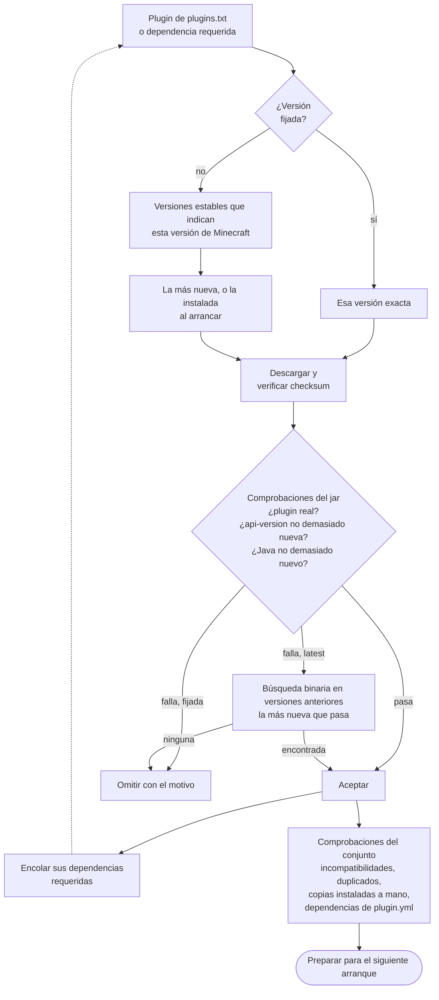

<!-- language-switcher -->
[English](../plugins.md) · [हिन्दी](../hi/plugins.md) · **Español** · [简体中文](../zh-CN/plugins.md) · [Português (BR)](../pt-BR/plugins.md) · [日本語](../ja/plugins.md) · [한국어](../ko/plugins.md)

#  Plugins

Este servidor ejecuta **Paper**, así que admite **plugins**: archivos `.jar` de Paper, Spigot o Bukkit. Los plugins solo se ejecutan en el servidor; los jugadores no instalan nada. No ejecuta [mods](#mods).

Hay dos formas de instalar plugins:

| Forma | Úsala para |
|---|---|
| [`plugins/plugins.txt`](#plugins-gestionados-pluginstxt) (recomendada) | Plugins de [Modrinth](https://modrinth.com/plugins) o [Hangar](https://hangar.papermc.io). Se eligen las versiones correctas y sus dependencias, se verifican y se mantienen actualizadas por ti. |
| [A mano](#plugins-de-otros-sitios) | Todo lo demás. |

## Plugins gestionados: `plugins.txt`

Lista los plugins que quieres, uno por línea:

```text
# source    project            version
modrinth    luckperms          latest
modrinth    worldguard         latest
hangar      ViaVersion         latest
modrinth    chunky             1.5.3
```

| Campo | Significado |
|---|---|
| `source` | `modrinth` o `hangar` (el sitio oficial de plugins de PaperMC) |
| `project` | El nombre en la dirección de la página del plugin: `modrinth.com/plugin/luckperms` da `luckperms`, y `hangar.papermc.io/ViaVersion/ViaVersion` da `ViaVersion` |
| `version` | `latest` para la versión estable más reciente que funciona en este servidor, o un nombre de versión exacto copiado de la página del plugin |

`#` empieza un comentario. Las líneas vacías se ignoran.

Luego ejecuta:

```bash
make update-plugins
```

| Para… | Haz esto |
|---|---|
| Añadir un plugin | Añade una línea y luego `make update-plugins` |
| Actualizarlo todo | `make update-plugins` |
| Fijar o volver atrás un plugin | Cambia `latest` por una versión y luego `make update-plugins` |
| Quitar un plugin | Borra su línea y luego `make update-plugins`. También se quitan las dependencias que trajo. Su carpeta de ajustes se conserva. |
| Ver qué está instalado y por qué | `make plugins` |

```
Minecraft 1.20.4 on Java 17 - plugins managed by plugins.txt:
  WorldGuard               7.0.9                  listed
  WorldEdit                7.3.0                  required by WorldGuard
Other plugin jars (added by hand or built in):
  UsernameRules.jar
```

### Qué hace `make update-plugins`

1. Con el servidor en marcha, calcula el conjunto completo de versiones de plugins (ver más abajo) y descarga lo nuevo en una carpeta temporal.
2. Si nada cambió, muestra `all plugins are up to date` y se detiene.
3. Si no, hace una copia de seguridad, avisa a los jugadores y reinicia el servidor.
4. Al arrancar, se colocan los plugins preparados y se borran los plugins quitados.

Nunca se sustituyen archivos de plugins mientras el servidor los está usando.

## Cómo se eligen versiones compatibles

Solo listas los plugins que quieres. Para cada uno, el resolvedor hace lo siguiente.



**1. Filtrar por versión de Minecraft.** Solo considera versiones **estables** (sin betas) que, según el sitio del plugin, soportan la versión de Minecraft de tu servidor.

**2. Comprobar el jar real.** Los sitios de plugins a veces se equivocan, así que cada candidato se descarga e inspecciona:

| Comprobación | Por qué |
|---|---|
| El checksum coincide con el del sitio (SHA-512 en Modrinth, SHA-256 en Hangar) | El archivo es exactamente lo que publicó el autor |
| Contiene `plugin.yml` o `paper-plugin.yml` | Es de verdad un plugin de Paper/Bukkit |
| `api-version` ≤ tu versión de Minecraft | Paper rechaza plugins hechos para un Minecraft más nuevo |
| Compilado para un Java ≤ el Java del servidor | La causa más común de "el plugin no carga"; los sitios de plugins no lo indican |

Si la versión más reciente falla, el resolvedor busca hacia atrás en las versiones anteriores **la más nueva que pasa**. Los requisitos solo suben con el tiempo, así que una búsqueda binaria la encuentra con pocas descargas, incluso entre más de 100 versiones:

```
[plugins] WorldEdit: using 7.3.0 because 7.3.9 needs Java 21 (this server runs Java 17)
```

**3. Instalar dependencias.** Las dependencias requeridas declaradas en Modrinth o Hangar se resuelven igual, de forma recursiva. Las dependencias opcionales no se instalan.

**4. Leer la lista de dependencias de cada plugin.** Algunos plugins indican dependencias en `plugin.yml` pero no en el sitio. El resolvedor las busca por nombre de plugin en Hangar y Modrinth. Solo acepta una coincidencia si el jar descargado es realmente un plugin con ese nombre, así nunca se instala por error un proyecto parecido.

**5. Comprobar el conjunto completo.**

| Situación | Resultado |
|---|---|
| Modrinth marca dos plugins como incompatibles | Se omite la dependencia (o el que aparece después), con un aviso |
| El mismo plugin desde dos fuentes | Se conserva el primero y se omite el segundo; Paper rechaza duplicados |
| Un plugin que también instalaste a mano | Se omite la copia gestionada |
| Una dependencia no se encuentra en ningún sitio | Aviso: "X requires the plugin Y, which could not be found automatically; add it to plugins.txt" |

Ejemplo: en un servidor de Minecraft 1.20.4 con cuatro plugins listados, se añadieron tres dependencias y se eligió un WorldEdit más antiguo para Java 17:

```
[plugins] WorldEdit: using 7.3.0 because 7.3.9 needs Java 21 (this server runs Java 17)
[plugins] + Multiverse-Portals 5.3.0  (listed)
[plugins] + WorldGuard 7.0.9  (listed)
[plugins] + ViaBackwards 5.12.2  (listed)
[plugins] + LuckPerms v5.5.71-bukkit  (listed)
[plugins] + Multiverse-Core 5.8.2  (required by Multiverse-Portals)
[plugins] + WorldEdit 7.3.0  (required by WorldGuard)
[plugins] + ViaVersion 5.12.2  (required by ViaBackwards)
```

### Cuando algo cambia

| Cambio | Qué ocurre |
|---|---|
| Editas `plugins.txt` | Se aplica con `make update-plugins`, o en el siguiente arranque |
| Cambias la versión de Minecraft o de Java | Todos los plugins se vuelven a resolver en el siguiente arranque. Un plugin puede subir o bajar a la versión que encaje con la nueva. |
| No ha cambiado nada | Los arranques no contactan con Modrinth ni con Hangar en absoluto |

Al arrancar, el resolvedor prefiere la versión ya instalada, siempre que siga pasando todas las comprobaciones. Solo `make update-plugins` (o la actualización automática diaria) lleva los plugins a versiones más nuevas.

### Versiones fijadas

Una versión fijada (`modrinth chunky 1.5.3`) se usa tal cual, sin buscar:

- Si el sitio del plugin no indica tu versión de Minecraft, recibes un aviso, pero se instala igualmente.
- Si el jar no puede funcionar en absoluto (Java incorrecto, API más nueva), se rechaza.

### Los fallos nunca tumban el servidor

| Problema | Resultado |
|---|---|
| Modrinth o Hangar inaccesibles, una errata, un proyecto borrado | Aviso. La versión instalada se mantiene, el servidor arranca y el siguiente arranque reintenta. |
| Ninguna versión funciona en este servidor | Aviso explicando el motivo, con una pista sobre `JAVA_VERSION` cuando un Java más nuevo ayudaría. Se elimina una versión instalada antes que no puede cargarse. |
| Dos `update-plugins` a la vez (manual y programado) | El segundo se rechaza: "another plugin install/update is already running; try again in a minute" |

## Actualizaciones automáticas

```env
PLUGIN_AUTO_UPDATE=true
PLUGIN_UPDATE_TIME=04:00
TZ=Europe/Madrid
```

Cada día a la hora `PLUGIN_UPDATE_TIME`:

1. El servidor busca actualizaciones de plugins. Si no hay, no pasa nada.
2. Si las hay, los jugadores ven avisos en el chat 5 minutos, 1 minuto y 10 segundos antes del reinicio.
3. Se hace una copia de seguridad.
4. El servidor se reinicia y aplica las actualizaciones.

Ejecuta `make up` después de cambiar estos ajustes. Las actualizaciones automáticas están **desactivadas por defecto**: las actualizaciones de plugins a veces cambian el formato de la configuración o se comportan distinto. Para un servidor importante, ejecuta `make update-plugins` cuando puedas revisar el resultado, y fija las versiones de las que dependes.

## Plugins de otros sitios

Para plugins que no están en Modrinth ni en Hangar, o que Hangar solo enlaza externamente:

```bash
docker compose cp SomePlugin.jar mc:/data/plugins/
make restart
```

Para quitar uno:

```bash
docker compose exec mc rm /data/plugins/SomePlugin.jar
make restart
```

`plugins.txt` nunca toca los jars que añades a mano, y cuentan como instalados al comprobar dependencias.

## Dónde viven los plugins

| Ruta (dentro del volumen `mc-data`) | Contenido |
|---|---|
| `/data/plugins/*.jar` | Todos los jars de plugins |
| `/data/plugins/<Name>/` | Ajustes y datos de cada plugin |
| `/data/plugins/.managed/lock.tsv` | Lo que instaló `plugins.txt`: versión, archivo, checksum, motivo |
| `/data/plugins/.managed/pending/` | Actualizaciones preparadas para el siguiente arranque |

Todo esto se incluye en las copias de seguridad (salvo la carpeta temporal).

## Plugin integrado

`UsernameRules` viene con la imagen. Aplica las reglas de nombres de usuario de Mojang en modo sin conexión (consulta [Modo con y sin conexión](offline-mode.md#reglas-de-nombres-de-usuario)) y se controla con `ENFORCE_USERNAME_RULES`, no con `plugins.txt`.

## Mods

Los mods (Fabric, Forge, NeoForge) cambian el propio juego. Paper no puede cargarlos, y la mayoría de mods de contenido también deben instalarlos **todos los jugadores**. Ejecutar mods supondría construir esta imagen sobre Fabric o NeoForge en lugar de Paper. La mayor parte del proyecto se mantendría (copias de seguridad, comprobaciones de salud, apagado seguro, migración de jugadores), pero los plugins de Paper no. No se recomiendan los servidores "híbridos" que intentan ejecutar ambos para un servidor fiable.

## Límites

- Solo se busca automáticamente en Modrinth y Hangar.
- Las dependencias opcionales no se instalan; añádelas a la lista si las quieres.
- Las comprobaciones del jar detectan las incompatibilidades habituales, pero un plugin puede superarlas y fallar en ejecución por cambios internos de la API. La copia de seguridad que se hace antes de cada actualización de plugins es la red de seguridad.
- Los datos que los plugins guardan bajo UUID de jugadores no se migran al cambiar entre modo con y sin conexión.
