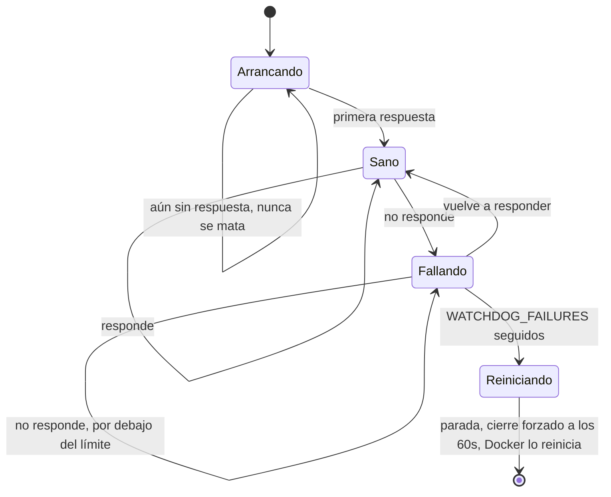
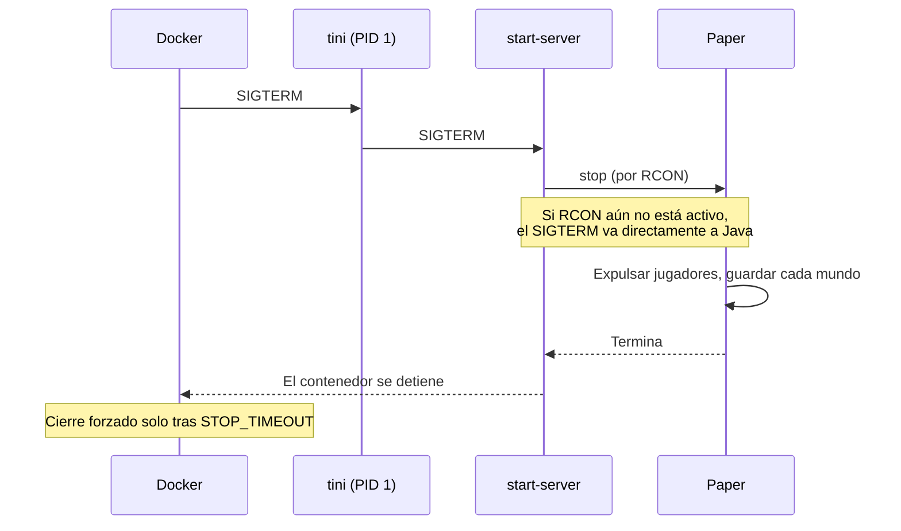

<!-- language-switcher -->
[English](../reliability.md) · [हिन्दी](../hi/reliability.md) · **Español** · [简体中文](../zh-CN/reliability.md) · [Português (BR)](../pt-BR/reliability.md) · [日本語](../ja/reliability.md) · [한국어](../ko/reliability.md)

#  Fiabilidad

Esta página explica todo lo que mantiene el servidor en marcha y el mundo a salvo sin que nadie esté pendiente.

| Mecanismo | Protege contra |
|---|---|
| [Política de reinicio](#reinicio-automático) | Fallos, errores de falta de memoria, reinicios del equipo |
| [Comprobación de salud](#comprobación-de-salud) | No saber si el servidor funciona de verdad |
| [Watchdog contra bloqueos](#watchdog-contra-bloqueos) | Un servidor congelado que sigue en marcha pero no responde |
| [Apagado seguro](#apagado-seguro) | Perder o corromper el mundo al detenerlo |
| [Seguridad de memoria](#seguridad-de-memoria) | Bucles de cierres por falta de memoria |
| [Validación de la configuración](#validación-de-la-configuración) | Erratas que se convierten en bucles de fallos o funciones desactivadas en silencio |
| [Protecciones de versión y de datos](#protecciones-de-versión-y-de-datos) | Bajadas de versión del mundo, pérdida de datos de jugadores |
| [Copias de seguridad](backups.md) | Todo lo demás |

## Reinicio automático

Ambos contenedores usan `restart: unless-stopped`. Cada vez que el proceso del servidor termina, ya sea por un fallo, falta de memoria, el watchdog o alguien que escribe `/stop`, Docker lo vuelve a arrancar. Tras reiniciar el equipo, vuelve en cuanto lo hace Docker. Solo `make down` (o `docker stop`) lo mantiene detenido.

## Comprobación de salud

Cada 30 segundos, Docker ejecuta `mc-health` dentro del contenedor:

1. Envía un **ping de lista de servidores**, la misma petición que hace la pantalla de multijugador de Minecraft, al puerto del juego.
2. Si se rechaza porque el servidor está oculto de las listas (`enable-status=false`), recurre a un comando `list` por RCON.

`make status` muestra `healthy` en cuanto pasa una comprobación. Los servidores nuevos tienen **5 minutos** de margen para generar el mundo. El contenedor `backup` espera a que el servidor esté sano antes de arrancar.

## Watchdog contra bloqueos

Un servidor puede congelarse aunque su proceso siga vivo: un interbloqueo o un plugin atascado en un bucle infinito. Docker solo reinicia procesos que terminan, así que un watchdog en segundo plano dentro del contenedor cubre este caso:

- Cada `WATCHDOG_INTERVAL` segundos (60 por defecto) ejecuta la comprobación de salud.
- Solo empieza a contar **después de que el servidor haya respondido una vez**, así que nunca se mata un primer arranque lento.
- Tras `WATCHDOG_FAILURES` fallos seguidos (5 por defecto, unos 5 minutos), envía una señal de parada normal, espera 60 segundos y luego fuerza el cierre. Después Docker reinicia el servidor.




```
[start-server] Watchdog: server not responding (1/5)
...
[start-server] Watchdog: server is hung, killing it
```

Paper tiene su propio watchdog para ticks de juego congelados. Este también detecta bloqueos que el de Paper no ve. Pon `WATCHDOG_INTERVAL=0` para desactivarlo.

## Apagado seguro

Detener un servidor de Minecraft matándolo hace perder todo lo ocurrido desde el último autoguardado y puede corromper los chunks que se estaban escribiendo. Aquí cada parada sigue el mismo camino:




1. `tini` (PID 1) pasa la señal de parada de Docker a `start-server`.
2. `start-server` envía `stop` por RCON. Paper expulsa a los jugadores, guarda cada mundo y termina.
3. Si RCON aún no está activo (por ejemplo, durante el arranque), Java recibe una señal de parada normal. Paper también guarda en ese caso.

Docker espera hasta `STOP_TIMEOUT` (`2m` por defecto) antes de forzar el cierre. Para mundos muy grandes o discos lentos, súbelo:

```env
STOP_TIMEOUT=5m
```

## Seguridad de memoria

| Riesgo | Protección |
|---|---|
| El heap crece en mitad de la partida y el equipo se queda sin memoria | El heap se fija al arrancar (`-Xms` = `-Xmx` = `MEMORY`) y se reserva por adelantado, así que los problemas de memoria aparecen al arrancar, no durante el juego |
| Heap demasiado grande para el contenedor, y el kernel lo mata (exit 137) en bucle | Se rechaza el arranque salvo que `MEMORY` + 512M quepa en `CONTAINER_MEMORY`. El error dice qué poner. |
| Java se queda sin heap y sigue funcionando a duras penas | `-XX:+ExitOnOutOfMemoryError` hace que termine limpiamente, y Docker lo reinicia |

La recolección de basura usa los conocidos flags de Aikar para G1, con la variante para heaps grandes a partir de 12 GB, para pausas cortas y predecibles.

## Validación de la configuración

Los ajustes se comprueban antes de que arranque nada. Un valor incorrecto detiene el arranque con un mensaje que nombra el ajuste, en lugar de provocar un bucle de fallos, un bucle de copias sin fin o una función que se desactiva sola en silencio:

| Ajuste | Ejemplo de valor rechazado | Mensaje |
|---|---|---|
| `EULA` | `false` | hay que aceptar el EULA |
| `RCON_PASSWORD` | el valor de ejemplo, o uno con barra invertida | explica el motivo y cómo generar una |
| `MEMORY` | `2GB` | debe ser como `2G` o `1536M` |
| `MEMORY` / `CONTAINER_MEMORY` | `4G` en un contenedor de `3G` | dice qué `CONTAINER_MEMORY` poner |
| `WATCHDOG_INTERVAL`, `WATCHDOG_FAILURES` | `1m` | debe ser un número entero |
| `PLUGIN_UPDATE_TIME` | `25:00` | debe ser `HH:MM` |
| `BACKUP_INTERVAL` | `abc` | debe ser como `30m`, `6h`, `1d` |
| `BACKUP_KEEP` | `0` | debe ser 1 o más |
| `MC_VERSION` | `1.16.5`, `9.9` | demasiado antigua, o no disponible |
| `PAPER_BUILD` | un número con `MC_VERSION=latest` | necesita una versión exacta |

## Protecciones de versión y de datos

- **Se rechazan las bajadas de versión del mundo**, y antes de cada actualización se hace una copia. Consulta [Versiones de Minecraft](minecraft-versions.md).
- **Los datos de los jugadores los acompañan** al cambiar entre modo con y sin conexión. Antes se hace una copia, y el servidor no arranca a medio migrar. Consulta [Modo con y sin conexión](offline-mode.md).
- **Los problemas de plugins nunca bloquean el arranque.** Si falla una descarga, se mantiene la versión instalada, y los plugins que no pueden cargarse se omiten. Consulta [Plugins](plugins.md).

## Mínimos privilegios y aislamiento

- El servidor se ejecuta con un usuario sin privilegios (`PUID`/`PGID`). Root solo se usa un momento al arrancar para corregir la propiedad de los archivos.
- RCON solo es accesible en la red privada de Compose.
- La rotación de logs de Docker (5 × 10 MB por contenedor) evita que los logs llenen el disco.
