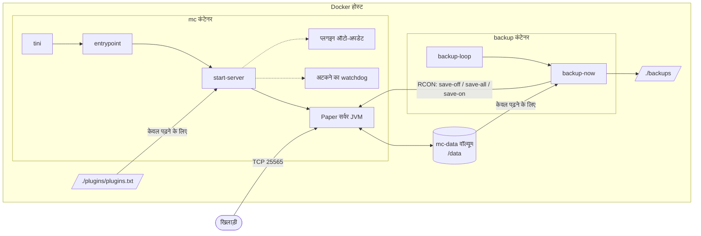
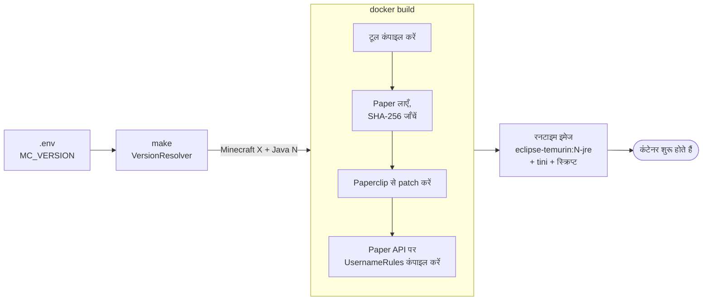
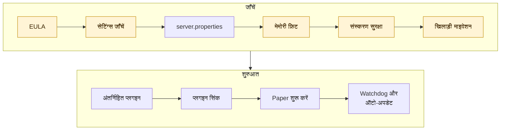

<!-- language-switcher -->
[English](../architecture.md) · **हिन्दी** · [Español](../es/architecture.md) · [简体中文](../zh-CN/architecture.md) · [Português (BR)](../pt-BR/architecture.md) · [日本語](../ja/architecture.md) · [한국어](../ko/architecture.md)

#  आर्किटेक्चर

यह पेज समझाता है कि प्रोजेक्ट कैसे बना है: क्या कहाँ चलता है, बिल्ड और शुरुआत के समय क्या होता है, और डेटा कहाँ रहता है।

## पूरी तस्वीर



| हिस्सा | यह क्या है |
|---|---|
| **इमेज** `local/paper-server` | `Dockerfile` से लोकल रूप से बनी। एक ही इमेज दोनों कंटेनर चलाती है। |
| **`mc` कंटेनर** | गेम सर्वर, साथ में सहायक प्रोसेस (watchdog, वैकल्पिक प्लगइन ऑटो-अपडेट)। |
| **`backup` कंटेनर** | वही इमेज, `backup` कमांड से शुरू। तय समय पर बैकअप बनाता है। |
| **`mc-data` वॉल्यूम** | सर्वर जो कुछ भी लिखता है: दुनियाएँ, कॉन्फ़िगरेशन, प्लगइन्स, खिलाड़ी डेटा। दोबारा बिल्ड होने पर भी बना रहता है। |
| **`./backups`** | बैकअप आर्काइव, होस्ट पर, ताकि आप उन्हें कहीं भी कॉपी कर सकें। |
| **`./plugins/plugins.txt`** | आपकी प्लगइन सूची, सर्वर में केवल पढ़ने के लिए mount की गई। |
| **RCON** | Minecraft का रिमोट कंसोल। स्क्रिप्ट इसका उपयोग दुनिया सेव करने और कमांड भेजने के लिए करती हैं। यह केवल Compose नेटवर्क के अंदर पहुँचा जा सकता है और होस्ट पर कभी पब्लिश नहीं होता। |

## `make up` से चलते सर्वर तक




### 1. संस्करण तय करना (आपकी मशीन पर)

`make` एक अस्थायी `eclipse-temurin:25-jdk` कंटेनर में `VersionResolver` चलाता है। यह PaperMC API से पूछता है कि कौन-सा Paper रिलीज़ `MC_VERSION` से मेल खाता है और उस रिलीज़ को कौन-सा Java चाहिए, और मेल खाता Java LTS (17, 21 या 25) चुनता है:

```
==> Minecraft 1.21.4 (Paper) on Java 21
```

नतीजा इमेज बिल्ड को दिया जाता है। आपकी मशीन पर केवल Docker चाहिए।

### 2. इमेज बनाना

`Dockerfile` में दो चरण हैं।

**बिल्ड चरण** (`eclipse-temurin:25-jdk`):

1. प्रोजेक्ट के Java टूल (`tools/*.java`) Java 17 के लिए कंपाइल करता है, ताकि वे सर्वर के किसी भी Java पर चलें।
2. `scripts/fetch-paper.sh` चलाता है। यह चुने गए संस्करण का सबसे नया stable Paper बिल्ड ढूँढता है, जाँचता है कि चुना गया Java पर्याप्त नया है, jar डाउनलोड करता है, और **उसका SHA-256 checksum जाँचता है**।
3. Paper के लॉन्चर (Paperclip) को पूरा सर्वर jar बनाने देता है। यह Mojang से आधिकारिक Minecraft सर्वर डाउनलोड करता है। यह चरण फिर से आज़माया जाता है, क्योंकि Paperclip डाउनलोड विफल होने पर भी सफलतापूर्वक बंद हो सकता है।
4. अंतर्निहित `UsernameRules` प्लगइन को उसी संस्करण की सटीक Paper API पर कंपाइल करता है।

**रनटाइम चरण** (`eclipse-temurin:<17|21|25>-jre`):

- जाँचा गया Paper jar, टूल, अंतर्निहित प्लगइन और `scripts/` की स्क्रिप्ट
- PID 1 के रूप में `tini`, ताकि सिग्नल सर्वर तक पहुँचें और zombie प्रोसेस साफ़ हों

### 3. कंटेनर शुरू करना

हर कंटेनर `tini → entrypoint` से शुरू होता है। entrypoint:

1. ज़रूरत हो तो `/data` और `/backups` का स्वामित्व `PUID:PGID` पर ठीक करता है।
2. root विशेषाधिकार छोड़ देता है।
3. माँगा गया मोड चलाता है: `server`, `backup`, `backup-now` या `restore`।

### 4. सर्वर शुरू होने का क्रम (`start-server`)

हर चरण क्रम से चलता है। कोई भी विफलता, खराब स्थिति में शुरू होने के बजाय, साफ़ संदेश के साथ शुरुआत रोक देती है।




हाइलाइट किए गए चरण साफ़ संदेश के साथ शुरुआत रोक सकते हैं।

| # | चरण | विवरण |
|---|---|---|
| 1 | EULA जाँचें | `EULA=TRUE` न हो तो शुरू होने से मना करता है। |
| 2 | सेटिंग्स जाँचें | RCON पासवर्ड, `MEMORY` का प्रारूप, संख्याएँ, समय के प्रारूप। देखें [विश्वसनीयता](reliability.md#सेटिंग्स-की-जाँच)। |
| 3 | `server.properties` लिखें | `.env` की गेमप्ले सेटिंग्स लागू करता है। पोर्ट, सुनने का पता और RCON सेटिंग्स हमेशा ज़बरदस्ती सेट करता है। |
| 4 | मेमोरी फ़िट जाँच | ऐसा heap मना करता है जो कंटेनर की मेमोरी सीमा में न समाए। |
| 5 | दुनिया संस्करण सुरक्षा | अपग्रेड से पहले बैकअप लेता है और डाउनग्रेड मना करता है। देखें [Minecraft संस्करण](minecraft-versions.md)। |
| 6 | खिलाड़ी डेटा माइग्रेशन | अगर ऑनलाइन/ऑफ़लाइन मोड बदला है, तो खिलाड़ी डेटा नई ID पर ले जाता है। देखें [ऑनलाइन और ऑफ़लाइन मोड](offline-mode.md)। |
| 7 | अंतर्निहित प्लगइन | `UsernameRules.jar` इंस्टॉल करता या हटाता है (`ENFORCE_USERNAME_RULES`)। |
| 8 | प्लगइन सिंक | स्टेज किए प्लगइन अपडेट लागू करता है, और अगर `plugins.txt`, Minecraft या Java बदला है तो उसे फिर से तय करता है। कभी शुरुआत नहीं रोकता। |
| 9 | Paper शुरू करें | ट्यून किए गए flags के साथ JVM चलाता है। |
| 10 | सहायक | अटकने का watchdog शुरू करता है, और चालू हो तो प्लगइन ऑटो-अपडेट शेड्यूलर भी। |

### 5. बंद होने का क्रम

```
docker stop / make down / make restart
  → tini forwards SIGTERM
  → start-server sends "stop" over RCON (or SIGTERM to Java if RCON isn't up yet)
  → Paper saves every world and exits
  → container stops
```

ज़बरदस्ती बंद करने से पहले Docker `STOP_TIMEOUT` (डिफ़ॉल्ट 2 मिनट) तक इंतज़ार करता है।

## डेटा की संरचना

`mc-data` वॉल्यूम (`/data`) के अंदर:

```
/data
├── world/                     # दुनिया (नाम LEVEL_NAME से)
├── plugins/
│   ├── *.jar                  # इंस्टॉल प्लगइन्स
│   ├── <Plugin>/              # हर प्लगइन की अपनी सेटिंग्स
│   └── .managed/
│       ├── lock.tsv           # plugins.txt ने कौन-से प्लगइन और संस्करण इंस्टॉल किए
│       └── pending/           # स्टेज किए प्लगइन अपडेट, अगली शुरुआत पर लागू
├── server.properties, bukkit.yml, spigot.yml, config/   # सर्वर कॉन्फ़िगरेशन
├── ops.json, whitelist.json, banned-players.json        # एडमिन सूचियाँ
├── .mc-version                # वह Minecraft संस्करण जिस पर दुनिया पिछली बार चली
├── .player-uuid-mode          # खिलाड़ी डेटा किस ऑनलाइन/ऑफ़लाइन मोड से मेल खाता है
├── cache/, libraries/, versions/   # Paper फिर से बनाता है; बैकअप से बाहर
└── logs/                      # सर्वर लॉग; बैकअप से बाहर
```

## बाहरी सेवाएँ

| सेवा | किसके लिए | कब |
|---|---|---|
| Docker Hub (`eclipse-temurin`) | Java इमेज | बिल्ड |
| PaperMC API (`fill.papermc.io`) | Paper संस्करण, डाउनलोड, checksum | बिल्ड, `make versions` |
| Mojang (`piston-data.mojang.com`) | आधिकारिक सर्वर jar जिसे Paper patch करता है | बिल्ड, पहली शुरुआत |
| Mojang (`api.mojang.com`) | यूज़रनेम → अकाउंट ID | केवल मौजूदा खिलाड़ियों के साथ ऑनलाइन मोड पर जाते समय |
| Modrinth, Hangar | प्लगइन जानकारी और डाउनलोड | केवल प्लगइन इंस्टॉल और अपडेट पर |

किसी तीसरे पक्ष की सर्वर इमेज या स्क्रिप्ट का उपयोग नहीं होता। हर डाउनलोड किए गए सर्वर और प्लगइन jar का checksum जाँचा जाता है।

## सोर्स की संरचना

```
Dockerfile, compose.yaml, Makefile, .env.example
scripts/
  entrypoint.sh       स्वामित्व ठीक करना, root छोड़ना, मोड चलाना
  start-server.sh     शुरुआत का क्रम, सिग्नल, watchdog, ऑटो-अपडेट
  fetch-paper.sh      Paper डाउनलोड तय करना और जाँचना (बिल्ड के समय)
  backup-now.sh       एक सुसंगत, लॉक किया, जाँचा गया बैकअप
  backup-loop.sh      बैकअप शेड्यूलर
  restore-backup.sh   staging फ़ोल्डर के ज़रिए सुरक्षित रिस्टोर
  plugins, rcon-cli, mc-health   Java टूल के पतले wrapper
tools/                बिना dependency वाले Java टूल, mctool.jar में कंपाइल
  McTool.java         entry point; RCON client और server-list ping
  VersionResolver.java  Minecraft संस्करण → Paper रिलीज़ + Java
  PluginManager.java  plugins.txt resolver, downloader और verifier
  PlayerMigrator.java ऑनलाइन/ऑफ़लाइन UUID माइग्रेशन
  Json.java, Yaml.java  छोटे parser
plugins/
  plugins.txt         आपकी प्लगइन सूची
  username-rules/     अंतर्निहित प्लगइन का सोर्स
docs/                 यह दस्तावेज़
  assets/             बैनर और आइकन (हाथ से बने SVG)
```
