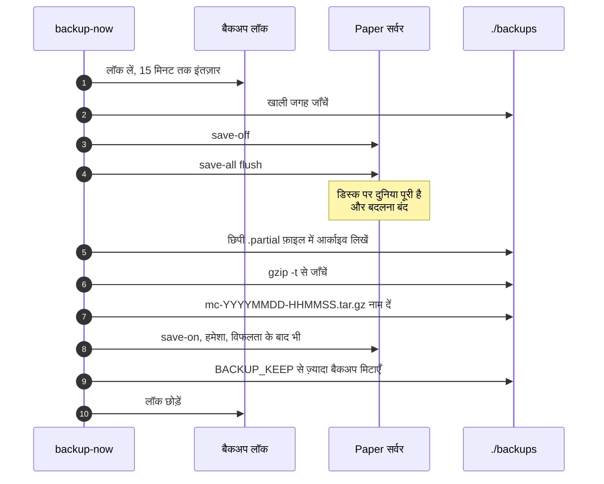
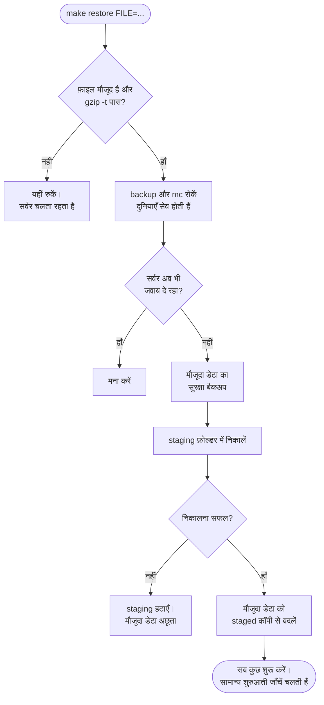

<!-- language-switcher -->
[English](../backups.md) · **हिन्दी** · [Español](../es/backups.md) · [简体中文](../zh-CN/backups.md) · [Português (BR)](../pt-BR/backups.md) · [日本語](../ja/backups.md) · [한국어](../ko/backups.md)

#  बैकअप और रिस्टोर

बैकअप अपने आप चलते हैं, खिलाड़ियों के ऑनलाइन रहते हुए भी सुसंगत रहते हैं, और गिने जाने से पहले जाँचे जाते हैं। रिस्टोर ऐसे बनाए गए हैं कि कोई गलती आपकी मौजूदा दुनिया न छीन सके।

## एक नज़र में

| | |
|---|---|
| **समय-सारणी** | हर `BACKUP_INTERVAL` (डिफ़ॉल्ट `1h`) पर, `backup` कंटेनर द्वारा |
| **कितने रखे जाते हैं** | सबसे नए `BACKUP_KEEP` (डिफ़ॉल्ट `24`) |
| **कहाँ** | होस्ट पर `./backups/` में, `mc-YYYYMMDD-HHMMSS.tar.gz` के रूप में (UTC समय) |
| **हाथ से** | `make backup` |
| **सूची** | `make backups` |
| **रिस्टोर** | `make restore FILE=mc-….tar.gz` |

**हर जोखिम भरे काम से पहले भी बैकअप अपने आप लिए जाते हैं**:

| इससे पहले… | कौन लेता है |
|---|---|
| दुनिया को नए Minecraft संस्करण पर अपग्रेड करना | `start-server` |
| ऑनलाइन और ऑफ़लाइन मोड के बीच खिलाड़ी डेटा माइग्रेट करना | `start-server` |
| प्लगइन अपडेट लागू करना (`make update-plugins`, ऑटो-अपडेट) | अपडेट कमांड |
| कोई बैकअप रिस्टोर करना (जो बदला जा रहा है उसका "सुरक्षा बैकअप") | `restore` |

## बैकअप में क्या होता है

सर्वर को ठीक पहले जैसा वापस लाने के लिए ज़रूरी सब कुछ: दुनियाएँ, `server.properties` और अन्य कॉन्फ़िगरेशन, प्लगइन्स और उनकी सेटिंग्स, खिलाड़ी डेटा, ऑपरेटर, whitelist और ban सूचियाँ, और संस्करण चिह्न।

जो छोड़ा जाता है, क्योंकि Paper उन्हें फिर से बना लेता है या वे अस्थायी हैं:

| छोड़ा गया | क्यों |
|---|---|
| `cache/`, `libraries/`, `versions/` | शुरुआत में Paper द्वारा डाउनलोड या तैयार किए जाते हैं |
| `logs/` | रिस्टोर के लिए ज़रूरी नहीं; बड़े हो सकते हैं |
| `plugins/.managed/pending/` | स्टेज किए गए प्लगइन अपडेट, अगले अपडेट में फिर बनते हैं |
| `plugins/spark/tmp/` | प्रोफ़ाइलर की अस्थायी फ़ाइलें |

## बैकअप सुसंगत कैसे रहता है

Minecraft की दुनिया हज़ारों फ़ाइलें होती है जिन्हें सर्वर लगातार फिर से लिखता रहता है। लिखते समय उन्हें कॉपी करने से आधा-सेव chunk कैद हो सकता है। इसलिए हर बैकअप:



1. **बैकअप लॉक लेता है।** एक समय में केवल एक बैकअप चलता है, `mc` और `backup` दोनों कंटेनरों में भी। वरना दूसरा बैकअप autosave को तब चालू कर सकता है जब पहला अभी पढ़ रहा हो। बैकअप लॉक के लिए 15 मिनट तक इंतज़ार करता है।
2. **डिस्क की जगह जाँचता है** (नीचे देखें)।
3. **RCON से autosave रोकता है और flush करता है**: `save-off`, फिर `save-all flush`। मेमोरी का सब कुछ अब डिस्क पर है और स्थिर रहता है।
4. **`/data` को आर्काइव करता है**, एक छिपी `.partial` फ़ाइल में।
5. **आर्काइव की जाँच करता है**, `gzip -t` से। खराब आर्काइव हटा दिया जाता है और पुराने बैकअप बने रहते हैं।
6. **उसे सही नाम देता है।** आधा लिखा बैकअप कभी असली जैसा नहीं दिखता।
7. **`save-on` से autosave फिर चालू करता है।** ऊपर कुछ भी विफल हो, तब भी यह होता है।
8. **सबसे पुराने बैकअप मिटाता है**, जो `BACKUP_KEEP` से ज़्यादा हों।

खिलाड़ी पूरे समय खेलते रह सकते हैं; न कुछ घोषित होता है, न कुछ रुकता है।

अगर RCON तक नहीं पहुँचा जा सके (जैसे सर्वर बंद है), तो बैकअप चरण 3 के बिना लिया जाता है और यह बताया जाता है। सर्वर न चल रहा हो तो यह सुरक्षित है।

## डिस्क जगह की सुरक्षा

डिस्क भर देने वाला बैकअप सर्वर को दुनिया सेव करने से भी रोक सकता है, जिससे खराबी का खतरा है। शुरू करने से पहले बैकअप अपने आकार का अनुमान लगाता है (पिछले बैकअप का आकार और 20%, या पहली बार डेटा के आकार का 60%) और तब तक चलने से मना करता है जब तक उतनी जगह **और 512 MB** खाली न हो:

```
ERROR: not enough disk space: about 102M needed plus 512M headroom, 20M free. Lower BACKUP_KEEP or free space.
```

तय समय वाला लूप विफलता को लॉग करता है और अगले अंतराल पर फिर कोशिश करता है।

## रिस्टोर करना

```bash
make backups                                   # pick one
make restore FILE=mc-20261030-175220.tar.gz
```

क्रम से क्या होता है:



1. **कुछ भी छूने से पहले, आपकी मशीन पर:** फ़ाइल मौजूद होनी चाहिए और `gzip -t` पास करनी चाहिए। टाइपो या खराब फ़ाइल यहीं रुक जाती है, और सर्वर चलता रहता है।
2. `backup` और `mc` कंटेनर रोके जाते हैं (दुनियाएँ सेव होती हैं)।
3. अगर सर्वर अब भी जवाब दे, तो रिस्टोर आगे बढ़ने से मना कर देता है।
4. मौजूदा स्थिति का **सुरक्षा बैकअप** लिया जाता है।
5. बैकअप को लाइव डेटा के बगल में एक **staging फ़ोल्डर** में निकाला जाता है। अगर निकालना विफल हो (जैसे डिस्क भरी हो), तो मौजूदा डेटा अछूता रहता है।
6. केवल तभी मौजूदा डेटा को staged कॉपी से बदला जाता है।
7. सब कुछ फिर से शुरू होता है।

रिस्टोर के बाद भी सामान्य शुरुआती जाँचें लागू होती हैं:

- सर्वर से **नए** Minecraft संस्करण पर बना बैकअप [डाउनग्रेड सुरक्षा](minecraft-versions.md#डाउनग्रेड-करना) द्वारा मना कर दिया जाता है।
- **पुराने** संस्करण पर बना बैकअप अपग्रेड किया जाता है, उससे पहले एक और बैकअप लेकर।
- दूसरे ऑनलाइन/ऑफ़लाइन मोड में बने बैकअप का खिलाड़ी डेटा [माइग्रेट](offline-mode.md#मोड-बदलने-पर-खिलाड़ी-डेटा) किया जाता है।
- प्लगइन्स को फिर से `plugins.txt` के अनुसार सिंक किया जाता है।

सुरक्षा बैकअप एक सामान्य बैकअप है। जब वह सबसे नए `BACKUP_KEEP` बैकअप से पुराना हो जाता है, तो सामान्य रोटेशन उसे मिटा देता है, इसलिए रखना चाहें तो उसे कहीं और कॉपी कर लें।

## नई मशीन पर रिस्टोर करना

1. नई मशीन पर प्रोजेक्ट सेट करें ([शुरुआत करें](getting-started.md)), बैकअप वाले **उसी `MC_VERSION`** या नए के साथ।
2. बैकअप फ़ाइल को `./backups/` में कॉपी करें।
3. एक बार `make up` चलाएँ, ताकि कंटेनर और वॉल्यूम बन जाएँ।
4. `make restore FILE=…` चलाएँ।

## बाहर रखी कॉपियाँ

`./backups` के बैकअप सर्वर वाली ही डिस्क पर होते हैं। वे गलतियों और खराबी से बचाते हैं, पर मशीन खोने से नहीं। उन्हें नियमित रूप से कहीं और कॉपी करें; उदाहरण के लिए देखें [डिप्लॉयमेंट](deployment.md#बाहर-रखे-बैकअप)।

## बैकअप को हाथ से खोलना

बैकअप सामान्य `tar.gz` आर्काइव होते हैं:

```bash
tar -tzf backups/mc-20261030-175220.tar.gz | head        # list contents
mkdir /tmp/old && tar -xzf backups/mc-….tar.gz -C /tmp/old ./world/
```
