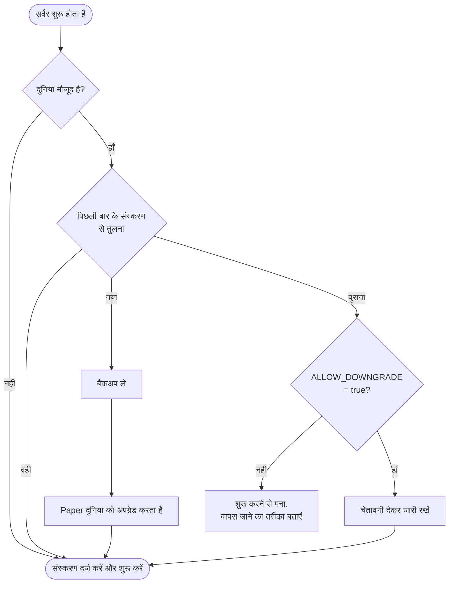

<!-- language-switcher -->
[English](../minecraft-versions.md) · **हिन्दी** · [Español](../es/minecraft-versions.md) · [简体中文](../zh-CN/minecraft-versions.md) · [Português (BR)](../pt-BR/minecraft-versions.md) · [日本語](../ja/minecraft-versions.md) · [한국어](../ko/minecraft-versions.md)

#  Minecraft संस्करण

आप **1.17** से लेकर नवीनतम रिलीज़ तक कोई भी Minecraft संस्करण चला सकते हैं। सही Java अपने आप चुना जाता है, और संस्करण बदलने पर दुनिया सुरक्षित रहती है।

## संस्करण चुनना

इसे `.env` में **पहली बार `make up` चलाने से पहले** सेट करें:

```env
MC_VERSION=1.21.4
```

मान्य मान:

- `latest`: सबसे नया Minecraft संस्करण जिसका **stable** Paper बिल्ड हो। हर बार इमेज बनने पर इसे फिर से तय किया जाता है।
- एक सटीक संस्करण, जैसे `1.20.4`, `1.21.4` या `26.3`

उपलब्ध संस्करण देखने के लिए:

```bash
make versions
```

```
MINECRAFT  JAVA   PAPER SUPPORT
26.3       25     supported
26.2       25     deprecated
1.21.11    21     unsupported
...
```

"Paper support" कॉलम PaperMC की अपनी स्थिति है। "Unsupported" संस्करण अब भी चलते हैं, लेकिन उन्हें PaperMC से सुधार नहीं मिलते।

## Java कैसे चुना जाता है

हर Minecraft संस्करण को एक न्यूनतम Java संस्करण चाहिए। `make` PaperMC API से पूछता है और सबसे पुराना Java LTS चुनता है जो उस शर्त को पूरा करे, क्योंकि वही संस्करण उसी पर बना और परखा गया था:

| Minecraft | Java |
|---|---|
| 1.17 – 1.20.4 | 17 |
| 1.20.5 – 1.21.x | 21 |
| 26.x | 25 |

फिर उस संस्करण के लिए आधिकारिक `eclipse-temurin` Java इमेज से इमेज बनाई जाती है। `make up` यह फ़ैसला दिखाता है:

```
==> Minecraft 1.20.4 (Paper) on Java 17
```

नया Java ज़बरदस्ती चुनने के लिए, जैसे जब आपको चाहिए कोई प्लगइन Java 21 के लिए बना हो लेकिन आप 1.20.4 चलाते हों, `.env` में `JAVA_VERSION=21` सेट करें। चुने गए Minecraft संस्करण के लिए बहुत पुराना Java मना कर दिया जाता है।

Minecraft **1.16.5 और पुराने** संस्करणों को Java 8 या 11 चाहिए और वे सपोर्ट नहीं हैं; `make` उन्हें साफ़ संदेश के साथ मना कर देता है।

## संस्करण बदलने पर क्या होता है

हर शुरुआत पर, सर्वर Minecraft संस्करण की तुलना उस संस्करण से करता है जिस पर दुनिया पिछली बार चली थी:



## अपग्रेड करना

1. नए संस्करण के लिए अपने प्लगइन्स का सपोर्ट देख लें (वैकल्पिक; वे अपने आप फिर से चुने जाते हैं)।
2. `.env` में `MC_VERSION` बदलें।
3. `make up` चलाएँ।

नए संस्करण के साथ पहली शुरुआत पर:

```
[start-server] Upgrading world from Minecraft 1.20.4 to 1.21.4; taking a backup first
[backup] Saved /backups/mc-20261030-195423.tar.gz (51M)
[plugins] plugins.txt, Minecraft or Java changed: resolving plugins for Minecraft 1.21.4 on Java 21
[plugins] ~ WorldEdit 7.3.0 -> 7.4.2
```

- **Minecraft दुनिया को अपग्रेड करे, उससे पहले बैकअप लिया जाता है।** अगर अपग्रेड में गड़बड़ हो, तो उसे रिस्टोर करें।
- **प्लगइन्स नए Minecraft और Java संस्करण के लिए फिर से चुने जाते हैं।** देखें [प्लगइन्स](plugins.md)।

## डाउनग्रेड करना

Minecraft किसी नए संस्करण से सेव की गई दुनिया को सुरक्षित रूप से नहीं खोल सकता; chunks और items खो सकते हैं या खराब हो सकते हैं। इसलिए सर्वर `/data/.mc-version` में दर्ज करता है कि हर दुनिया पिछली बार किस संस्करण पर चली थी, और पुराने संस्करण को शुरू होने से मना करता है:

```
[start-server] This world was last run on Minecraft 1.21.4, but the server is now 1.20.4.
[start-server] Opening a world in an older version can corrupt it, so the server will not start.
[start-server] Set MC_VERSION=1.21.4 in .env (or restore a backup made on 1.20.4) and run 'make up'.
```

सच में वापस जाने के लिए:

1. `MC_VERSION` को वापस पुराने संस्करण पर सेट करें।
2. **उसी पुराने संस्करण पर चलते समय** बना बैकअप रिस्टोर करें (`make restore FILE=…`), जैसे अपग्रेड से ठीक पहले अपने आप लिया गया बैकअप।

`ALLOW_DOWNGRADE=true` सेट करने से यह जाँच छूट जाती है। इसका उपयोग केवल तब करें जब आपको पता हो कि दुनिया संगत है, जैसे किसी अपग्रेड के ठीक बाद, किसी के जुड़ने से पहले।

## एक संस्करण पर बने रहना

`MC_VERSION=latest` हर बार इमेज दोबारा बनने पर (बदलाव के बाद `make up`, या `make update`) नए Minecraft रिलीज़ पर पहुँच जाता है। जिस सर्वर पर लोग निर्भर हों, उसके लिए संतुष्ट होने पर **एक सटीक संस्करण तय कर दें**:

```env
MC_VERSION=26.3
```

तब `make update` उसी Minecraft संस्करण के केवल नए Paper बिल्ड (बग और सुरक्षा सुधार) लाता है।

## एक Paper बिल्ड तय करना

```env
MC_VERSION=1.21.4
PAPER_BUILD=232
```

`PAPER_BUILD` केवल सटीक `MC_VERSION` के साथ काम करता है, क्योंकि बिल्ड नंबर हर संस्करण के लिए अलग-अलग गिने जाते हैं। ज़्यादातर किसी भरोसेमंद बिल्ड पर टिके रहने या खराब बिल्ड से वापस जाने के लिए उपयोगी।

## परखे गए संस्करण

बिल्ड और साफ़ शुरुआत की जाँच 1.17.1, 1.18.2 और 1.20.4 (Java 17), 1.21.4 (Java 21) और 26.3 (Java 25) पर की गई है। 1.20.4 से 1.21.4 का अपग्रेड और डाउनग्रेड से सुरक्षा भी परखे गए हैं।
