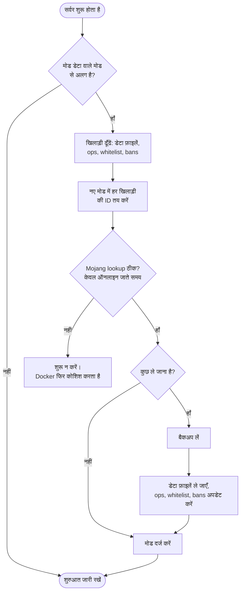

<!-- language-switcher -->
[English](../offline-mode.md) · **हिन्दी** · [Español](../es/offline-mode.md) · [简体中文](../zh-CN/offline-mode.md) · [Português (BR)](../pt-BR/offline-mode.md) · [日本語](../ja/offline-mode.md) · [한국어](../ko/offline-mode.md)

#  ऑनलाइन और ऑफ़लाइन मोड

डिफ़ॉल्ट रूप से केवल आधिकारिक Minecraft अकाउंट वाले खिलाड़ी जुड़ सकते हैं। ऑफ़लाइन मोड सबको जुड़ने देता है, बिना अकाउंट वाले दोस्तों को भी। यह पेज बताता है कि मोड कैसे बदलें, उसके जोखिम क्या हैं, और वे दो सुविधाएँ जो ऑफ़लाइन मोड को सुरक्षित बनाती हैं: **यूज़रनेम नियम** और **खिलाड़ी डेटा माइग्रेशन**।

## EULA और ऑनलाइन मोड अलग चीज़ें हैं

| सेटिंग | इसका मतलब | यह किससे जुड़ा है |
|---|---|---|
| `EULA=TRUE` | आप, यानी सर्वर ऑपरेटर, Mojang का EULA स्वीकार करते हैं। सर्वर चलाने के लिए ज़रूरी। | आप |
| `ONLINE_MODE` | क्या खिलाड़ियों को साबित करना होगा कि उनके पास आधिकारिक अकाउंट है | आपके खिलाड़ी |

खिलाड़ी EULA न कभी देखते हैं, न स्वीकार करते हैं। बिना अकाउंट वाले खिलाड़ियों को ऑनलाइन मोड रोकता है, EULA नहीं।

## मोड बदलना

```env
ONLINE_MODE=false     # anyone can join
ONLINE_MODE=true      # official accounts only
```

फिर `make up` चलाएँ। आप बार-बार आगे-पीछे बदल सकते हैं; खिलाड़ी डेटा साथ चलता है (देखें [नीचे](#मोड-बदलने-पर-खिलाड़ी-डेटा))।

## जोखिम: यूज़रनेम की पुष्टि नहीं होती

ऑनलाइन मोड में Mojang गारंटी देता है कि हर खिलाड़ी वही है जो उसका नाम बताता है। ऑफ़लाइन मोड में **कोई भी कोई भी नाम लिख सकता है**, आपका भी, और आपके ऑपरेटर अधिकार और सामान पा सकता है।

- खिलाड़ियों को केवल ज़रूरत होने पर ऑपरेटर बनाएँ।
- **whitelist आपकी रक्षा नहीं करती**: वह नाम मिलाती है, और नाम नकली हो सकते हैं।
- सार्वजनिक ऑफ़लाइन सर्वर के लिए, एक लॉगिन प्लगइन जोड़ें जो हर खिलाड़ी से पहली बार जुड़ने पर पासवर्ड सेट करवाए।

## यूज़रनेम नियम

ऑफ़लाइन मोड सामान्यतः लगभग कोई भी नाम स्वीकार कर लेता है। अंतर्निहित `UsernameRules` प्लगइन वही नियम लागू करता है जो Mojang अकाउंट पर लागू होते हैं:

| नियम | अस्वीकृत उदाहरण |
|---|---|
| 3–16 अक्षर | `ab`, `ThisNameIsWayTooLong` |
| केवल `A–Z`, `a–z`, `0–9`, `_` | `bad name`, `bad-name`, `café`, `x.y` |
| बड़े-छोटे अक्षरों की परवाह किए बिना अनोखा | `steve`, जब `Steve` पहले खेल चुका हो |

किसी नाम का उपयोग करने वाला पहला खिलाड़ी उस वर्तनी का मालिक बन जाता है। बाकी लोगों को बताया जाता है:

```
The username Steve is already taken.
If it is yours, log in as exactly "Steve".
```

अस्वीकृतियाँ लॉग में दर्ज होती हैं। ऑनलाइन मोड में यह प्लगइन कुछ नहीं करता, क्योंकि वहाँ Mojang पहले से ये नियम लागू करता है। इसे `ENFORCE_USERNAME_RULES=false` से बंद करें।

> [!NOTE]
> अगर आप [Geyser/Floodgate](https://geysermc.org) जोड़ते हैं ताकि Bedrock खिलाड़ी जुड़ सकें, तो उनके नामों में आमतौर पर `.Steve` जैसा उपसर्ग लगता है, जिसे ये नियम अस्वीकार कर देते हैं। उस स्थिति में `ENFORCE_USERNAME_RULES=false` सेट करें।

## मोड बदलने पर खिलाड़ी डेटा

Minecraft हर खिलाड़ी का सामान, स्थिति, आँकड़े और उपलब्धियाँ एक ID (UUID) के तहत रखता है, और यह ID दोनों मोड में अलग होती है:

- **ऑनलाइन:** Mojang अकाउंट की ID
- **ऑफ़लाइन:** यूज़रनेम से गणना की गई ID

बिना मदद के, मोड बदलने पर सबको spawn पर खाली सामान मिलता। इसके बजाय, `ONLINE_MODE` बदलने के बाद पहली शुरुआत पर सर्वर:



1. डेटा फ़ाइलों और `ops.json`, `whitelist.json` और `banned-players.json` से हर खिलाड़ी को ढूँढता है।
2. नए मोड में हर खिलाड़ी की ID तय करता है। ऑनलाइन मोड के लिए, नाम को Mojang से देखता है।
3. **बैकअप लेता है।**
4. हर खिलाड़ी की डेटा फ़ाइलों को नई ID पर ले जाता है और ऑपरेटर, whitelist और ban की प्रविष्टियाँ अपडेट करता है।

```
[migrate-players] move Steve: a762f560-… -> 853c80ef-…
[migrate-players] keep Alex123: no official account with this name, data stays under its offline id
```

| स्थिति | परिणाम |
|---|---|
| खिलाड़ी के पास आधिकारिक अकाउंट है | डेटा दोनों दिशाओं में उसके साथ जाता है |
| खिलाड़ी के पास अकाउंट नहीं, ऑनलाइन पर जा रहे हैं | डेटा ऑफ़लाइन ID के तहत ही रहता है। वह ऑनलाइन मोड में नहीं जुड़ सकता, लेकिन वापस बदलने पर सब कुछ वहीं मिलता है। |
| खिलाड़ी का डेटा दोनों ID के तहत है | नई फ़ाइल जीतती है। पुरानी `player-migration-conflicts/` में ले जाई जाती है, कभी मिटाई नहीं जाती। |
| ऑनलाइन पर जाते समय Mojang तक नहीं पहुँच सके | सर्वर शुरू नहीं होता, ताकि किसी का डेटा दो ID में न बँटे। Docker अपने आप फिर कोशिश करता है। |
| रिस्टोर दूसरे मोड का डेटा वापस लाता है | अगली शुरुआत पर सामान्य बदलाव की तरह माइग्रेट होता है |

ध्यान रखने वाली बातें:

- खिलाड़ियों को नाम से मिलाया जाता है। अगर किसी ऑफ़लाइन खिलाड़ी ने ऐसा नाम इस्तेमाल किया जो किसी और के अकाउंट का है, तो ऑनलाइन मोड पर जाते समय उसका डेटा उस अकाउंट को चला जाता है।
- प्लगइन्स जो डेटा हर खिलाड़ी के लिए रखते हैं (permissions, economy balance), वह माइग्रेट नहीं होता।
- माइग्रेशन बंद करने के लिए `MIGRATE_PLAYER_DATA=false` सेट करें।
