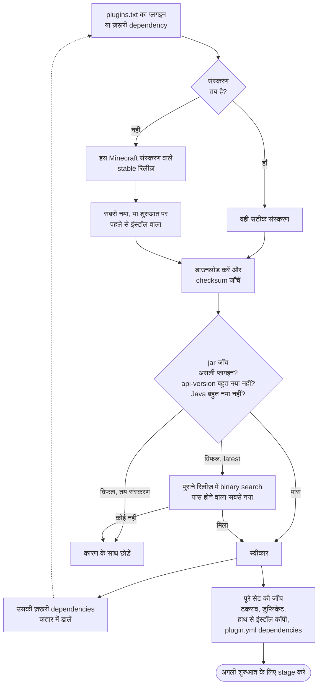

<!-- language-switcher -->
[English](../plugins.md) · **हिन्दी** · [Español](../es/plugins.md) · [简体中文](../zh-CN/plugins.md) · [Português (BR)](../pt-BR/plugins.md) · [日本語](../ja/plugins.md) · [한국어](../ko/plugins.md)

#  प्लगइन्स

यह सर्वर **Paper** चलाता है, इसलिए यह **प्लगइन्स** सपोर्ट करता है: Paper, Spigot या Bukkit की `.jar` फ़ाइलें। प्लगइन्स केवल सर्वर पर चलते हैं; खिलाड़ियों को कुछ इंस्टॉल नहीं करना पड़ता। यह [मॉड](#मॉड) नहीं चलाता।

प्लगइन्स इंस्टॉल करने के दो तरीके हैं:

| तरीका | किसके लिए |
|---|---|
| [`plugins/plugins.txt`](#प्रबंधित-प्लगइन्स-pluginstxt) (सुझाया गया) | [Modrinth](https://modrinth.com/plugins) या [Hangar](https://hangar.papermc.io) पर मौजूद प्लगइन्स। सही संस्करण और उनकी dependencies आपके लिए चुनी, जाँची और अपडेट रखी जाती हैं। |
| [हाथ से](#दूसरी-साइटों-के-प्लगइन्स) | बाकी सब। |

## प्रबंधित प्लगइन्स: `plugins.txt`

जो प्लगइन्स चाहिए, उन्हें एक लाइन में एक लिखें:

```text
# source    project            version
modrinth    luckperms          latest
modrinth    worldguard         latest
hangar      ViaVersion         latest
modrinth    chunky             1.5.3
```

| फ़ील्ड | मतलब |
|---|---|
| `source` | `modrinth` या `hangar` (PaperMC की आधिकारिक प्लगइन साइट) |
| `project` | प्लगइन पेज के पते में मौजूद नाम: `modrinth.com/plugin/luckperms` से `luckperms`, और `hangar.papermc.io/ViaVersion/ViaVersion` से `ViaVersion` |
| `version` | इस सर्वर पर चलने वाले सबसे नए stable संस्करण के लिए `latest`, या प्लगइन पेज से कॉपी किया गया सटीक संस्करण नाम |

`#` से टिप्पणी शुरू होती है। खाली लाइनें अनदेखी की जाती हैं।

फिर चलाएँ:

```bash
make update-plugins
```

| करना है… | यह करें |
|---|---|
| प्लगइन जोड़ना | एक लाइन जोड़ें, फिर `make update-plugins` |
| सब कुछ अपडेट करना | `make update-plugins` |
| किसी प्लगइन का संस्करण तय करना या वापस जाना | `latest` को किसी संस्करण से बदलें, फिर `make update-plugins` |
| प्लगइन हटाना | उसकी लाइन मिटाएँ, फिर `make update-plugins`। उसके साथ आई dependencies भी हट जाती हैं। उसका सेटिंग्स फ़ोल्डर बना रहता है। |
| क्या इंस्टॉल है और क्यों, यह देखना | `make plugins` |

```
Minecraft 1.20.4 on Java 17 - plugins managed by plugins.txt:
  WorldGuard               7.0.9                  listed
  WorldEdit                7.3.0                  required by WorldGuard
Other plugin jars (added by hand or built in):
  UsernameRules.jar
```

### `make update-plugins` क्या करता है

1. सर्वर के चलते रहते हुए, यह प्लगइन संस्करणों का पूरा सेट तय करता है (नीचे देखें) और जो भी नया है उसे एक staging फ़ोल्डर में डाउनलोड करता है।
2. अगर कुछ नहीं बदला, तो यह `all plugins are up to date` दिखाकर रुक जाता है।
3. वरना यह बैकअप लेता है, खिलाड़ियों को चेतावनी देता है, और सर्वर फिर से शुरू करता है।
4. शुरुआत पर, staged प्लगइन्स लगाए जाते हैं और हटाए गए प्लगइन्स मिटा दिए जाते हैं।

सर्वर जिन प्लगइन फ़ाइलों का उपयोग कर रहा हो, उन्हें कभी बदला नहीं जाता।

## संगत संस्करण कैसे चुने जाते हैं

आप केवल वे प्लगइन्स लिखते हैं जो चाहिए। हर एक के लिए resolver यह करता है:



**1. Minecraft संस्करण से छाँटना।** यह केवल उन **stable** रिलीज़ (कोई beta नहीं) पर विचार करता है जिनके बारे में प्लगइन साइट कहती है कि वे आपके सर्वर के Minecraft संस्करण को सपोर्ट करते हैं।

**2. असली jar की जाँच।** प्लगइन साइटें कभी-कभी गलत होती हैं, इसलिए हर उम्मीदवार डाउनलोड करके जाँचा जाता है:

| जाँच | क्यों |
|---|---|
| checksum साइट से मेल खाता है (Modrinth पर SHA-512, Hangar पर SHA-256) | फ़ाइल ठीक वही है जो लेखक ने प्रकाशित की |
| इसमें `plugin.yml` या `paper-plugin.yml` है | यह सच में Paper/Bukkit प्लगइन है |
| `api-version` ≤ आपका Minecraft संस्करण | Paper नए Minecraft के लिए बने प्लगइन्स मना कर देता है |
| ऐसे Java के लिए कंपाइल जो ≤ सर्वर का Java | "प्लगइन लोड नहीं होता" का सबसे आम कारण; प्लगइन साइटें यह दर्ज नहीं करतीं |

अगर सबसे नया संस्करण विफल हो, तो resolver पुराने रिलीज़ में पीछे जाकर **पास होने वाला सबसे नया** ढूँढता है। ज़रूरतें समय के साथ केवल बढ़ती हैं, इसलिए binary search 100+ रिलीज़ में भी कुछ ही डाउनलोड में उसे ढूँढ लेता है:

```
[plugins] WorldEdit: using 7.3.0 because 7.3.9 needs Java 21 (this server runs Java 17)
```

**3. Dependencies इंस्टॉल करना।** Modrinth या Hangar पर घोषित ज़रूरी dependencies भी इसी तरह, बार-बार, तय की जाती हैं। वैकल्पिक dependencies इंस्टॉल नहीं होतीं।

**4. हर प्लगइन की अपनी dependency सूची पढ़ना।** कुछ प्लगइन्स `plugin.yml` में dependencies लिखते हैं पर साइट पर नहीं। resolver उन्हें प्लगइन नाम से Hangar और Modrinth पर ढूँढता है। वह मेल को तभी स्वीकार करता है जब डाउनलोड किया गया jar सच में उसी नाम का प्लगइन हो, ताकि कोई मिलता-जुलता प्रोजेक्ट गलती से इंस्टॉल न हो।

**5. पूरे सेट की जाँच।**

| स्थिति | परिणाम |
|---|---|
| Modrinth दो प्लगइन्स को असंगत बताता है | dependency (या बाद में सूचीबद्ध वाला) चेतावनी के साथ छोड़ दिया जाता है |
| एक ही प्लगइन दो स्रोतों से | पहला रखा जाता है और दूसरा छोड़ा जाता है; Paper डुप्लिकेट मना करता है |
| ऐसा प्लगइन जो आपने हाथ से भी इंस्टॉल किया है | प्रबंधित कॉपी छोड़ दी जाती है |
| कोई dependency कहीं नहीं मिलती | चेतावनी: "X requires the plugin Y, which could not be found automatically; add it to plugins.txt" |

उदाहरण: चार प्लगइन्स सूचीबद्ध वाले Minecraft 1.20.4 सर्वर पर, तीन dependencies जोड़ी गईं और Java 17 के लिए पुराना WorldEdit चुना गया:

```
[plugins] WorldEdit: using 7.3.0 because 7.3.9 needs Java 21 (this server runs Java 17)
[plugins] + Multiverse-Portals 5.3.0  (listed)
[plugins] + WorldGuard 7.0.9  (listed)
[plugins] + ViaBackwards 5.12.2  (listed)
[plugins] + LuckPerms v5.5.71-bukkit  (listed)
[plugins] + Multiverse-Core 5.8.2  (required by Multiverse-Portals)
[plugins] + WorldEdit 7.3.0  (required by WorldGuard)
[plugins] + ViaVersion 5.12.2  (required by ViaBackwards)
```

### जब चीज़ें बदलती हैं

| बदलाव | क्या होता है |
|---|---|
| आपने `plugins.txt` बदला | `make update-plugins` से, या अगली शुरुआत पर लागू |
| आपने Minecraft या Java संस्करण बदला | अगली शुरुआत पर सभी प्लगइन्स फिर से तय होते हैं। कोई प्लगइन नए संस्करण के अनुकूल रिलीज़ पर ऊपर या नीचे जा सकता है। |
| कुछ नहीं बदला | शुरुआत Modrinth या Hangar से बिल्कुल संपर्क नहीं करती |

शुरुआत पर resolver पहले से इंस्टॉल संस्करण को प्राथमिकता देता है, जब तक वह सभी जाँचें पास करता रहे। केवल `make update-plugins` (या रोज़ का ऑटो-अपडेट) प्लगइन्स को नए संस्करणों पर ले जाता है।

### तय संस्करण

तय संस्करण (`modrinth chunky 1.5.3`) बिना खोजे वैसे ही इस्तेमाल होता है:

- अगर प्लगइन साइट आपके Minecraft संस्करण को सूचीबद्ध नहीं करती, तो चेतावनी मिलती है पर फिर भी इंस्टॉल होता है।
- अगर jar बिल्कुल नहीं चल सकता (गलत Java, नई API), तो उसे मना कर दिया जाता है।

### विफलताएँ कभी सर्वर नहीं गिरातीं

| समस्या | परिणाम |
|---|---|
| Modrinth या Hangar तक नहीं पहुँच सके, टाइपो, मिटाया गया प्रोजेक्ट | चेतावनी। इंस्टॉल संस्करण बना रहता है, सर्वर शुरू होता है, और अगली शुरुआत फिर कोशिश करती है। |
| इस सर्वर पर कोई संस्करण काम नहीं करता | कारण बताती चेतावनी, साथ में `JAVA_VERSION` संकेत जब नया Java मदद करे। लोड न हो सकने वाला पहले से इंस्टॉल संस्करण हटा दिया जाता है। |
| एक साथ दो `update-plugins` (हाथ से और तय समय वाला) | दूसरा मना कर दिया जाता है: "another plugin install/update is already running; try again in a minute" |

## अपने आप अपडेट

```env
PLUGIN_AUTO_UPDATE=true
PLUGIN_UPDATE_TIME=04:00
TZ=Asia/Kolkata
```

हर दिन `PLUGIN_UPDATE_TIME` पर:

1. सर्वर प्लगइन अपडेट जाँचता है। अगर कोई नहीं है, तो कुछ नहीं होता।
2. अगर हैं, तो रीस्टार्ट से 5 मिनट, 1 मिनट और 10 सेकंड पहले खिलाड़ियों को चैट में चेतावनी दिखती है।
3. बैकअप लिया जाता है।
4. सर्वर फिर से शुरू होकर अपडेट लागू करता है।

ये सेटिंग्स बदलने के बाद `make up` चलाएँ। अपने आप अपडेट **डिफ़ॉल्ट रूप से बंद** हैं: प्लगइन अपडेट कभी-कभी कॉन्फ़िगरेशन का प्रारूप बदल देते हैं या अलग व्यवहार करते हैं। किसी महत्वपूर्ण सर्वर के लिए, `make update-plugins` तब चलाएँ जब आप नतीजा देख सकें, और जिन संस्करणों पर निर्भर हैं उन्हें तय रखें।

## दूसरी साइटों के प्लगइन्स

जो प्लगइन्स Modrinth या Hangar पर नहीं हैं, या जिनका Hangar पर केवल बाहरी लिंक है:

```bash
docker compose cp SomePlugin.jar mc:/data/plugins/
make restart
```

किसी को हटाने के लिए:

```bash
docker compose exec mc rm /data/plugins/SomePlugin.jar
make restart
```

हाथ से जोड़े गए jar को `plugins.txt` कभी नहीं छूता, और dependencies जाँचते समय उन्हें इंस्टॉल माना जाता है।

## प्लगइन्स कहाँ रहते हैं

| पथ (`mc-data` वॉल्यूम के अंदर) | सामग्री |
|---|---|
| `/data/plugins/*.jar` | सभी प्लगइन jar |
| `/data/plugins/<Name>/` | हर प्लगइन की सेटिंग्स और डेटा |
| `/data/plugins/.managed/lock.tsv` | `plugins.txt` ने क्या इंस्टॉल किया: संस्करण, फ़ाइल, checksum, कारण |
| `/data/plugins/.managed/pending/` | अगली शुरुआत के लिए staged अपडेट |

यह सब बैकअप में शामिल है (staging फ़ोल्डर को छोड़कर)।

## अंतर्निहित प्लगइन

`UsernameRules` इमेज के साथ आता है। यह ऑफ़लाइन मोड में Mojang के यूज़रनेम नियम लागू करता है (देखें [ऑनलाइन और ऑफ़लाइन मोड](offline-mode.md#यूज़रनेम-नियम)) और इसे `plugins.txt` नहीं, बल्कि `ENFORCE_USERNAME_RULES` नियंत्रित करता है।

## मॉड

मॉड (Fabric, Forge, NeoForge) खुद गेम को बदलते हैं। Paper उन्हें लोड नहीं कर सकता, और ज़्यादातर content मॉड **हर खिलाड़ी** को भी इंस्टॉल करने पड़ते हैं। मॉड चलाने का मतलब होगा इस इमेज को Paper की जगह Fabric या NeoForge पर बनाना। इस प्रोजेक्ट का ज़्यादातर हिस्सा साथ आ जाएगा (बैकअप, health check, सुरक्षित बंद होना, खिलाड़ी माइग्रेशन), पर Paper प्लगइन्स नहीं। दोनों चलाने की कोशिश करने वाले "hybrid" सर्वर किसी भरोसेमंद सर्वर के लिए सुझाए नहीं जाते।

## सीमाएँ

- केवल Modrinth और Hangar अपने आप खोजे जाते हैं।
- वैकल्पिक dependencies इंस्टॉल नहीं होतीं; चाहिए तो उन्हें सूची में जोड़ें।
- jar जाँचें आम असंगतियाँ पकड़ लेती हैं, पर कोई प्लगइन उन्हें पास करके भी अंदरूनी API बदलावों के कारण चलते समय विफल हो सकता है। हर प्लगइन अपडेट से पहले लिया गया बैकअप सुरक्षा जाल है।
- प्लगइन्स जो डेटा खिलाड़ी UUID के तहत रखते हैं, वह ऑनलाइन और ऑफ़लाइन मोड बदलने पर माइग्रेट नहीं होता।
