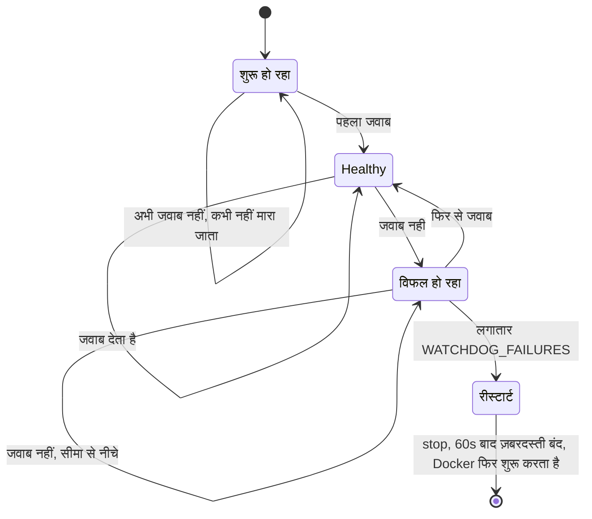
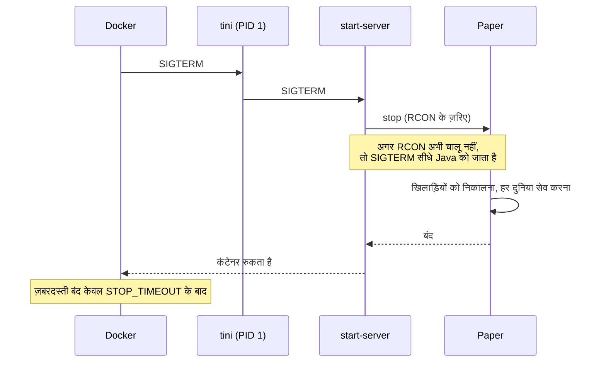

<!-- language-switcher -->
[English](../reliability.md) · **हिन्दी** · [Español](../es/reliability.md) · [简体中文](../zh-CN/reliability.md) · [Português (BR)](../pt-BR/reliability.md) · [日本語](../ja/reliability.md) · [한국어](../ko/reliability.md)

#  विश्वसनीयता

यह पेज वह सब कुछ समझाता है जो बिना किसी के देखे सर्वर को चालू और दुनिया को सुरक्षित रखता है।

| तंत्र | किससे बचाता है |
|---|---|
| [रीस्टार्ट नीति](#अपने-आप-रीस्टार्ट) | क्रैश, मेमोरी खत्म होने की गड़बड़ियाँ, होस्ट रीबूट |
| [Health check](#health-check) | यह न जान पाना कि सर्वर सच में काम कर रहा है या नहीं |
| [अटकने का watchdog](#अटकने-का-watchdog) | ऐसा जमा हुआ सर्वर जो चल तो रहा है पर जवाब नहीं दे रहा |
| [सुरक्षित बंद होना](#सुरक्षित-बंद-होना) | रोकते समय दुनिया का खोना या खराब होना |
| [मेमोरी सुरक्षा](#मेमोरी-सुरक्षा) | मेमोरी खत्म होने पर बार-बार मारे जाने का लूप |
| [सेटिंग्स की जाँच](#सेटिंग्स-की-जाँच) | टाइपो से क्रैश-लूप बनना या सुविधाओं का चुपचाप बंद हो जाना |
| [संस्करण और डेटा सुरक्षा](#संस्करण-और-डेटा-सुरक्षा) | दुनिया का डाउनग्रेड, खिलाड़ी डेटा का खोना |
| [बैकअप](backups.md) | बाकी सब कुछ |

## अपने आप रीस्टार्ट

दोनों कंटेनर `restart: unless-stopped` इस्तेमाल करते हैं। जब भी सर्वर प्रोसेस बंद होता है, चाहे क्रैश से, मेमोरी खत्म होने से, watchdog से, या किसी के `/stop` लिखने से, Docker उसे फिर से शुरू कर देता है। होस्ट रीबूट के बाद, Docker के चालू होते ही यह भी वापस आ जाता है। केवल `make down` (या `docker stop`) इसे बंद रखता है।

## Health check

हर 30 सेकंड पर Docker कंटेनर के अंदर `mc-health` चलाता है:

1. यह गेम पोर्ट पर एक **server list ping** भेजता है, वही अनुरोध जो Minecraft की multiplayer स्क्रीन भेजती है।
2. अगर सर्वर, सर्वर सूचियों से छिपा होने (`enable-status=false`) के कारण उसे मना करे, तो यह RCON की `list` कमांड पर लौट आता है।

एक जाँच पास होते ही `make status` में `healthy` दिखता है। नए सर्वरों को दुनिया बनाने के लिए **5 मिनट** की छूट मिलती है। `backup` कंटेनर तब तक शुरू नहीं होता जब तक सर्वर healthy न हो जाए।

## अटकने का watchdog

कोई सर्वर तब भी जम सकता है जब उसका प्रोसेस ज़िंदा रहे: deadlock, या किसी प्लगइन का अनंत लूप में फँस जाना। Docker केवल बंद हो चुके प्रोसेस को फिर से शुरू करता है, इसलिए कंटेनर में एक पृष्ठभूमि watchdog इसे संभालता है:

- हर `WATCHDOG_INTERVAL` सेकंड (डिफ़ॉल्ट 60) पर यह health check चलाता है।
- यह गिनती **सर्वर के एक बार जवाब देने के बाद ही** शुरू करता है, इसलिए धीमी पहली शुरुआत कभी नहीं मारी जाती।
- लगातार `WATCHDOG_FAILURES` विफलताओं के बाद (डिफ़ॉल्ट 5, यानी लगभग 5 मिनट), यह सामान्य stop सिग्नल भेजता है, 60 सेकंड इंतज़ार करता है, फिर ज़बरदस्ती बंद करता है। फिर Docker सर्वर को फिर से शुरू करता है।




```
[start-server] Watchdog: server not responding (1/5)
...
[start-server] Watchdog: server is hung, killing it
```

Paper का अपना watchdog जमे हुए game ticks के लिए है। यह वाला वे जमाव भी पकड़ता है जो Paper का watchdog नहीं देख सकता। इसे बंद करने के लिए `WATCHDOG_INTERVAL=0` सेट करें।

## सुरक्षित बंद होना

किसी Minecraft सर्वर को मारकर रोकने से पिछले autosave के बाद का सब कुछ खो जाता है और लिखे जा रहे chunks खराब हो सकते हैं। यहाँ हर बार रोकना एक ही रास्ते से होता है:




1. `tini` (PID 1) Docker का stop सिग्नल `start-server` तक पहुँचाता है।
2. `start-server` RCON के ज़रिए `stop` भेजता है। Paper खिलाड़ियों को निकालता है, हर दुनिया सेव करता है और बंद हो जाता है।
3. अगर RCON अभी चालू नहीं है (जैसे शुरुआत के दौरान), तो Java को सामान्य stop सिग्नल मिलता है। उस पर भी Paper सेव करता है।

ज़बरदस्ती बंद करने से पहले Docker `STOP_TIMEOUT` (डिफ़ॉल्ट `2m`) तक इंतज़ार करता है। बहुत बड़ी दुनियाओं या धीमी डिस्क के लिए इसे बढ़ाएँ:

```env
STOP_TIMEOUT=5m
```

## मेमोरी सुरक्षा

| जोखिम | सुरक्षा |
|---|---|
| खेल के बीच heap बढ़ता है और होस्ट की मेमोरी खत्म हो जाती है | heap शुरुआत में ही तय (`-Xms` = `-Xmx` = `MEMORY`) और पहले से भरा जाता है, ताकि मेमोरी की दिक्कतें खेल के दौरान नहीं, शुरुआत में दिखें |
| heap कंटेनर के लिए बहुत बड़ा, तो kernel उसे बार-बार मारता है (exit 137) | शुरुआत तब तक मना रहती है जब तक `MEMORY` + 512M, `CONTAINER_MEMORY` में न समाए। error बताता है क्या सेट करना है। |
| Java का heap खत्म हो जाता है और वह लड़खड़ाते हुए चलता रहता है | `-XX:+ExitOnOutOfMemoryError` उसे साफ़ बंद कराता है, और Docker उसे फिर से शुरू करता है |

Garbage collection के लिए G1 के व्यापक रूप से इस्तेमाल होने वाले Aikar's flags का उपयोग होता है, जो 12 GB और उससे ऊपर बड़े heap वाले रूप पर चले जाते हैं, ताकि रुकावटें छोटी और अनुमानित रहें।

## सेटिंग्स की जाँच

कुछ भी शुरू होने से पहले सेटिंग्स जाँची जाती हैं। गलत मान, क्रैश-लूप, अंतहीन बैकअप लूप, या चुपचाप बंद हो जाने वाली सुविधा बनने के बजाय, सेटिंग के नाम वाले संदेश के साथ शुरुआत रोक देता है:

| सेटिंग | अस्वीकृत मान का उदाहरण | संदेश |
|---|---|---|
| `EULA` | `false` | EULA स्वीकार करना होगा |
| `RCON_PASSWORD` | पुराना प्लेसहोल्डर, या backslash वाला मान (खाली ठीक है: एक बन जाता है) | कारण और नया बनाने का तरीका बताता है |
| `MEMORY` | `2GB` | `2G` या `1536M` जैसा होना चाहिए |
| `MEMORY` / `CONTAINER_MEMORY` | `3G` कंटेनर में `4G` | बताता है कौन-सा `CONTAINER_MEMORY` सेट करें |
| `WATCHDOG_INTERVAL`, `WATCHDOG_FAILURES` | `1m` | पूर्ण संख्या होनी चाहिए |
| `PLUGIN_UPDATE_TIME` | `25:00` | `HH:MM` होना चाहिए |
| `BACKUP_INTERVAL` | `abc` | `30m`, `6h`, `1d` जैसा होना चाहिए |
| `BACKUP_KEEP` | `0` | 1 या ज़्यादा होना चाहिए |
| `MC_VERSION` | `1.16.5`, `9.9` | बहुत पुराना, या उपलब्ध नहीं |
| `PAPER_BUILD` | `MC_VERSION=latest` के साथ कोई संख्या | सटीक संस्करण चाहिए |

## संस्करण और डेटा सुरक्षा

- **दुनिया का डाउनग्रेड मना है**, और अपग्रेड से पहले बैकअप लिया जाता है। देखें [Minecraft संस्करण](minecraft-versions.md)।
- **ऑनलाइन/ऑफ़लाइन मोड बदलने पर खिलाड़ी डेटा खिलाड़ियों के साथ जाता है।** पहले बैकअप लिया जाता है, और सर्वर आधा-अधूरा माइग्रेट होकर शुरू नहीं होता। देखें [ऑनलाइन और ऑफ़लाइन मोड](offline-mode.md)।
- **प्लगइन की समस्याएँ कभी शुरुआत नहीं रोकतीं।** डाउनलोड विफल होने पर इंस्टॉल संस्करण बना रहता है, और जो प्लगइन लोड नहीं हो सकते उन्हें छोड़ दिया जाता है। देखें [प्लगइन्स](plugins.md)।

## न्यूनतम अधिकार और अलगाव

- सर्वर बिना विशेषाधिकार वाले यूज़र (`PUID`/`PGID`) के रूप में चलता है। root का उपयोग केवल शुरुआत में एक पल के लिए फ़ाइल स्वामित्व ठीक करने में होता है।
- RCON केवल निजी Compose नेटवर्क पर ही पहुँचा जा सकता है।
- Docker की लॉग रोटेशन (हर कंटेनर के लिए 5 × 10 MB) लॉग को डिस्क भरने से रोकती है।
