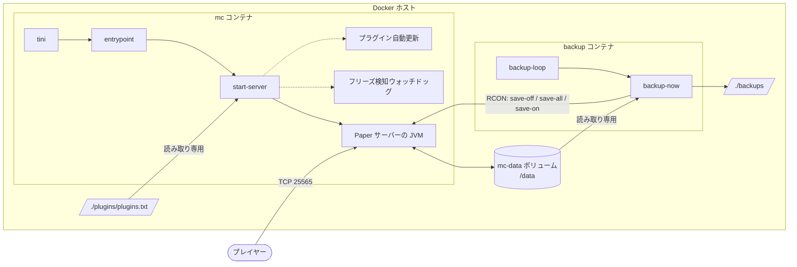
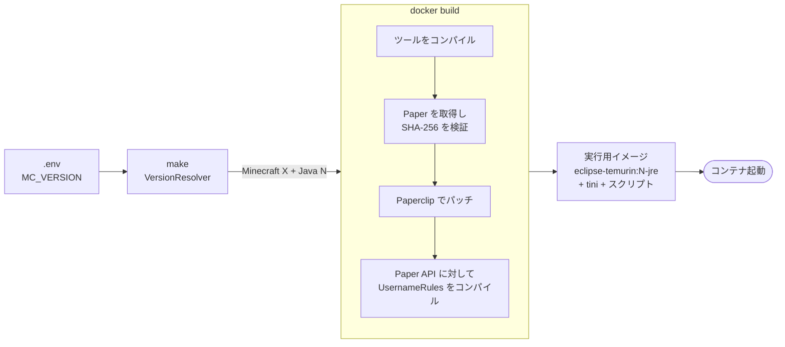
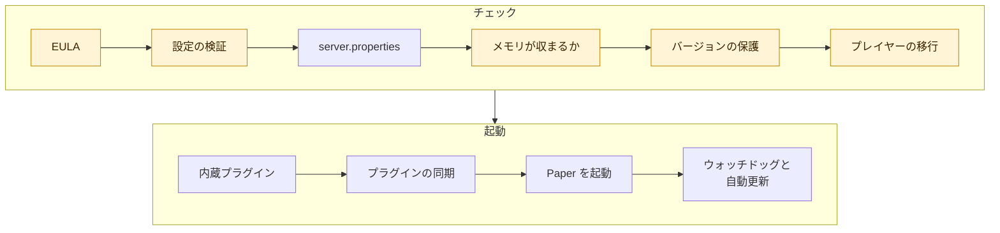

<!-- language-switcher -->
[English](../architecture.md) · [हिन्दी](../hi/architecture.md) · [Español](../es/architecture.md) · [简体中文](../zh-CN/architecture.md) · [Português (BR)](../pt-BR/architecture.md) · **日本語** · [한국어](../ko/architecture.md)

#  アーキテクチャ

このページでは、プロジェクトの組み立てを説明します。何がどこで動くか、ビルド時と起動時に何が起きるか、データがどこにあるかです。

## 全体像



| 構成要素 | 内容 |
|---|---|
| **イメージ** `local/paper-server` | `Dockerfile` からローカルでビルド。1 つのイメージで両方のコンテナを動かします。 |
| **`mc` コンテナ** | ゲームサーバーと補助プロセス（ウォッチドッグ、任意のプラグイン自動更新）。 |
| **`backup` コンテナ** | 同じイメージを `backup` コマンドで起動したもの。定期バックアップを取ります。 |
| **`mc-data` ボリューム** | サーバーが書き込むすべて: ワールド、設定、プラグイン、プレイヤーデータ。再ビルドしても残ります。 |
| **`./backups`** | バックアップのアーカイブ。ホスト上にあるので、どこへでもコピーできます。 |
| **`./plugins/plugins.txt`** | プラグインの一覧。サーバーには読み取り専用でマウントされます。 |
| **RCON** | Minecraft のリモートコンソール。スクリプトがワールドの保存やコマンド送信に使います。Compose ネットワーク内からしかアクセスできず、ホストに公開されることはありません。 |

## `make up` からサーバー起動まで




### 1. バージョンを決める（あなたのマシン上で）

`make` は一時的な `eclipse-temurin:25-jdk` コンテナで `VersionResolver` を実行します。PaperMC API に、`MC_VERSION` に対応する Paper のリリースと、そのリリースに必要な Java を問い合わせ、対応する Java LTS（17・21・25）を選びます:

```
==> Minecraft 1.21.4 (Paper) on Java 21
```

結果はイメージのビルドに渡されます。あなたのマシンに必要なのは Docker だけです。

### 2. イメージをビルドする

`Dockerfile` には 2 つのステージがあります。

**ビルドステージ**（`eclipse-temurin:25-jdk`）:

1. プロジェクトの Java ツール（`tools/*.java`）を Java 17 向けにコンパイルします。これでサーバーがどの Java でも動きます。
2. `scripts/fetch-paper.sh` を実行します。選んだバージョンの最新の安定版 Paper ビルドを探し、選んだ Java が十分新しいか確認し、jar をダウンロードして **SHA-256 チェックサムを検証**します。
3. Paper のランチャー（Paperclip）に完全なサーバー jar を組み立てさせます。このとき Mojang から公式の Minecraft サーバーをダウンロードします。Paperclip はダウンロードに失敗しても正常終了することがあるため、この手順は再試行されます。
4. 内蔵の `UsernameRules` プラグインを、そのバージョンの Paper API に対してコンパイルします。

**実行ステージ**（`eclipse-temurin:<17|21|25>-jre`）:

- 検証済みの Paper jar、ツール、内蔵プラグイン、`scripts/` のスクリプト
- PID 1 としての `tini`。シグナルをサーバーに届け、ゾンビプロセスを片付けます

### 3. コンテナを起動する

どのコンテナも `tini → entrypoint` で始まります。entrypoint は:

1. 必要なら `/data` と `/backups` の所有者を `PUID:PGID` に直します。
2. root 権限を手放します。
3. 指定されたモードを実行します: `server`、`backup`、`backup-now`、`restore`。

### 4. サーバーの起動手順（`start-server`）

各手順は順番に実行されます。どこかで失敗すると、悪い状態のまま起動するのではなく、わかりやすいメッセージとともに起動を止めます。




強調表示された手順は、わかりやすいメッセージとともに起動を止めることがあります。

| # | 手順 | 詳細 |
|---|---|---|
| 1 | EULA の確認 | `EULA=TRUE` でなければ起動を拒否します。 |
| 2 | 設定の検証 | RCON パスワード、`MEMORY` の形式、数値、時刻の形式。[信頼性](reliability.md#設定の検証) を参照。 |
| 3 | `server.properties` の書き込み | `.env` のゲーム設定を反映します。ポート、待ち受けアドレス、RCON の設定は常に強制します。 |
| 4 | メモリが収まるかの確認 | コンテナのメモリ上限に収まらないヒープを拒否します。 |
| 5 | ワールドのバージョン保護 | アップグレード前にバックアップを取り、ダウングレードを拒否します。[Minecraft のバージョン](minecraft-versions.md) を参照。 |
| 6 | プレイヤーデータの移行 | オンライン/オフラインモードが変わっていれば、プレイヤーデータを新しい ID に移します。[オンラインモードとオフラインモード](offline-mode.md) を参照。 |
| 7 | 内蔵プラグイン | `UsernameRules.jar` をインストールまたは削除します（`ENFORCE_USERNAME_RULES`）。 |
| 8 | プラグインの同期 | 準備済みのプラグイン更新を反映し、`plugins.txt`、Minecraft、Java のどれかが変わっていれば再解決します。起動を止めることはありません。 |
| 9 | Paper の起動 | 調整済みのフラグで JVM を起動します。 |
| 10 | 補助プロセス | フリーズ検知ウォッチドッグを起動し、有効ならプラグイン自動更新のスケジューラーも起動します。 |

### 5. 停止の手順

```
docker stop / make down / make restart
  → tini forwards SIGTERM
  → start-server sends "stop" over RCON (or SIGTERM to Java if RCON isn't up yet)
  → Paper saves every world and exits
  → container stops
```

Docker は強制終了する前に `STOP_TIMEOUT`（デフォルト 2 分）待ちます。

## データの配置

`mc-data` ボリューム（`/data`）の中身:

```
/data
├── world/                     # ワールド（名前は LEVEL_NAME から）
├── plugins/
│   ├── *.jar                  # インストール済みプラグイン
│   ├── <Plugin>/              # 各プラグイン自身の設定
│   └── .managed/
│       ├── lock.tsv           # plugins.txt がどのプラグインとバージョンを入れたか
│       └── pending/           # 準備済みのプラグイン更新。次回起動時に反映
├── server.properties, bukkit.yml, spigot.yml, config/   # サーバーの設定
├── ops.json, whitelist.json, banned-players.json        # 管理用リスト
├── .mc-version                # ワールドが最後に動いた Minecraft バージョン
├── .player-uuid-mode          # プレイヤーデータが対応するオンライン/オフラインモード
├── cache/, libraries/, versions/   # Paper が作り直す。バックアップ対象外
└── logs/                      # サーバーのログ。バックアップ対象外
```

## 外部サービス

| サービス | 用途 | タイミング |
|---|---|---|
| Docker Hub（`eclipse-temurin`） | Java イメージ | ビルド |
| PaperMC API（`fill.papermc.io`） | Paper のバージョン、ダウンロード、チェックサム | ビルド、`make versions` |
| Mojang（`piston-data.mojang.com`） | Paper がパッチを当てる公式サーバー jar | ビルド、初回起動 |
| Mojang（`api.mojang.com`） | ユーザー名 → アカウント ID | 既存のプレイヤーがいる状態でオンラインモードに切り替えるときだけ |
| Modrinth、Hangar | プラグインの情報とダウンロード | プラグインのインストールと更新のときだけ |

サードパーティ製のサーバーイメージやスクリプトは使いません。ダウンロードしたサーバーとプラグインの jar はすべてチェックサムを検証します。

## ソースの構成

```
Dockerfile, compose.yaml, Makefile, .env.example
scripts/
  entrypoint.sh       所有者の修正、root の放棄、モードの振り分け
  start-server.sh     起動手順、シグナル処理、ウォッチドッグ、自動更新
  fetch-paper.sh      Paper のダウンロードを決めて検証（ビルド時）
  backup-now.sh       一貫性があり、ロック付きで検証済みのバックアップ 1 回分
  backup-loop.sh      バックアップのスケジューラー
  restore-backup.sh   一時フォルダーを使った安全な復元
  plugins, rcon-cli, mc-health   Java ツールの薄いラッパー
tools/                依存関係のない Java ツール。mctool.jar にコンパイル
  McTool.java         エントリーポイント。RCON クライアントとサーバーリスト ping
  VersionResolver.java  Minecraft バージョン → Paper のリリース + Java
  PluginManager.java  plugins.txt の解決、ダウンロード、検証
  PlayerMigrator.java オンライン/オフライン間の UUID 移行
  Json.java, Yaml.java  最小限のパーサー
plugins/
  plugins.txt         プラグインの一覧
  username-rules/     内蔵プラグインのソース
docs/                 このドキュメント
  assets/             バナーとアイコン（手作りの SVG）
```
