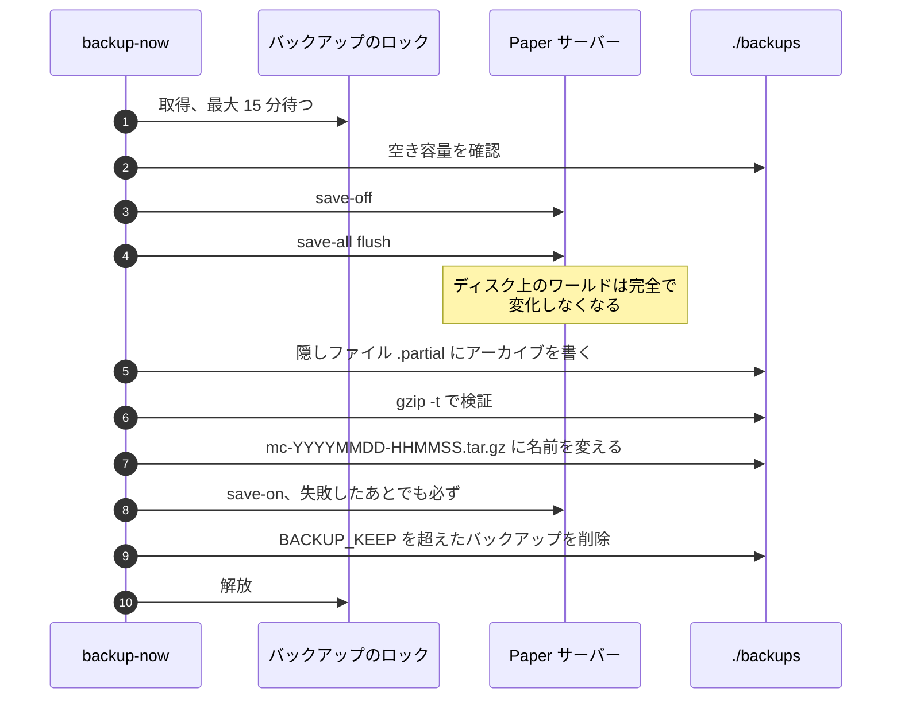
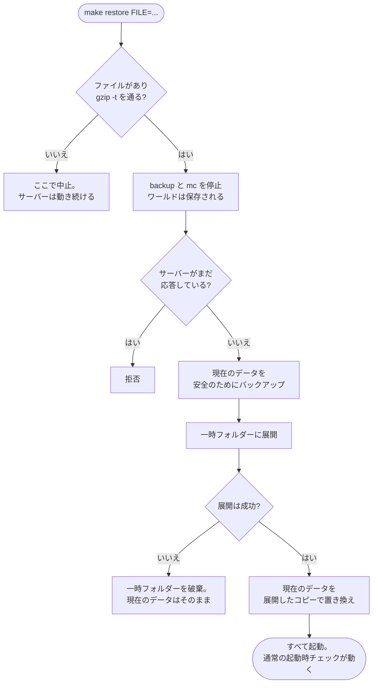

<!-- language-switcher -->
[English](../backups.md) · [हिन्दी](../hi/backups.md) · [Español](../es/backups.md) · [简体中文](../zh-CN/backups.md) · [Português (BR)](../pt-BR/backups.md) · **日本語** · [한국어](../ko/backups.md)

#  バックアップと復元

バックアップは自動で実行され、プレイヤーがオンラインでも一貫性を保ち、有効とみなす前に検証されます。復元は、一度のミスで今のワールドを失うことがないように設計されています。

## 概要

| | |
|---|---|
| **スケジュール** | `BACKUP_INTERVAL`（デフォルト `1h`）ごとに `backup` コンテナが実行 |
| **保持数** | 最新の `BACKUP_KEEP` 個（デフォルト `24`） |
| **保存先** | ホストの `./backups/` に `mc-YYYYMMDD-HHMMSS.tar.gz`（UTC 時刻）として保存 |
| **手動** | `make backup` |
| **一覧** | `make backups` |
| **復元** | `make restore FILE=mc-….tar.gz` |

**危険な操作の前にも毎回自動で**バックアップを取ります:

| この操作の前に | 実行するもの |
|---|---|
| ワールドを新しい Minecraft バージョンにアップグレード | `start-server` |
| オンラインモードとオフラインモードの間でプレイヤーデータを移行 | `start-server` |
| プラグインの更新を反映（`make update-plugins`、自動更新） | 更新コマンド |
| バックアップの復元（置き換えられる内容の「安全のためのバックアップ」） | `restore` |

## バックアップの中身

サーバーを元どおりに戻すのに必要なものすべて: ワールド、`server.properties` などの設定、プラグインとその設定、プレイヤーデータ、オペレーター・ホワイトリスト・BAN のリスト、バージョンの記録。

Paper が作り直すもの、または一時的なものは除外します:

| 除外するもの | 理由 |
|---|---|
| `cache/`、`libraries/`、`versions/` | 起動時に Paper がダウンロードまたは生成する |
| `logs/` | 復元には不要で、大きくなることがある |
| `plugins/.managed/pending/` | 準備中のプラグイン更新。次の更新で作り直される |
| `plugins/spark/tmp/` | プロファイラーの一時ファイル |

## バックアップの一貫性を保つ仕組み

Minecraft のワールドは、サーバーが絶えず書き換える何千ものファイルです。書き込みの途中でコピーすると、保存しかけのチャンクが入ってしまうことがあります。そこで各バックアップは次のように動きます:



1. **バックアップのロックを取ります。**`mc` と `backup` の両コンテナをまたいでも、同時に動くバックアップは 1 つだけです。そうしないと、1 つ目がまだ読んでいる最中に 2 つ目が自動保存を再開してしまうおそれがあります。ロックは最大 15 分待ちます。
2. **ディスク容量を確認します**（下記参照）。
3. **RCON で自動保存を止めてフラッシュします**: `save-off` のあと `save-all flush`。メモリ上の内容がすべてディスクに書かれ、変化しなくなります。
4. **`/data` をアーカイブします**。書き込み先は隠しファイルの `.partial` です。
5. **`gzip -t` でアーカイブを検証します。**壊れたアーカイブは破棄され、古いバックアップは残ります。
6. **正式な名前に変えます。**書きかけのバックアップが本物に見えることはありません。
7. **`save-on` で自動保存を再開します。**上のどこかで失敗した場合もこれは必ず行います。
8. **`BACKUP_KEEP` を超えた古いバックアップを削除します。**

その間もプレイヤーは遊び続けられます。何かが告知されたり止まったりすることはありません。

RCON に接続できない場合（サーバーが停止しているときなど）は、手順 3 を飛ばしてバックアップを取り、その旨を表示します。サーバーが動いていなければ安全です。

## ディスク容量の安全

ディスクをいっぱいにするバックアップは、サーバーがワールドを保存できなくなる原因にもなり、ワールドが壊れるおそれがあります。開始前にバックアップは自分のサイズを見積もり（前回のバックアップのサイズ + 20%、初回はデータサイズの 60%）、その分**に加えて 512 MB** の空きがなければ実行を拒否します:

```
ERROR: not enough disk space: about 102M needed plus 512M headroom, 20M free. Lower BACKUP_KEEP or free space.
```

定期実行のループは失敗をログに残し、次の間隔でまた試します。

## 復元

```bash
make backups                                   # pick one
make restore FILE=mc-20261030-175220.tar.gz
```

順番に次のことが起きます:



1. **何かに手を付ける前に、あなたのマシン上で:** ファイルが存在し、`gzip -t` を通る必要があります。入力ミスや壊れたファイルはここで止まり、サーバーは動き続けます。
2. `backup` と `mc` のコンテナを停止します（ワールドは保存されます）。
3. サーバーがまだ応答している場合、復元は続行を拒否します。
4. 現在の状態の**安全のためのバックアップ**を取ります。
5. バックアップを、使用中のデータの隣にある**一時フォルダー**に展開します。展開に失敗した場合（ディスクがいっぱいなど）、現在のデータはそのまま残ります。
6. そのときになって初めて、現在のデータを展開したコピーで置き換えます。
7. すべてを再び起動します。

復元のあとも、通常の起動時チェックはそのまま行われます:

- サーバーより**新しい** Minecraft バージョンで作ったバックアップは、[ダウングレード防止](minecraft-versions.md#ダウングレード) によって拒否されます。
- **古い**バージョンで作ったバックアップはアップグレードされます。その前にもう一度バックアップを取ります。
- もう一方のオンライン/オフラインモードで作ったバックアップは、プレイヤーデータが[移行](offline-mode.md#モードをまたいだプレイヤーデータ)されます。
- プラグインは `plugins.txt` に合わせて同期し直されます。

安全のためのバックアップも普通のバックアップです。最新の `BACKUP_KEEP` 個より古くなると通常の世代管理で削除されるので、残したい場合は別の場所にコピーしてください。

## 新しいマシンで復元する

1. 新しいマシンにプロジェクトをセットアップします（[はじめに](getting-started.md)）。`MC_VERSION` はバックアップと**同じ**か、それより新しいものにします。
2. バックアップファイルを `./backups/` にコピーします。
3. コンテナとボリュームを作るために、一度 `make up` を実行します。
4. `make restore FILE=…` を実行します。

## 外部コピー

`./backups` のバックアップはサーバーと同じディスクにあります。ミスや破損からは守れますが、マシンそのものを失った場合は守れません。定期的に別の場所へコピーしてください。例は [デプロイ](deployment.md#外部バックアップ) を参照してください。

## バックアップを手動で開く

バックアップはただの `tar.gz` アーカイブです:

```bash
tar -tzf backups/mc-20261030-175220.tar.gz | head        # list contents
mkdir /tmp/old && tar -xzf backups/mc-….tar.gz -C /tmp/old ./world/
```
