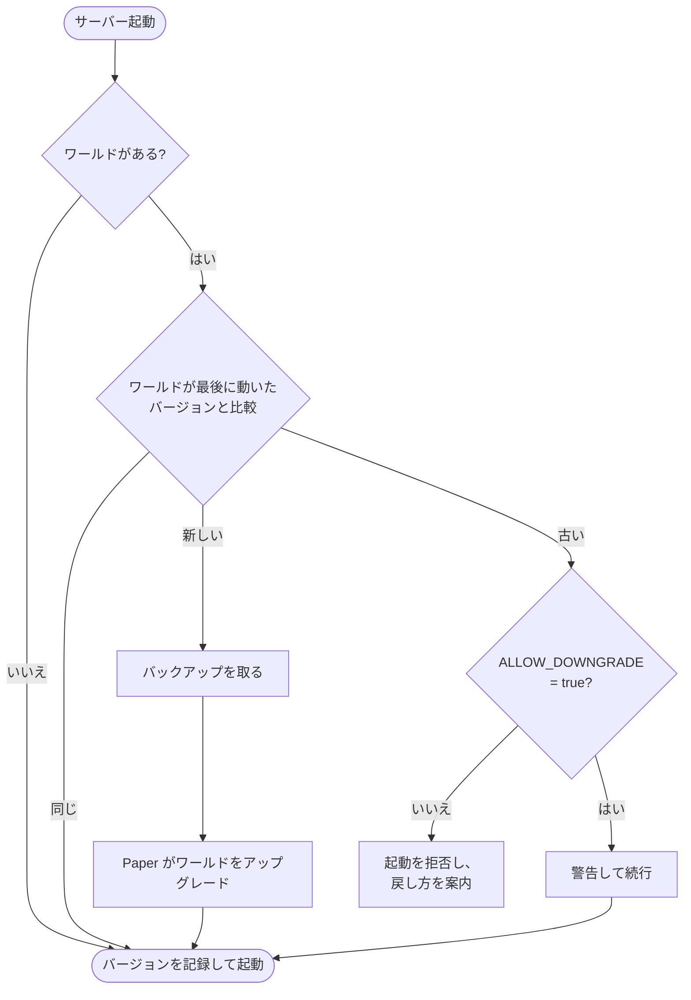

<!-- language-switcher -->
[English](../minecraft-versions.md) · [हिन्दी](../hi/minecraft-versions.md) · [Español](../es/minecraft-versions.md) · [简体中文](../zh-CN/minecraft-versions.md) · [Português (BR)](../pt-BR/minecraft-versions.md) · **日本語** · [한국어](../ko/minecraft-versions.md)

#  Minecraft のバージョン

**1.17** から最新リリースまで、どの Minecraft バージョンでも動かせます。適切な Java が自動で選ばれ、バージョンが変わるときもワールドは守られます。

## バージョンを選ぶ

**最初の `make up` の前に** `.env` で設定します:

```env
MC_VERSION=1.21.4
```

指定できる値:

- `latest`: **安定版**の Paper ビルドがある最新の Minecraft バージョン。イメージをビルドするたびに解決されます。
- `1.20.4`、`1.21.4`、`26.3` のような具体的なバージョン

利用できるバージョンを見るには:

```bash
make versions
```

```
MINECRAFT  JAVA   PAPER SUPPORT
26.3       25     supported
26.2       25     deprecated
1.21.11    21     unsupported
...
```

「Paper support」の列は PaperMC 自身によるステータスです。「unsupported」のバージョンも動きますが、PaperMC からの修正は提供されなくなっています。

## Java の選び方

Minecraft のバージョンごとに最低限必要な Java があります。`make` は PaperMC API に問い合わせ、その条件を満たすもっとも古い Java LTS を選びます。そのバージョンはその Java でビルド・テストされているからです:

| Minecraft | Java |
|---|---|
| 1.17 – 1.20.4 | 17 |
| 1.20.5 – 1.21.x | 21 |
| 26.x | 25 |

そのうえで、そのバージョン用の公式 `eclipse-temurin` Java イメージからイメージをビルドします。`make up` は決定内容を表示します:

```
==> Minecraft 1.20.4 (Paper) on Java 17
```

新しい Java を強制したい場合、たとえば必要なプラグインが Java 21 向けにビルドされているのに 1.20.4 を使っているときは、`.env` で `JAVA_VERSION=21` を設定します。選んだ Minecraft バージョンに対して古すぎる Java は拒否されます。

Minecraft **1.16.5 以前**は Java 8 または 11 が必要なためサポート対象外です。`make` はわかりやすいメッセージとともに拒否します。

## バージョンが変わったときの動作

起動のたびに、サーバーは現在の Minecraft バージョンと、ワールドが最後に動いたバージョンを比較します:



## アップグレード

1. 新しいバージョンにプラグインが対応しているか確認します（任意。プラグインは自動で再解決されます）。
2. `.env` の `MC_VERSION` を変更します。
3. `make up` を実行します。

新しいバージョンでの初回起動時:

```
[start-server] Upgrading world from Minecraft 1.20.4 to 1.21.4; taking a backup first
[backup] Saved /backups/mc-20261030-195423.tar.gz (51M)
[plugins] plugins.txt, Minecraft or Java changed: resolving plugins for Minecraft 1.21.4 on Java 21
[plugins] ~ WorldEdit 7.3.0 -> 7.4.2
```

- **Minecraft がワールドをアップグレードする前にバックアップを取ります。**アップグレードに失敗したら、それを復元してください。
- **プラグインは新しい Minecraft と Java のバージョン向けに再解決されます。**[プラグイン](plugins.md) を参照してください。

## ダウングレード

Minecraft は新しいバージョンで保存されたワールドを安全に開けません。チャンクやアイテムが失われたり壊れたりすることがあります。そのためサーバーは各ワールドが最後に動いたバージョンを `/data/.mc-version` に記録し、それより古いバージョンでの起動を拒否します:

```
[start-server] This world was last run on Minecraft 1.21.4, but the server is now 1.20.4.
[start-server] Opening a world in an older version can corrupt it, so the server will not start.
[start-server] Set MC_VERSION=1.21.4 in .env (or restore a backup made on 1.20.4) and run 'make up'.
```

本当に戻すには:

1. `MC_VERSION` を古いバージョンに戻します。
2. **その古いバージョンで動いていたときに**作られたバックアップを復元します（`make restore FILE=…`）。アップグレード直前に自動で取られたものなどです。

`ALLOW_DOWNGRADE=true` にするとこのチェックを飛ばします。ワールドに互換性があるとわかっているとき、たとえばアップグレード直後で誰も参加していないときだけ使ってください。

## 同じバージョンに留まる

`MC_VERSION=latest` は、イメージを再ビルドするたび（変更後の `make up` や `make update`）に新しい Minecraft リリースへ移ります。みんなが使うサーバーでは、問題がないと確認できたら**具体的なバージョンに固定**してください:

```env
MC_VERSION=26.3
```

すると `make update` は、同じ Minecraft バージョンの新しい Paper ビルド（バグ修正とセキュリティ修正）だけを取得します。

## Paper ビルドを固定する

```env
MC_VERSION=1.21.4
PAPER_BUILD=232
```

ビルド番号はバージョンごとに別々に数えられるため、`PAPER_BUILD` は具体的な `MC_VERSION` と組み合わせたときだけ使えます。安定しているとわかっているビルドに留まったり、問題のあるビルドから戻したりするのに便利です。

## テスト済みのバージョン

1.17.1・1.18.2・1.20.4（Java 17）、1.21.4（Java 21）、26.3（Java 25）でビルドとクリーンな起動を確認済みです。1.20.4 から 1.21.4 へのアップグレードとダウングレード防止もテスト済みです。
