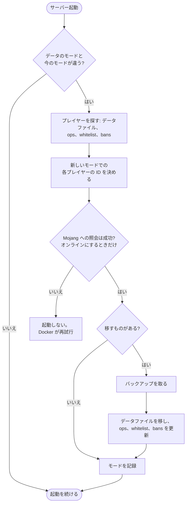

<!-- language-switcher -->
[English](../offline-mode.md) · [हिन्दी](../hi/offline-mode.md) · [Español](../es/offline-mode.md) · [简体中文](../zh-CN/offline-mode.md) · [Português (BR)](../pt-BR/offline-mode.md) · **日本語** · [한국어](../ko/offline-mode.md)

#  オンラインモードとオフラインモード

デフォルトでは、公式の Minecraft アカウントを持つプレイヤーだけが参加できます。オフラインモードにすると、アカウントのない友だちも含めて誰でも参加できます。このページでは、切り替え方、リスク、そしてオフラインモードをより安全にする 2 つの機能、**ユーザー名ルール**と**プレイヤーデータの移行**を説明します。

## EULA とオンラインモードは別物

| 設定 | 意味 | 関係する人 |
|---|---|---|
| `EULA=TRUE` | サーバー運営者であるあなたが Mojang の EULA に同意すること。サーバーを動かすのに必須です。 | あなた |
| `ONLINE_MODE` | プレイヤーが公式アカウントを持っていることを証明する必要があるかどうか | プレイヤー |

プレイヤーが EULA を目にしたり同意したりすることはありません。アカウントのないプレイヤーを締め出しているのはオンラインモードであり、EULA ではありません。

## モードの切り替え

```env
ONLINE_MODE=false     # anyone can join
ONLINE_MODE=true      # official accounts only
```

そのあと `make up` を実行します。何度でも行き来でき、プレイヤーデータもついてきます（[下記](#モードをまたいだプレイヤーデータ) を参照）。

## リスク: ユーザー名は確認されない

オンラインモードでは、各プレイヤーが名前どおりの本人であることを Mojang が保証します。オフラインモードでは、**誰でも好きな名前を入力できます**。あなたの名前も使えてしまい、あなたのオペレーター権限やインベントリを手に入れられます。

- プレイヤーをオペレーターにするのは必要なときだけにしてください。
- **ホワイトリストでは守れません**。名前を照合するだけで、名前は偽装できます。
- 公開のオフラインサーバーでは、初回参加時に各プレイヤーにパスワードを設定させるログインプラグインを追加してください。

## ユーザー名ルール

オフラインモードでは通常ほぼどんな名前でも受け入れられます。内蔵の `UsernameRules` プラグインは、Mojang アカウントと同じルールを適用します:

| ルール | 拒否される例 |
|---|---|
| 3〜16 文字 | `ab`、`ThisNameIsWayTooLong` |
| 使える文字は `A–Z`、`a–z`、`0–9`、`_` のみ | `bad name`、`bad-name`、`café`、`x.y` |
| 大文字小文字を区別せずに一意 | `Steve` がすでに遊んでいるときの `steve` |

ある名前を最初に使ったプレイヤーがそのつづりの持ち主になります。ほかの人には次のように表示されます:

```
The username Steve is already taken.
If it is yours, log in as exactly "Steve".
```

拒否はログに記録されます。オンラインモードでは Mojang がすでにこれらのルールを適用しているため、プラグインは何もしません。`ENFORCE_USERNAME_RULES=false` で無効にできます。

> [!NOTE]
> 統合版（Bedrock）のプレイヤーが参加できるよう [Geyser/Floodgate](https://geysermc.org) を導入すると、その名前には通常 `.Steve` のような接頭辞が付き、このルールでは拒否されます。その場合は `ENFORCE_USERNAME_RULES=false` にしてください。

## モードをまたいだプレイヤーデータ

Minecraft は各プレイヤーのインベントリ、位置、統計、進捗を ID（UUID）ごとに保存しており、この ID はモードによって異なります:

- **オンライン:** Mojang アカウントの ID
- **オフライン:** ユーザー名から計算した ID

何もしなければ、モードを切り替えると全員がスポーン地点で空のインベントリになってしまいます。そうならないよう、`ONLINE_MODE` を変えたあとの最初の起動で、サーバーは次のことを行います:



1. データファイルと `ops.json`、`whitelist.json`、`banned-players.json` からすべてのプレイヤーを見つけます。
2. 新しいモードでの各プレイヤーの ID を決めます。オンラインモードでは Mojang で名前を照会します。
3. **バックアップを取ります。**
4. 各プレイヤーのデータファイルを新しい ID に移し、オペレーター・ホワイトリスト・BAN の項目を更新します。

```
[migrate-players] move Steve: a762f560-… -> 853c80ef-…
[migrate-players] keep Alex123: no official account with this name, data stays under its offline id
```

| 状況 | 結果 |
|---|---|
| プレイヤーが公式アカウントを持っている | データはどちらの方向にもついていきます |
| アカウントのないプレイヤーで、オンラインに切り替える | データはオフライン ID のまま残ります。オンラインモードでは参加できませんが、戻せばすべてそのままです。 |
| 両方の ID にデータがある | 新しいほうのファイルが優先されます。古いほうは `player-migration-conflicts/` に移され、削除はされません。 |
| オンラインへの切り替え中に Mojang に接続できない | 誰のデータも 2 つの ID に分かれないよう、サーバーは起動しません。Docker が自動で再試行します。 |
| 復元で、もう一方のモードのデータが戻ってきた | 通常の切り替えと同じく、次の起動で移行されます |

知っておくこと:

- プレイヤーは名前で照合されます。オフラインのプレイヤーが他人のアカウントの名前を使っていた場合、オンラインに切り替えるとそのデータはそのアカウントのものになります。
- プラグインがプレイヤーごとに保存しているデータ（権限、経済の残高など）は移行されません。
- 移行を無効にするには `MIGRATE_PLAYER_DATA=false` にします。
