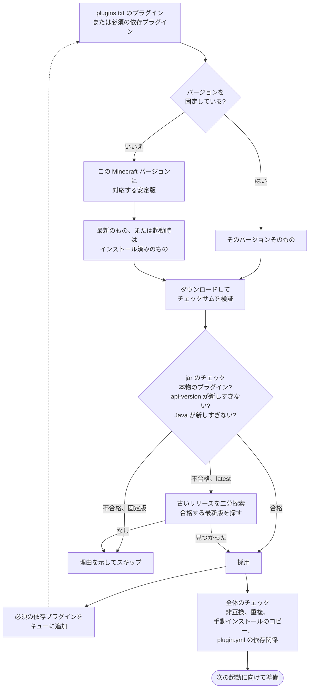

<!-- language-switcher -->
[English](../plugins.md) · [हिन्दी](../hi/plugins.md) · [Español](../es/plugins.md) · [简体中文](../zh-CN/plugins.md) · [Português (BR)](../pt-BR/plugins.md) · **日本語** · [한국어](../ko/plugins.md)

#  プラグイン

このサーバーは **Paper** で動いているので、**プラグイン**（Paper、Spigot、Bukkit の `.jar` ファイル）に対応しています。プラグインはサーバー上だけで動き、プレイヤーが何かをインストールする必要はありません。[Mod](#mod) には対応していません。

プラグインのインストール方法は 2 つあります:

| 方法 | 用途 |
|---|---|
| [`plugins/plugins.txt`](#管理されたプラグイン-pluginstxt)（推奨） | [Modrinth](https://modrinth.com/plugins) や [Hangar](https://hangar.papermc.io) にあるプラグイン。適切なバージョンと依存プラグインが選ばれ、検証され、最新に保たれます。 |
| [手動](#ほかのサイトのプラグイン) | それ以外のすべて。 |

## 管理されたプラグイン: `plugins.txt`

使いたいプラグインを 1 行に 1 つずつ書きます:

```text
# source    project            version
modrinth    luckperms          latest
modrinth    worldguard         latest
hangar      ViaVersion         latest
modrinth    chunky             1.5.3
```

| 項目 | 意味 |
|---|---|
| `source` | `modrinth` または `hangar`（PaperMC 公式のプラグインサイト） |
| `project` | プラグインページのアドレスにある名前。`modrinth.com/plugin/luckperms` なら `luckperms`、`hangar.papermc.io/ViaVersion/ViaVersion` なら `ViaVersion` |
| `version` | このサーバーで動く最新の安定版なら `latest`、またはプラグインページからコピーした正確なバージョン名 |

`#` 以降はコメントです。空行は無視されます。

そのあと実行します:

```bash
make update-plugins
```

| やりたいこと | 方法 |
|---|---|
| プラグインを追加 | 1 行追加して `make update-plugins` |
| すべて更新 | `make update-plugins` |
| プラグインのバージョンを固定、または戻す | `latest` をバージョンに変えて `make update-plugins` |
| プラグインを削除 | その行を消して `make update-plugins`。一緒に入った依存プラグインも削除されます。設定フォルダーは残ります。 |
| 何がなぜ入っているかを見る | `make plugins` |

```
Minecraft 1.20.4 on Java 17 - plugins managed by plugins.txt:
  WorldGuard               7.0.9                  listed
  WorldEdit                7.3.0                  required by WorldGuard
Other plugin jars (added by hand or built in):
  UsernameRules.jar
```

### `make update-plugins` がすること

1. サーバーを動かしたまま、プラグインのバージョンの組み合わせ全体を決め（下記参照）、新しいものを一時フォルダーにダウンロードします。
2. 何も変わっていなければ `all plugins are up to date` と表示して終わります。
3. 変わっていれば、バックアップを取り、プレイヤーに知らせて、サーバーを再起動します。
4. 起動時に、準備したプラグインと入れ替え、削除したプラグインを消します。

サーバーが使用中のプラグインファイルが置き換えられることはありません。

## 互換バージョンの選び方

書くのは使いたいプラグインだけです。リゾルバーはそれぞれについて次のことを行います。



**1. Minecraft のバージョンで絞り込む。**プラグインサイトがあなたのサーバーの Minecraft バージョンに対応すると書いている**安定版**（ベータは除く）だけを対象にします。

**2. 実際の jar を確認する。**プラグインサイトの情報が間違っていることもあるので、候補ごとにダウンロードして調べます:

| チェック | 理由 |
|---|---|
| チェックサムがサイトと一致（Modrinth は SHA-512、Hangar は SHA-256） | 作者が公開したファイルそのものであること |
| `plugin.yml` か `paper-plugin.yml` を含む | 本当に Paper/Bukkit のプラグインであること |
| `api-version` ≤ あなたの Minecraft バージョン | Paper は新しい Minecraft 向けのプラグインを拒否する |
| サーバーの Java 以下の Java 向けにコンパイルされている | 「プラグインが読み込まれない」原因で最も多いもの。プラグインサイトはこれを記録していない |

最新版が不合格なら、リゾルバーは古いリリースをさかのぼって**合格する中で最新のもの**を探します。要件は時間とともに上がる一方なので、100 を超えるリリースがあっても、二分探索なら数回のダウンロードで見つかります:

```
[plugins] WorldEdit: using 7.3.0 because 7.3.9 needs Java 21 (this server runs Java 17)
```

**3. 依存プラグインを入れる。**Modrinth や Hangar で宣言されている必須の依存プラグインも、同じ方法で再帰的に解決します。任意の依存プラグインは入れません。

**4. 各プラグイン自身の依存リストを読む。**`plugin.yml` には依存関係が書いてあるのに、サイトには書いていないプラグインもあります。リゾルバーはそれらをプラグイン名で Hangar と Modrinth から探します。ダウンロードした jar が本当にその名前のプラグインだった場合だけ採用するので、似た名前の別プロジェクトを誤って入れることはありません。

**5. 全体を確認する。**

| 状況 | 結果 |
|---|---|
| Modrinth が 2 つのプラグインを非互換としている | 依存プラグイン（または後から書いたほう）を警告付きでスキップ |
| 同じプラグインを 2 つの入手元から指定 | 先のものを残し、後のものはスキップ。Paper は重複を拒否する |
| 手動でもインストールしているプラグイン | 管理対象のコピーをスキップ |
| 依存プラグインがどこにも見つからない | 警告: "X requires the plugin Y, which could not be found automatically; add it to plugins.txt" |

例: プラグインを 4 つ書いた Minecraft 1.20.4 のサーバーで、依存プラグインが 3 つ追加され、Java 17 向けに古い WorldEdit が選ばれました:

```
[plugins] WorldEdit: using 7.3.0 because 7.3.9 needs Java 21 (this server runs Java 17)
[plugins] + Multiverse-Portals 5.3.0  (listed)
[plugins] + WorldGuard 7.0.9  (listed)
[plugins] + ViaBackwards 5.12.2  (listed)
[plugins] + LuckPerms v5.5.71-bukkit  (listed)
[plugins] + Multiverse-Core 5.8.2  (required by Multiverse-Portals)
[plugins] + WorldEdit 7.3.0  (required by WorldGuard)
[plugins] + ViaVersion 5.12.2  (required by ViaBackwards)
```

### 何かが変わったとき

| 変更 | 起きること |
|---|---|
| `plugins.txt` を編集した | `make update-plugins` か、次の起動で反映 |
| Minecraft か Java のバージョンを変えた | 次の起動ですべてのプラグインを再解決。新しいバージョンに合うリリースへ上がったり下がったりすることがある。 |
| 何も変わっていない | 起動時に Modrinth や Hangar へまったく接続しない |

起動時のリゾルバーは、すべてのチェックに合格する限り、インストール済みのバージョンを優先します。プラグインを新しいバージョンに上げるのは `make update-plugins`（または毎日の自動更新）だけです。

### 固定したバージョン

固定したバージョン（`modrinth chunky 1.5.3`）は、探索せずにそのまま使います:

- プラグインサイトがあなたの Minecraft バージョンを挙げていなければ警告が出ますが、インストールはされます。
- jar がまったく動かない場合（Java が違う、API が新しい）は拒否されます。

### 失敗してもサーバーは止まらない

| 問題 | 結果 |
|---|---|
| Modrinth や Hangar に接続できない、入力ミス、削除されたプロジェクト | 警告。インストール済みのバージョンは残り、サーバーは起動し、次の起動で再試行。 |
| このサーバーで動くバージョンがない | 理由を説明する警告。新しい Java で解決しそうなら `JAVA_VERSION` のヒントも出る。読み込めない既存のインストールは削除。 |
| `update-plugins` が同時に 2 つ（手動と定期） | 2 つ目は拒否: "another plugin install/update is already running; try again in a minute" |

## 自動更新

```env
PLUGIN_AUTO_UPDATE=true
PLUGIN_UPDATE_TIME=04:00
TZ=Asia/Tokyo
```

毎日 `PLUGIN_UPDATE_TIME` に:

1. サーバーがプラグインの更新を確認します。なければ何も起きません。
2. あれば、再起動の 5 分前、1 分前、10 秒前にプレイヤーのチャットに警告が出ます。
3. バックアップを取ります。
4. サーバーが再起動して更新を反映します。

これらの設定を変えたら `make up` を実行してください。自動更新は**デフォルトでオフ**です。プラグインの更新では、設定ファイルの形式や動作が変わることがときどきあります。大事なサーバーでは、結果を確認できるときに `make update-plugins` を実行し、頼りにしているバージョンは固定してください。

## ほかのサイトのプラグイン

Modrinth や Hangar にないプラグインや、Hangar が外部リンクしか載せていないプラグインの場合:

```bash
docker compose cp SomePlugin.jar mc:/data/plugins/
make restart
```

削除するには:

```bash
docker compose exec mc rm /data/plugins/SomePlugin.jar
make restart
```

手動で入れた jar に `plugins.txt` が手を出すことはありません。依存関係を確認するときは、インストール済みとして扱われます。

## プラグインの置き場所

| パス（`mc-data` ボリューム内） | 内容 |
|---|---|
| `/data/plugins/*.jar` | すべてのプラグイン jar |
| `/data/plugins/<Name>/` | 各プラグインの設定とデータ |
| `/data/plugins/.managed/lock.tsv` | `plugins.txt` が入れたもの: バージョン、ファイル、チェックサム、理由 |
| `/data/plugins/.managed/pending/` | 次の起動に向けて準備した更新 |

これらはすべてバックアップに含まれます（一時フォルダーを除く）。

## 内蔵プラグイン

`UsernameRules` はイメージに含まれています。オフラインモードで Mojang のユーザー名ルールを適用し（[オンラインモードとオフラインモード](offline-mode.md#ユーザー名ルール) を参照）、`plugins.txt` ではなく `ENFORCE_USERNAME_RULES` で制御します。

## Mod

Mod（Fabric、Forge、NeoForge）はゲームそのものを変えます。Paper では読み込めず、多くのコンテンツ系 Mod は**プレイヤー全員**もインストールする必要があります。Mod を使うには、このイメージを Paper ではなく Fabric や NeoForge で作り直すことになります。このプロジェクトの大部分（バックアップ、ヘルスチェック、安全な停止、プレイヤーの移行）はそのまま使えますが、Paper のプラグインは使えません。両方を動かそうとする「ハイブリッド」サーバーは、信頼性が必要なサーバーにはおすすめしません。

## 制限

- 自動で探すのは Modrinth と Hangar だけです。
- 任意の依存プラグインは入れません。必要ならリストに追加してください。
- jar のチェックでよくある非互換は見つけられますが、チェックに合格しても、内部 API の変更が原因で実行時に失敗するプラグインはありえます。プラグインを更新する前に毎回取るバックアップが、そのときの備えです。
- プラグインがプレイヤーの UUID ごとに保存しているデータは、オンラインモードとオフラインモードを切り替えても移行されません。
