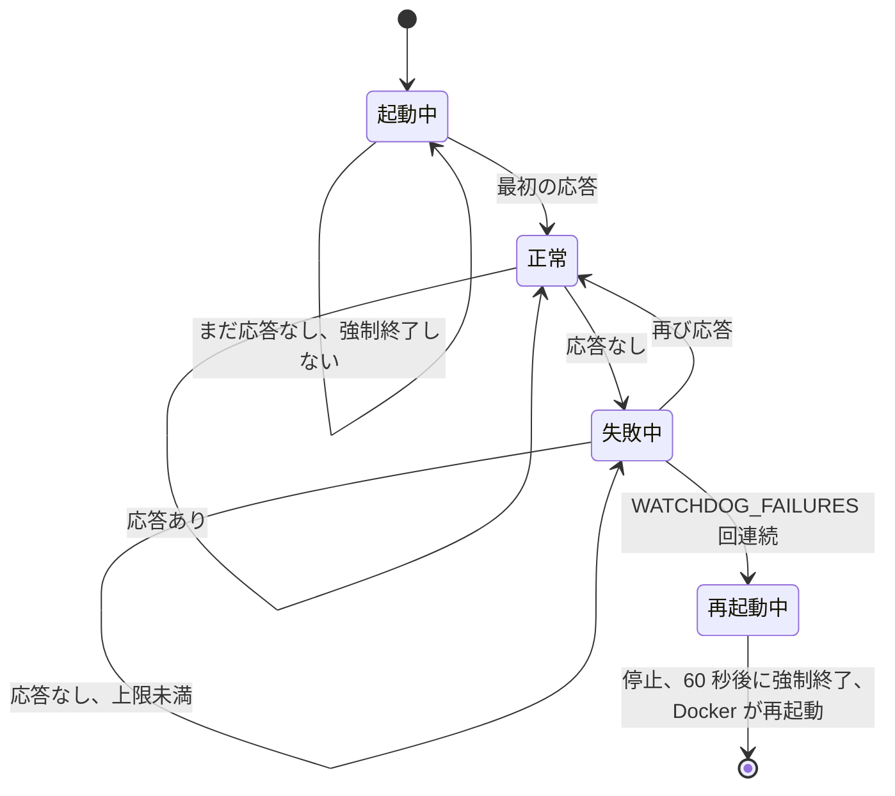
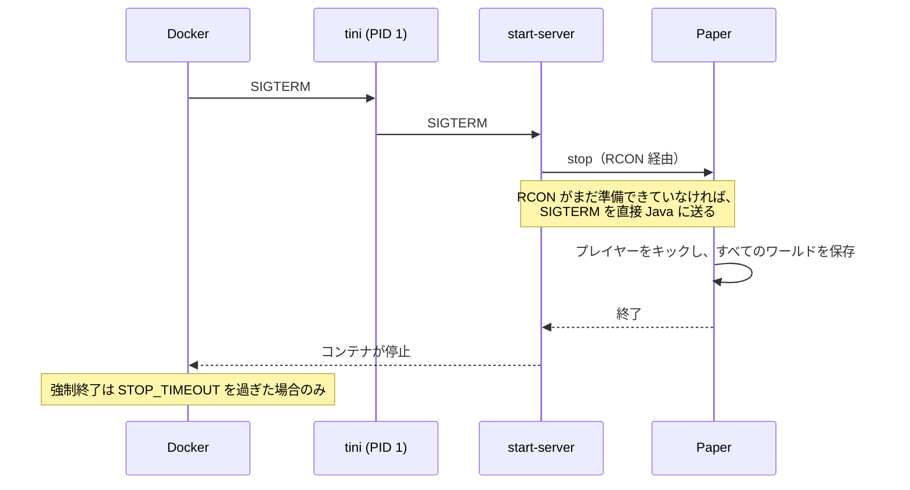

<!-- language-switcher -->
[English](../reliability.md) · [हिन्दी](../hi/reliability.md) · [Español](../es/reliability.md) · [简体中文](../zh-CN/reliability.md) · [Português (BR)](../pt-BR/reliability.md) · **日本語** · [한국어](../ko/reliability.md)

#  信頼性

このページでは、誰も見ていなくてもサーバーを動かし続け、ワールドを守る仕組みをすべて説明します。

| 仕組み | 防ぐもの |
|---|---|
| [再起動ポリシー](#自動再起動) | クラッシュ、メモリ不足エラー、ホストの再起動 |
| [ヘルスチェック](#ヘルスチェック) | サーバーが本当に動いているかわからない状態 |
| [フリーズ検知ウォッチドッグ](#フリーズ検知ウォッチドッグ) | 動いてはいるが応答しない、フリーズしたサーバー |
| [安全な停止](#安全な停止) | 停止時のワールドの消失や破損 |
| [メモリの安全](#メモリの安全) | メモリ不足による強制終了のループ |
| [設定の検証](#設定の検証) | 入力ミスによるクラッシュループや、機能が黙って止まること |
| [バージョンとデータの保護](#バージョンとデータの保護) | ワールドのダウングレード、プレイヤーデータの消失 |
| [バックアップ](backups.md) | それ以外のすべて |

## 自動再起動

どちらのコンテナも `restart: unless-stopped` を使っています。クラッシュ、メモリ不足、ウォッチドッグ、誰かが `/stop` と入力した場合など、理由を問わずサーバープロセスが終了すると Docker が再び起動します。ホストを再起動しても、Docker が起動するとすぐに復帰します。停止したままにするのは `make down`（または `docker stop`）だけです。

## ヘルスチェック

Docker は 30 秒ごとにコンテナ内で `mc-health` を実行します:

1. ゲームポートに**サーバーリスト ping** を送ります。Minecraft のマルチプレイ画面が送るのと同じリクエストです。
2. サーバーがサーバーリストから隠されている（`enable-status=false`）ために拒否された場合は、RCON の `list` コマンドで確認します。

チェックが 1 回通れば `make status` に `healthy` と表示されます。新しいサーバーにはワールド生成のために **5 分**の猶予があります。`backup` コンテナはサーバーが healthy になるまで起動を待ちます。

## フリーズ検知ウォッチドッグ

プロセスは生きたままサーバーがフリーズすることがあります。デッドロックや、無限ループにはまったプラグインなどです。Docker は終了したプロセスしか再起動しないので、コンテナ内のバックグラウンドのウォッチドッグがこれに対処します:

- `WATCHDOG_INTERVAL` 秒（デフォルト 60）ごとにヘルスチェックを実行します。
- カウントを始めるのは**サーバーが一度応答したあと**だけなので、初回起動が遅くても強制終了されることはありません。
- `WATCHDOG_FAILURES` 回連続で失敗すると（デフォルト 5 回、約 5 分）、通常の停止シグナルを送り、60 秒待ってから強制終了します。そのあと Docker がサーバーを再起動します。




```
[start-server] Watchdog: server not responding (1/5)
...
[start-server] Watchdog: server is hung, killing it
```

Paper にもゲームティックのフリーズを検知する独自のウォッチドッグがあります。このウォッチドッグは、Paper のものでは見えないフリーズも捕まえます。無効にするには `WATCHDOG_INTERVAL=0` にしてください。

## 安全な停止

Minecraft サーバーをプロセスごと強制終了すると、最後の自動保存以降の内容がすべて失われ、書き込み中のチャンクが壊れることがあります。ここではすべての停止が同じ手順を通ります:




1. `tini`（PID 1）が Docker の停止シグナルを `start-server` に渡します。
2. `start-server` が RCON で `stop` を送ります。Paper はプレイヤーをキックし、すべてのワールドを保存して終了します。
3. RCON がまだ準備できていない場合（起動中など）は、Java に通常の停止シグナルが送られます。その場合も Paper は保存します。

Docker は強制終了の前に最大 `STOP_TIMEOUT`（デフォルト `2m`）待ちます。非常に大きなワールドや遅いディスクでは増やしてください:

```env
STOP_TIMEOUT=5m
```

## メモリの安全

| リスク | 対策 |
|---|---|
| プレイ中にヒープが増えてホストのメモリが足りなくなる | ヒープは起動時に固定され（`-Xms` = `-Xmx` = `MEMORY`）、あらかじめ確保されるので、メモリの問題はプレイ中ではなく起動時に表面化します |
| ヒープがコンテナに対して大きすぎ、カーネルが強制終了（exit 137）を繰り返す | `MEMORY` + 512M が `CONTAINER_MEMORY` に収まらない限り起動を拒否します。エラーには設定すべき値が出ます。 |
| Java のヒープが尽きて、不安定なまま動き続ける | `-XX:+ExitOnOutOfMemoryError` によりきれいに終了し、Docker が再起動します |

ガベージコレクションには広く使われている G1 用の Aikar's flags を使い、12 GB 以上では大きなヒープ向けの設定に切り替えて、停止時間を短く予測しやすくしています。

## 設定の検証

何かが起動する前に設定を確認します。不正な値があると、クラッシュループや終わらないバックアップループ、黙って止まる機能を生む代わりに、設定名を示すメッセージとともに起動を止めます:

| 設定 | 拒否される値の例 | メッセージ |
|---|---|---|
| `EULA` | `false` | EULA に同意する必要がある |
| `RCON_PASSWORD` | 仮の値、またはバックスラッシュを含む値 | 理由と生成方法を説明 |
| `MEMORY` | `2GB` | `2G` や `1536M` の形式にする |
| `MEMORY` / `CONTAINER_MEMORY` | `3G` のコンテナで `4G` | 設定すべき `CONTAINER_MEMORY` を提示 |
| `WATCHDOG_INTERVAL`、`WATCHDOG_FAILURES` | `1m` | 整数にする |
| `PLUGIN_UPDATE_TIME` | `25:00` | `HH:MM` にする |
| `BACKUP_INTERVAL` | `abc` | `30m`、`6h`、`1d` の形式にする |
| `BACKUP_KEEP` | `0` | 1 以上にする |
| `MC_VERSION` | `1.16.5`、`9.9` | 古すぎる、または存在しない |
| `PAPER_BUILD` | `MC_VERSION=latest` と組み合わせた数字 | 具体的なバージョンが必要 |

## バージョンとデータの保護

- **ワールドのダウングレードは拒否され**、アップグレードの前にはバックアップを取ります。[Minecraft のバージョン](minecraft-versions.md) を参照。
- **オンライン/オフラインモードを切り替えても、プレイヤーデータはプレイヤーについていきます。**先にバックアップを取り、移行が中途半端なままサーバーが起動することはありません。[オンラインモードとオフラインモード](offline-mode.md) を参照。
- **プラグインの問題で起動が止まることはありません。**ダウンロードに失敗してもインストール済みのバージョンが残り、読み込めないプラグインはスキップされます。[プラグイン](plugins.md) を参照。

## 最小権限と分離

- サーバーは特権のないユーザー（`PUID`/`PGID`）で動作します。root は起動時にファイルの所有者を直すために一瞬使うだけです。
- RCON にはプライベートな Compose ネットワーク内からしかアクセスできません。
- Docker のログローテーション（コンテナごとに 5 × 10 MB）により、ログでディスクがいっぱいになることはありません。
