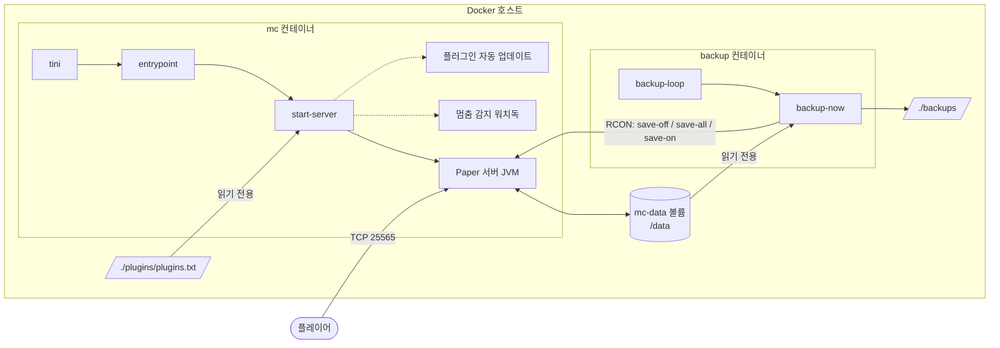
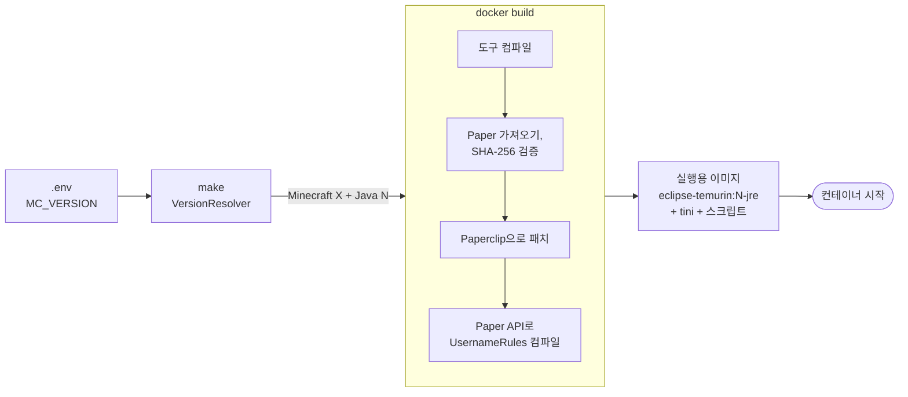
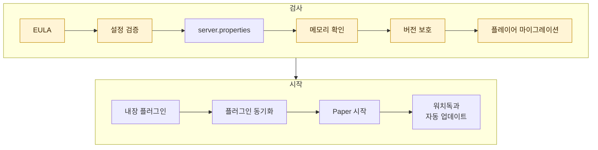

<!-- language-switcher -->
[English](../architecture.md) · [हिन्दी](../hi/architecture.md) · [Español](../es/architecture.md) · [简体中文](../zh-CN/architecture.md) · [Português (BR)](../pt-BR/architecture.md) · [日本語](../ja/architecture.md) · **한국어**

#  아키텍처

이 페이지는 프로젝트가 어떻게 구성되어 있는지 설명합니다. 무엇이 어디서 실행되는지, 빌드와 시작 때 무슨 일이 일어나는지, 데이터가 어디에 있는지입니다.

## 전체 그림



| 구성 요소 | 설명 |
|---|---|
| **이미지** `local/paper-server` | `Dockerfile`로 로컬에서 빌드합니다. 이미지 하나로 두 컨테이너를 모두 실행합니다. |
| **`mc` 컨테이너** | 게임 서버와 보조 프로세스(워치독, 선택 사항인 플러그인 자동 업데이트). |
| **`backup` 컨테이너** | 같은 이미지를 `backup` 명령으로 시작한 것. 정기 백업을 만듭니다. |
| **`mc-data` 볼륨** | 서버가 기록하는 모든 것: 월드, 설정, 플러그인, 플레이어 데이터. 다시 빌드해도 남아 있습니다. |
| **`./backups`** | 백업 아카이브. 호스트에 있어서 어디로든 복사할 수 있습니다. |
| **`./plugins/plugins.txt`** | 플러그인 목록. 서버에 읽기 전용으로 마운트됩니다. |
| **RCON** | Minecraft의 원격 콘솔. 스크립트가 월드를 저장하고 명령을 보내는 데 씁니다. Compose 네트워크 안에서만 접근할 수 있고, 호스트에 공개되는 일은 없습니다. |

## `make up`부터 서버 실행까지




### 1. 버전 결정 (내 컴퓨터에서)

`make`는 임시 `eclipse-temurin:25-jdk` 컨테이너에서 `VersionResolver`를 실행합니다. PaperMC API에 `MC_VERSION`에 맞는 Paper 릴리스와 그 릴리스에 필요한 Java를 물어보고, 그에 맞는 Java LTS(17, 21, 25)를 고릅니다:

```
==> Minecraft 1.21.4 (Paper) on Java 21
```

결과는 이미지 빌드에 전달됩니다. 내 컴퓨터에는 Docker만 있으면 됩니다.

### 2. 이미지 빌드

`Dockerfile`에는 두 단계가 있습니다.

**빌드 단계**(`eclipse-temurin:25-jdk`):

1. 프로젝트의 Java 도구(`tools/*.java`)를 Java 17용으로 컴파일해서, 서버가 어떤 Java를 쓰든 실행되게 합니다.
2. `scripts/fetch-paper.sh`를 실행합니다. 선택한 버전의 최신 안정 Paper 빌드를 찾고, 선택한 Java가 충분히 새로운지 확인하고, jar를 내려받아 **SHA-256 체크섬을 검증**합니다.
3. Paper의 런처(Paperclip)가 전체 서버 jar를 만들게 합니다. 이때 Mojang에서 공식 Minecraft 서버를 내려받습니다. Paperclip은 내려받기가 실패해도 정상 종료할 수 있기 때문에 이 단계는 재시도됩니다.
4. 내장 `UsernameRules` 플러그인을 그 버전의 정확한 Paper API로 컴파일합니다.

**실행 단계**(`eclipse-temurin:<17|21|25>-jre`):

- 검증된 Paper jar, 도구, 내장 플러그인, `scripts/`의 스크립트
- PID 1인 `tini`. 신호가 서버에 전달되게 하고 좀비 프로세스를 정리합니다

### 3. 컨테이너 시작

모든 컨테이너는 `tini → entrypoint`로 시작합니다. entrypoint는:

1. 필요하면 `/data`와 `/backups`의 소유자를 `PUID:PGID`로 고칩니다.
2. root 권한을 내려놓습니다.
3. 요청된 모드를 실행합니다: `server`, `backup`, `backup-now`, `restore`.

### 4. 서버 시작 순서 (`start-server`)

각 단계는 순서대로 실행됩니다. 어디서든 실패하면 잘못된 상태로 시작하는 대신, 명확한 메시지와 함께 시작을 멈춥니다.




강조된 단계는 명확한 메시지와 함께 시작을 멈출 수 있습니다.

| # | 단계 | 설명 |
|---|---|---|
| 1 | EULA 확인 | `EULA=TRUE`가 아니면 시작을 거부합니다. |
| 2 | 설정 검증 | RCON 비밀번호, `MEMORY` 형식, 숫자, 시간 형식. [안정성](reliability.md#설정-검증) 참고. |
| 3 | `server.properties` 기록 | `.env`의 게임 설정을 적용합니다. 포트, 수신 주소, RCON 설정은 항상 강제로 지정합니다. |
| 4 | 메모리 확인 | 컨테이너 메모리 한도에 들어가지 않는 힙을 거부합니다. |
| 5 | 월드 버전 보호 | 업그레이드 전에 백업하고 다운그레이드를 거부합니다. [Minecraft 버전](minecraft-versions.md) 참고. |
| 6 | 플레이어 데이터 마이그레이션 | 온라인/오프라인 모드가 바뀌었다면 플레이어 데이터를 새 ID로 옮깁니다. [온라인 모드와 오프라인 모드](offline-mode.md) 참고. |
| 7 | 내장 플러그인 | `UsernameRules.jar`를 설치하거나 제거합니다(`ENFORCE_USERNAME_RULES`). |
| 8 | 플러그인 동기화 | 준비된 플러그인 업데이트를 적용하고, `plugins.txt`나 Minecraft, Java가 바뀌었으면 다시 결정합니다. 시작을 막지는 않습니다. |
| 9 | Paper 시작 | 조정된 플래그로 JVM을 실행합니다. |
| 10 | 보조 프로세스 | 멈춤 감지 워치독을 시작하고, 켜져 있다면 플러그인 자동 업데이트 스케줄러도 시작합니다. |

### 5. 종료 순서

```
docker stop / make down / make restart
  → tini forwards SIGTERM
  → start-server sends "stop" over RCON (or SIGTERM to Java if RCON isn't up yet)
  → Paper saves every world and exits
  → container stops
```

Docker는 강제 종료하기 전에 `STOP_TIMEOUT`(기본 2분)을 기다립니다.

## 데이터 구성

`mc-data` 볼륨(`/data`) 안:

```
/data
├── world/                     # 월드 (이름은 LEVEL_NAME에서)
├── plugins/
│   ├── *.jar                  # 설치된 플러그인
│   ├── <Plugin>/              # 각 플러그인 자체 설정
│   └── .managed/
│       ├── lock.tsv           # plugins.txt가 설치한 플러그인과 버전
│       └── pending/           # 준비된 플러그인 업데이트, 다음 시작 때 적용
├── server.properties, bukkit.yml, spigot.yml, config/   # 서버 설정
├── ops.json, whitelist.json, banned-players.json        # 관리 목록
├── .mc-version                # 월드가 마지막으로 실행된 Minecraft 버전
├── .player-uuid-mode          # 플레이어 데이터가 맞춰진 온라인/오프라인 모드
├── cache/, libraries/, versions/   # Paper가 다시 만듦; 백업에서 제외
└── logs/                      # 서버 로그; 백업에서 제외
```

## 외부 서비스

| 서비스 | 용도 | 시점 |
|---|---|---|
| Docker Hub(`eclipse-temurin`) | Java 이미지 | 빌드 |
| PaperMC API(`fill.papermc.io`) | Paper 버전, 다운로드, 체크섬 | 빌드, `make versions` |
| Mojang(`piston-data.mojang.com`) | Paper가 패치하는 공식 서버 jar | 빌드, 첫 시작 |
| Mojang(`api.mojang.com`) | 사용자 이름 → 계정 ID | 기존 플레이어가 있는 상태에서 온라인 모드로 바꿀 때만 |
| Modrinth, Hangar | 플러그인 정보와 다운로드 | 플러그인 설치와 업데이트 때만 |

서드파티 서버 이미지나 스크립트는 사용하지 않습니다. 내려받은 모든 서버와 플러그인 jar는 체크섬을 검증합니다.

## 소스 구성

```
Dockerfile, compose.yaml, Makefile, .env.example
scripts/
  entrypoint.sh       소유권 수정, root 권한 내려놓기, 모드 분기
  start-server.sh     시작 순서, 신호 처리, 워치독, 자동 업데이트
  fetch-paper.sh      Paper 다운로드 결정과 검증 (빌드 시)
  backup-now.sh       일관되고, 잠금되고, 검증된 백업 한 번
  backup-loop.sh      백업 스케줄러
  restore-backup.sh   임시 폴더를 거치는 안전한 복원
  plugins, rcon-cli, mc-health   Java 도구를 감싼 얇은 래퍼
tools/                의존성 없는 Java 도구, mctool.jar로 컴파일
  McTool.java         진입점; RCON 클라이언트와 서버 목록 ping
  VersionResolver.java  Minecraft 버전 → Paper 릴리스 + Java
  PluginManager.java  plugins.txt 해석, 다운로드, 검증
  PlayerMigrator.java 온라인/오프라인 UUID 마이그레이션
  Json.java, Yaml.java  최소한의 파서
plugins/
  plugins.txt         플러그인 목록
  username-rules/     내장 플러그인 소스
docs/                 이 문서
  assets/             배너와 아이콘 (직접 만든 SVG)
```
