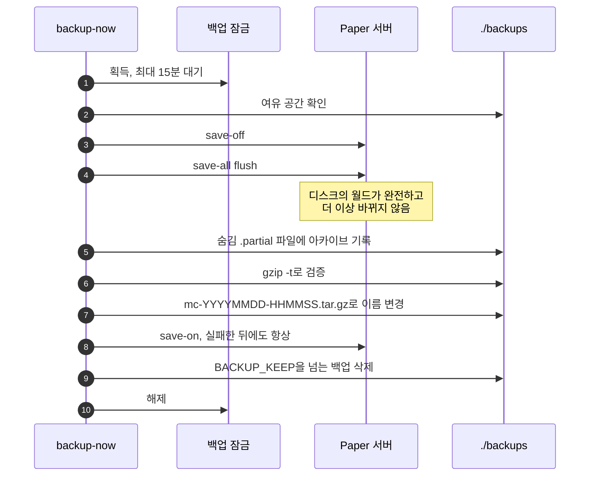
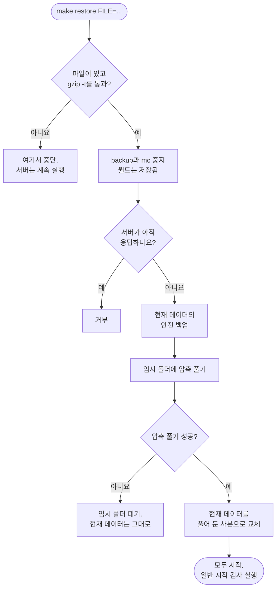

<!-- language-switcher -->
[English](../backups.md) · [हिन्दी](../hi/backups.md) · [Español](../es/backups.md) · [简体中文](../zh-CN/backups.md) · [Português (BR)](../pt-BR/backups.md) · [日本語](../ja/backups.md) · **한국어**

#  백업과 복원

백업은 자동으로 실행되고, 플레이어가 접속 중이어도 일관성을 유지하며, 유효한 것으로 치기 전에 검증합니다. 복원은 실수 한 번으로 현재 월드를 잃지 않도록 설계되어 있습니다.

## 한눈에 보기

| | |
|---|---|
| **일정** | `BACKUP_INTERVAL`(기본 `1h`)마다 `backup` 컨테이너가 실행 |
| **보관** | 가장 최근의 `BACKUP_KEEP`개(기본 `24`) |
| **위치** | 호스트의 `./backups/`에 `mc-YYYYMMDD-HHMMSS.tar.gz`(UTC 시각)로 저장 |
| **수동** | `make backup` |
| **목록** | `make backups` |
| **복원** | `make restore FILE=mc-….tar.gz` |

**위험한 작업 전에도 매번 자동으로** 백업합니다:

| 이 작업 전에 | 실행 주체 |
|---|---|
| 월드를 새 Minecraft 버전으로 업그레이드 | `start-server` |
| 온라인과 오프라인 모드 사이에서 플레이어 데이터 마이그레이션 | `start-server` |
| 플러그인 업데이트 적용(`make update-plugins`, 자동 업데이트) | 업데이트 명령어 |
| 백업 복원(교체될 내용의 "안전 백업") | `restore` |

## 백업에 들어 있는 것

서버를 정확히 원래대로 되돌리는 데 필요한 모든 것: 월드, `server.properties`와 기타 설정, 플러그인과 그 설정, 플레이어 데이터, 운영자·화이트리스트·차단 목록, 버전 기록.

Paper가 다시 만들거나 임시 파일이라서 빼는 것:

| 제외 | 이유 |
|---|---|
| `cache/`, `libraries/`, `versions/` | 시작할 때 Paper가 내려받거나 생성 |
| `logs/` | 복원에 필요 없고, 클 수 있음 |
| `plugins/.managed/pending/` | 준비된 플러그인 업데이트. 다음 업데이트 때 다시 만들어짐 |
| `plugins/spark/tmp/` | 프로파일러 임시 파일 |

## 백업이 일관성을 유지하는 방법

Minecraft 월드는 서버가 끊임없이 다시 쓰는 수천 개의 파일입니다. 쓰는 도중에 복사하면 반쯤 저장된 청크가 담길 수 있습니다. 그래서 각 백업은 다음을 합니다:



1. **백업 잠금을 얻습니다.** `mc`와 `backup` 두 컨테이너를 통틀어 한 번에 하나의 백업만 실행됩니다. 그렇지 않으면 첫 번째 백업이 아직 읽는 중에 두 번째 백업이 자동 저장을 다시 켤 수 있습니다. 백업은 잠금을 최대 15분까지 기다립니다.
2. **디스크 공간을 확인합니다**(아래 참고).
3. **RCON으로 자동 저장을 멈추고 기록을 마칩니다**: `save-off` 다음 `save-all flush`. 메모리에 있던 모든 것이 이제 디스크에 있고 그대로 유지됩니다.
4. **`/data`를 아카이브합니다.** 숨김 `.partial` 파일에 기록합니다.
5. **`gzip -t`로 아카이브를 검증합니다.** 손상된 아카이브는 버리고 이전 백업은 남겨 둡니다.
6. **정식 이름으로 바꿉니다.** 반쯤 쓰인 백업이 진짜처럼 보이는 일은 없습니다.
7. **`save-on`으로 자동 저장을 다시 켭니다.** 위에서 무엇이 실패해도 이것은 실행됩니다.
8. **`BACKUP_KEEP`을 넘는 가장 오래된 백업을 삭제합니다.**

그동안 플레이어는 계속 플레이할 수 있습니다. 아무것도 공지되거나 멈추지 않습니다.

RCON에 연결할 수 없으면(예: 서버가 멈춰 있을 때) 3단계 없이 백업하고 그 사실을 알립니다. 서버가 실행 중이 아니라면 안전합니다.

## 디스크 공간 안전

디스크를 가득 채우는 백업은 서버가 월드를 저장하지 못하게 만들어 손상 위험을 키울 수 있습니다. 시작하기 전에 백업은 자기 크기를 추정하고(마지막 백업 크기 + 20%, 첫 백업이면 데이터 크기의 60%), 그만큼에 **512 MB를 더한** 여유 공간이 없으면 실행을 거부합니다:

```
ERROR: not enough disk space: about 102M needed plus 512M headroom, 20M free. Lower BACKUP_KEEP or free space.
```

정기 실행 루프는 실패를 기록하고 다음 주기에 다시 시도합니다.

## 복원하기

```bash
make backups                                   # pick one
make restore FILE=mc-20261030-175220.tar.gz
```

순서대로 일어나는 일:



1. **아무것도 건드리기 전에, 내 컴퓨터에서:** 파일이 있어야 하고 `gzip -t`를 통과해야 합니다. 오타나 손상된 파일은 여기서 멈추고, 서버는 계속 실행됩니다.
2. `backup`과 `mc` 컨테이너를 멈춥니다(월드는 저장됨).
3. 서버가 아직 응답하면 복원은 진행을 거부합니다.
4. 현재 상태의 **안전 백업**을 만듭니다.
5. 백업을 사용 중인 데이터 옆의 **임시 폴더**에 풉니다. 압축 풀기가 실패하면(예: 디스크가 가득 참) 현재 데이터는 그대로 남습니다.
6. 그때서야 현재 데이터를 풀어 둔 사본으로 교체합니다.
7. 모든 것이 다시 시작됩니다.

복원한 뒤에도 일반적인 시작 검사는 그대로 적용됩니다:

- 서버보다 **새로운** Minecraft 버전에서 만든 백업은 [다운그레이드 방지](minecraft-versions.md#다운그레이드)에 의해 거부됩니다.
- **오래된** 버전에서 만든 백업은 업그레이드되며, 그 전에 한 번 더 백업합니다.
- 다른 온라인/오프라인 모드에서 만든 백업은 플레이어 데이터가 [마이그레이션](offline-mode.md#모드를-넘나드는-플레이어-데이터)됩니다.
- 플러그인은 `plugins.txt`에 맞춰 다시 동기화됩니다.

안전 백업도 일반 백업입니다. 최신 `BACKUP_KEEP`개보다 오래되면 일반적인 정리 과정에서 삭제되므로, 보관하고 싶다면 다른 곳에 복사해 두세요.

## 새 머신에서 복원하기

1. 새 머신에 프로젝트를 설정합니다([시작하기](getting-started.md)). `MC_VERSION`은 백업과 **같거나** 더 새로운 버전을 씁니다.
2. 백업 파일을 `./backups/`에 복사합니다.
3. 컨테이너와 볼륨이 만들어지도록 `make up`을 한 번 실행합니다.
4. `make restore FILE=…`을 실행합니다.

## 외부 사본

`./backups`의 백업은 서버와 같은 디스크에 있습니다. 실수와 손상은 막아 주지만 머신 자체를 잃는 것은 막지 못합니다. 정기적으로 다른 곳에 복사하세요. 예시는 [배포](deployment.md#외부-백업)를 참고하세요.

## 백업을 직접 열어 보기

백업은 평범한 `tar.gz` 아카이브입니다:

```bash
tar -tzf backups/mc-20261030-175220.tar.gz | head        # list contents
mkdir /tmp/old && tar -xzf backups/mc-….tar.gz -C /tmp/old ./world/
```
