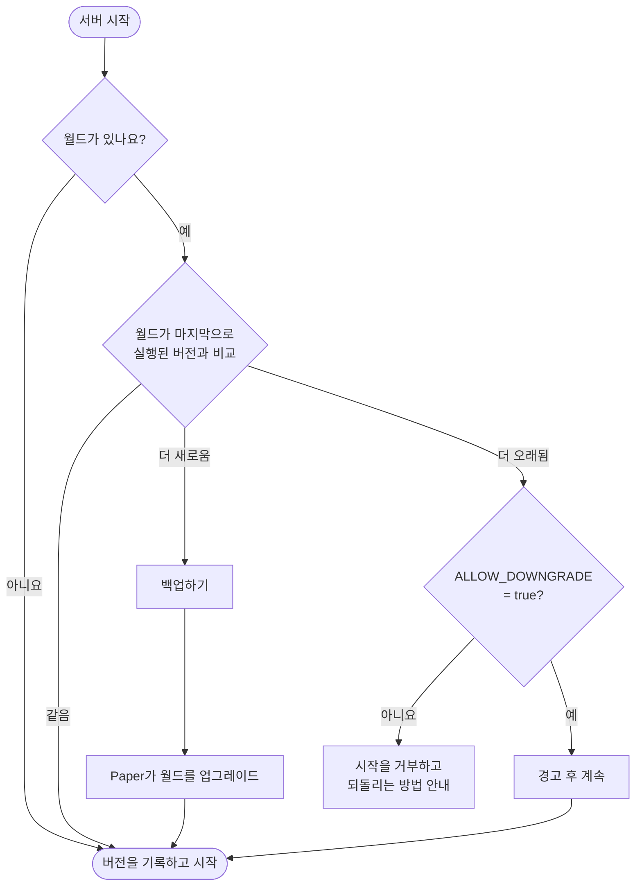

<!-- language-switcher -->
[English](../minecraft-versions.md) · [हिन्दी](../hi/minecraft-versions.md) · [Español](../es/minecraft-versions.md) · [简体中文](../zh-CN/minecraft-versions.md) · [Português (BR)](../pt-BR/minecraft-versions.md) · [日本語](../ja/minecraft-versions.md) · **한국어**

#  Minecraft 버전

**1.17**부터 최신 릴리스까지 어떤 Minecraft 버전이든 실행할 수 있습니다. 알맞은 Java가 자동으로 선택되고, 버전이 바뀔 때 월드가 보호됩니다.

## 버전 고르기

**처음 `make up`을 실행하기 전에** `.env`에서 설정하세요:

```env
MC_VERSION=1.21.4
```

사용 가능한 값:

- `latest`: **안정** Paper 빌드가 있는 가장 최신 Minecraft 버전. 이미지를 빌드할 때마다 다시 결정됩니다.
- `1.20.4`, `1.21.4`, `26.3` 같은 정확한 버전

사용 가능한 버전을 보려면:

```bash
make versions
```

```
MINECRAFT  JAVA   PAPER SUPPORT
26.3       25     supported
26.2       25     deprecated
1.21.11    21     unsupported
...
```

"Paper support" 열은 PaperMC가 직접 밝힌 상태입니다. "unsupported" 버전도 여전히 동작하지만, 더 이상 PaperMC의 수정을 받지 않습니다.

## Java를 고르는 방식

Minecraft 버전마다 필요한 최소 Java 버전이 있습니다. `make`는 PaperMC API에 물어보고 그 조건을 만족하는 가장 오래된 Java LTS를 고릅니다. 그 버전이 바로 그 Java로 빌드되고 테스트되었기 때문입니다:

| Minecraft | Java |
|---|---|
| 1.17 – 1.20.4 | 17 |
| 1.20.5 – 1.21.x | 21 |
| 26.x | 25 |

그다음 해당 버전의 공식 `eclipse-temurin` Java 이미지로 이미지를 빌드합니다. `make up`은 결정한 내용을 보여 줍니다:

```
==> Minecraft 1.20.4 (Paper) on Java 17
```

더 새로운 Java를 강제하려면, 예를 들어 필요한 플러그인이 Java 21용으로 빌드되었는데 1.20.4를 실행 중이라면, `.env`에서 `JAVA_VERSION=21`로 설정하세요. 선택한 Minecraft 버전에 비해 너무 오래된 Java는 거부됩니다.

Minecraft **1.16.5 이하**는 Java 8 또는 11이 필요하므로 지원하지 않습니다. `make`가 명확한 메시지와 함께 거부합니다.

## 버전이 바뀌면 일어나는 일

서버는 시작할 때마다 현재 Minecraft 버전을 월드가 마지막으로 실행된 버전과 비교합니다:



## 업그레이드

1. 새 버전에 대한 플러그인 지원 여부를 확인합니다(선택 사항. 플러그인은 자동으로 다시 결정됩니다).
2. `.env`에서 `MC_VERSION`을 바꿉니다.
3. `make up`을 실행합니다.

새 버전으로 처음 시작할 때:

```
[start-server] Upgrading world from Minecraft 1.20.4 to 1.21.4; taking a backup first
[backup] Saved /backups/mc-20261030-195423.tar.gz (51M)
[plugins] plugins.txt, Minecraft or Java changed: resolving plugins for Minecraft 1.21.4 on Java 21
[plugins] ~ WorldEdit 7.3.0 -> 7.4.2
```

- **Minecraft가 월드를 업그레이드하기 전에 백업합니다.** 업그레이드가 잘못되면 그 백업을 복원하세요.
- **플러그인은 새 Minecraft와 Java 버전에 맞게 다시 결정됩니다.** [플러그인](plugins.md)을 참고하세요.

## 다운그레이드

Minecraft는 더 새로운 버전에서 저장된 월드를 안전하게 열 수 없습니다. 청크와 아이템이 사라지거나 손상될 수 있습니다. 그래서 서버는 각 월드가 마지막으로 실행된 버전을 `/data/.mc-version`에 기록하고, 그보다 오래된 버전으로는 시작을 거부합니다:

```
[start-server] This world was last run on Minecraft 1.21.4, but the server is now 1.20.4.
[start-server] Opening a world in an older version can corrupt it, so the server will not start.
[start-server] Set MC_VERSION=1.21.4 in .env (or restore a backup made on 1.20.4) and run 'make up'.
```

정말로 되돌리려면:

1. `MC_VERSION`을 이전 버전으로 되돌립니다.
2. **그 이전 버전으로 실행하던 때** 만든 백업을 복원합니다(`make restore FILE=…`). 예를 들어 업그레이드 직전에 자동으로 만들어진 백업입니다.

`ALLOW_DOWNGRADE=true`로 설정하면 이 검사를 건너뜁니다. 월드가 호환된다는 것을 알 때만 사용하세요. 예를 들어 업그레이드 직후 아무도 접속하기 전이라면 괜찮습니다.

## 한 버전에 머무르기

`MC_VERSION=latest`는 이미지를 다시 빌드할 때마다(변경 후 `make up` 또는 `make update`) 새 Minecraft 릴리스로 넘어갑니다. 사람들이 의지하는 서버라면, 만족스러운 버전을 찾았을 때 **정확한 버전으로 고정**하세요:

```env
MC_VERSION=26.3
```

그러면 `make update`는 같은 Minecraft 버전의 새 Paper 빌드(버그 및 보안 수정)만 가져옵니다.

## Paper 빌드 고정

```env
MC_VERSION=1.21.4
PAPER_BUILD=232
```

빌드 번호는 버전마다 따로 매겨지기 때문에 `PAPER_BUILD`는 정확한 `MC_VERSION`과 함께일 때만 동작합니다. 잘 동작하는 것으로 알려진 빌드에 머무르거나 문제 있는 빌드에서 되돌릴 때 주로 유용합니다.

## 테스트된 버전

1.17.1, 1.18.2, 1.20.4(Java 17), 1.21.4(Java 21), 26.3(Java 25)에서 빌드와 깨끗한 시작을 확인했습니다. 1.20.4에서 1.21.4로의 업그레이드와 다운그레이드 방지도 테스트했습니다.
