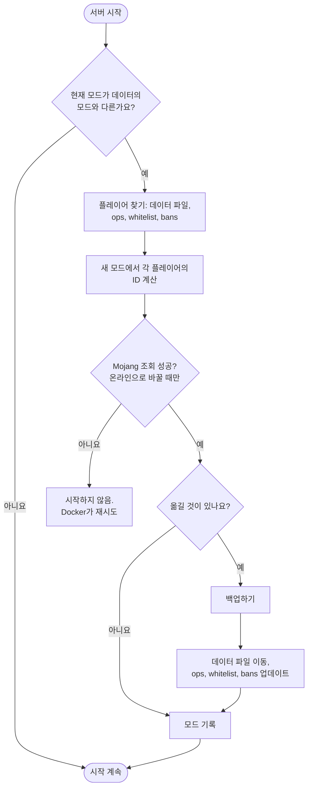

<!-- language-switcher -->
[English](../offline-mode.md) · [हिन्दी](../hi/offline-mode.md) · [Español](../es/offline-mode.md) · [简体中文](../zh-CN/offline-mode.md) · [Português (BR)](../pt-BR/offline-mode.md) · [日本語](../ja/offline-mode.md) · **한국어**

#  온라인 모드와 오프라인 모드

기본적으로는 정품 Minecraft 계정이 있는 플레이어만 접속할 수 있습니다. 오프라인 모드는 계정이 없는 친구를 포함해 모두가 접속할 수 있게 합니다. 이 페이지에서는 모드를 바꾸는 방법, 위험성, 그리고 오프라인 모드를 더 안전하게 만드는 두 가지 기능인 **사용자 이름 규칙**과 **플레이어 데이터 마이그레이션**을 설명합니다.

## EULA와 온라인 모드는 서로 다릅니다

| 설정 | 의미 | 누구와 관련되나 |
|---|---|---|
| `EULA=TRUE` | 서버 운영자인 내가 Mojang의 EULA에 동의함. 서버를 실행하려면 반드시 필요. | 나 |
| `ONLINE_MODE` | 플레이어가 정품 계정을 가지고 있음을 증명해야 하는지 여부 | 플레이어 |

플레이어는 EULA를 보거나 동의하지 않습니다. 계정이 없는 플레이어를 막는 것은 EULA가 아니라 온라인 모드입니다.

## 모드 바꾸기

```env
ONLINE_MODE=false     # anyone can join
ONLINE_MODE=true      # official accounts only
```

그다음 `make up`을 실행합니다. 언제든 오갈 수 있고, 플레이어 데이터도 따라갑니다([아래](#모드를-넘나드는-플레이어-데이터) 참고).

## 위험성: 사용자 이름이 확인되지 않음

온라인 모드에서는 Mojang이 각 플레이어가 이름 그대로의 본인임을 보장합니다. 오프라인 모드에서는 **누구나 아무 이름이나 입력할 수 있어서**, 내 이름으로 들어와 내 운영자 권한과 인벤토리를 가져갈 수도 있습니다.

- 꼭 필요할 때만 플레이어를 운영자로 만드세요.
- **화이트리스트로는 보호되지 않습니다.** 이름만 비교하는데, 이름은 위조할 수 있습니다.
- 공개 오프라인 서버라면, 처음 접속할 때 플레이어마다 비밀번호를 정하게 하는 로그인 플러그인을 추가하세요.

## 사용자 이름 규칙

오프라인 모드는 보통 거의 모든 이름을 받아들입니다. 내장 `UsernameRules` 플러그인은 Mojang 계정과 같은 규칙을 적용합니다:

| 규칙 | 거부되는 예 |
|---|---|
| 3–16자 | `ab`, `ThisNameIsWayTooLong` |
| `A–Z`, `a–z`, `0–9`, `_`만 사용 | `bad name`, `bad-name`, `café`, `x.y` |
| 대소문자와 관계없이 고유해야 함 | `Steve`가 이미 플레이한 상태에서 `steve` |

어떤 이름을 처음 쓴 플레이어가 그 철자의 주인이 됩니다. 다른 사람에게는 다음과 같이 표시됩니다:

```
The username Steve is already taken.
If it is yours, log in as exactly "Steve".
```

거부 내역은 로그에 남습니다. 온라인 모드에서는 Mojang이 이미 이 규칙을 적용하므로 플러그인은 아무것도 하지 않습니다. `ENFORCE_USERNAME_RULES=false`로 끌 수 있습니다.

> [!NOTE]
> Bedrock 플레이어가 접속할 수 있도록 [Geyser/Floodgate](https://geysermc.org)를 추가하면, 그 이름에는 보통 `.Steve` 같은 접두사가 붙어 이 규칙에 의해 거부됩니다. 그런 경우 `ENFORCE_USERNAME_RULES=false`로 설정하세요.

## 모드를 넘나드는 플레이어 데이터

Minecraft는 각 플레이어의 인벤토리, 위치, 통계, 발전 과제를 ID(UUID) 아래에 저장하는데, 이 ID는 모드마다 다릅니다:

- **온라인:** Mojang 계정의 ID
- **오프라인:** 사용자 이름으로 계산한 ID

아무 조치가 없으면 모드를 바꿀 때 모두가 스폰 지점에서 빈 인벤토리를 갖게 됩니다. 대신 `ONLINE_MODE`를 바꾼 뒤 처음 시작할 때 서버는 다음을 합니다:



1. 데이터 파일과 `ops.json`, `whitelist.json`, `banned-players.json`에서 모든 플레이어를 찾습니다.
2. 새 모드에서 각 플레이어의 ID를 계산합니다. 온라인 모드라면 Mojang에서 이름을 조회합니다.
3. **백업합니다.**
4. 각 플레이어의 데이터 파일을 새 ID로 옮기고, 운영자·화이트리스트·차단 항목을 업데이트합니다.

```
[migrate-players] move Steve: a762f560-… -> 853c80ef-…
[migrate-players] keep Alex123: no official account with this name, data stays under its offline id
```

| 상황 | 결과 |
|---|---|
| 플레이어에게 정품 계정이 있음 | 데이터가 양방향으로 따라감 |
| 계정이 없는 플레이어, 온라인으로 전환 | 데이터는 오프라인 ID 아래에 남습니다. 온라인 모드에서는 접속할 수 없지만, 다시 바꾸면 모두 그대로 있습니다. |
| 두 ID 모두에 데이터가 있음 | 더 새로운 파일이 우선합니다. 오래된 파일은 `player-migration-conflicts/`로 옮겨지며 절대 삭제되지 않습니다. |
| 온라인으로 바꾸는 중 Mojang에 연결할 수 없음 | 누구의 데이터도 두 ID로 나뉘지 않도록 서버가 시작되지 않습니다. Docker가 자동으로 다시 시도합니다. |
| 복원으로 다른 모드의 데이터가 돌아옴 | 다음 시작 때 일반적인 전환처럼 마이그레이션됩니다 |

알아 둘 점:

- 플레이어는 이름으로 매칭됩니다. 오프라인 플레이어가 다른 사람 계정의 이름을 썼다면, 온라인으로 바꿀 때 그 데이터는 그 계정으로 갑니다.
- 플러그인이 플레이어별로 저장하는 데이터(권한, 경제 잔액)는 마이그레이션되지 않습니다.
- 마이그레이션을 끄려면 `MIGRATE_PLAYER_DATA=false`로 설정하세요.
