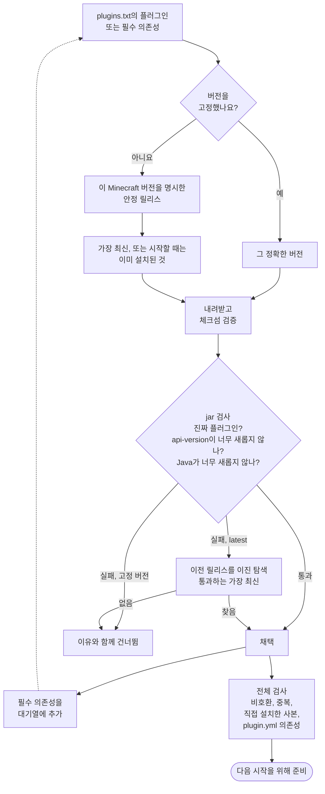

<!-- language-switcher -->
[English](../plugins.md) · [हिन्दी](../hi/plugins.md) · [Español](../es/plugins.md) · [简体中文](../zh-CN/plugins.md) · [Português (BR)](../pt-BR/plugins.md) · [日本語](../ja/plugins.md) · **한국어**

#  플러그인

이 서버는 **Paper**로 실행되므로 **플러그인**을 지원합니다. Paper, Spigot, Bukkit의 `.jar` 파일입니다. 플러그인은 서버에서만 실행되며, 플레이어는 아무것도 설치할 필요가 없습니다. [모드](#모드)는 실행하지 않습니다.

플러그인을 설치하는 방법은 두 가지입니다:

| 방법 | 용도 |
|---|---|
| [`plugins/plugins.txt`](#관리되는-플러그인-pluginstxt)(권장) | [Modrinth](https://modrinth.com/plugins)나 [Hangar](https://hangar.papermc.io)에 있는 플러그인. 알맞은 버전과 의존성을 골라 검증하고 최신 상태로 유지해 줍니다. |
| [직접 설치](#다른-사이트의-플러그인) | 그 밖의 모든 것. |

## 관리되는 플러그인: `plugins.txt`

원하는 플러그인을 한 줄에 하나씩 적습니다:

```text
# source    project            version
modrinth    luckperms          latest
modrinth    worldguard         latest
hangar      ViaVersion         latest
modrinth    chunky             1.5.3
```

| 항목 | 의미 |
|---|---|
| `source` | `modrinth` 또는 `hangar`(PaperMC 공식 플러그인 사이트) |
| `project` | 플러그인 페이지 주소에 있는 이름: `modrinth.com/plugin/luckperms`이면 `luckperms`, `hangar.papermc.io/ViaVersion/ViaVersion`이면 `ViaVersion` |
| `version` | 이 서버에서 동작하는 최신 안정 버전을 원하면 `latest`, 아니면 플러그인 페이지에서 복사한 정확한 버전 이름 |

`#`부터는 주석입니다. 빈 줄은 무시됩니다.

그다음 실행합니다:

```bash
make update-plugins
```

| 하고 싶은 것 | 방법 |
|---|---|
| 플러그인 추가 | 한 줄을 추가하고 `make update-plugins` |
| 전부 업데이트 | `make update-plugins` |
| 플러그인 버전 고정 또는 되돌리기 | `latest`를 버전으로 바꾸고 `make update-plugins` |
| 플러그인 제거 | 그 줄을 지우고 `make update-plugins`. 함께 들어온 의존성도 제거됩니다. 설정 폴더는 남습니다. |
| 무엇이 왜 설치되었는지 보기 | `make plugins` |

```
Minecraft 1.20.4 on Java 17 - plugins managed by plugins.txt:
  WorldGuard               7.0.9                  listed
  WorldEdit                7.3.0                  required by WorldGuard
Other plugin jars (added by hand or built in):
  UsernameRules.jar
```

### `make update-plugins`가 하는 일

1. 서버를 계속 실행한 채로 전체 플러그인 버전 조합을 정하고(아래 참고), 새로운 것을 임시 폴더에 내려받습니다.
2. 바뀐 것이 없으면 `all plugins are up to date`를 출력하고 끝납니다.
3. 바뀐 것이 있으면 백업하고, 플레이어에게 알린 뒤, 서버를 재시작합니다.
4. 시작할 때 준비된 플러그인으로 교체하고, 제거한 플러그인은 삭제합니다.

서버가 사용 중인 플러그인 파일은 절대 교체되지 않습니다.

## 호환 버전을 고르는 방식

원하는 플러그인만 적으면 됩니다. 리졸버는 각 플러그인마다 다음을 합니다.



**1. Minecraft 버전으로 거르기.** 플러그인 사이트가 내 서버의 Minecraft 버전을 지원한다고 밝힌 **안정** 릴리스(베타 제외)만 고려합니다.

**2. 실제 jar 확인하기.** 플러그인 사이트 정보가 틀릴 때도 있으므로, 후보마다 내려받아 살펴봅니다:

| 검사 | 이유 |
|---|---|
| 체크섬이 사이트와 일치(Modrinth는 SHA-512, Hangar는 SHA-256) | 파일이 작성자가 공개한 것과 똑같음 |
| `plugin.yml` 또는 `paper-plugin.yml` 포함 | 정말 Paper/Bukkit 플러그인임 |
| `api-version` ≤ 내 Minecraft 버전 | Paper는 더 새로운 Minecraft용으로 만든 플러그인을 거부함 |
| 서버의 Java 이하 버전용으로 컴파일됨 | "플러그인이 로드되지 않음"의 가장 흔한 원인. 플러그인 사이트는 이 정보를 기록하지 않음 |

최신 버전이 실패하면 리졸버는 이전 릴리스를 거슬러 올라가 **통과하는 것 중 가장 최신**을 찾습니다. 요구 사항은 시간이 지날수록 올라가기만 하므로, 릴리스가 100개가 넘어도 이진 탐색으로 몇 번만 내려받으면 찾을 수 있습니다:

```
[plugins] WorldEdit: using 7.3.0 because 7.3.9 needs Java 21 (this server runs Java 17)
```

**3. 의존성 설치하기.** Modrinth나 Hangar에 선언된 필수 의존성도 같은 방식으로 재귀적으로 결정합니다. 선택적 의존성은 설치하지 않습니다.

**4. 각 플러그인의 의존성 목록 읽기.** 어떤 플러그인은 `plugin.yml`에는 의존성을 적어 두고 사이트에는 적지 않습니다. 리졸버는 그런 의존성을 플러그인 이름으로 Hangar와 Modrinth에서 찾습니다. 내려받은 jar가 정말 그 이름의 플러그인일 때만 받아들이므로, 이름이 비슷한 다른 프로젝트가 실수로 설치되는 일은 없습니다.

**5. 전체 조합 확인하기.**

| 상황 | 결과 |
|---|---|
| Modrinth가 두 플러그인을 비호환으로 표시 | 의존성(또는 나중에 적은 것)을 경고와 함께 건너뜀 |
| 같은 플러그인이 두 출처에서 옴 | 첫 번째는 유지하고 두 번째는 건너뜀. Paper는 중복을 거부함 |
| 직접도 설치한 플러그인 | 관리되는 사본을 건너뜀 |
| 의존성을 어디서도 찾을 수 없음 | 경고: "X requires the plugin Y, which could not be found automatically; add it to plugins.txt" |

예시: 플러그인 네 개를 적은 Minecraft 1.20.4 서버에서 의존성 세 개가 추가되었고, Java 17에 맞춰 더 오래된 WorldEdit가 선택되었습니다:

```
[plugins] WorldEdit: using 7.3.0 because 7.3.9 needs Java 21 (this server runs Java 17)
[plugins] + Multiverse-Portals 5.3.0  (listed)
[plugins] + WorldGuard 7.0.9  (listed)
[plugins] + ViaBackwards 5.12.2  (listed)
[plugins] + LuckPerms v5.5.71-bukkit  (listed)
[plugins] + Multiverse-Core 5.8.2  (required by Multiverse-Portals)
[plugins] + WorldEdit 7.3.0  (required by WorldGuard)
[plugins] + ViaVersion 5.12.2  (required by ViaBackwards)
```

### 무언가 바뀌었을 때

| 변경 | 일어나는 일 |
|---|---|
| `plugins.txt`를 수정함 | `make update-plugins`로, 또는 다음 시작 때 적용 |
| Minecraft나 Java 버전을 바꿈 | 다음 시작 때 모든 플러그인을 다시 결정. 플러그인이 새 버전에 맞는 릴리스로 올라가거나 내려갈 수 있음. |
| 아무것도 바뀌지 않음 | 시작할 때 Modrinth나 Hangar에 전혀 연결하지 않음 |

시작할 때 리졸버는 모든 검사를 계속 통과하는 한 이미 설치된 버전을 우선합니다. 플러그인을 새 버전으로 올리는 것은 `make update-plugins`(또는 매일 하는 자동 업데이트)뿐입니다.

### 고정 버전

고정한 버전(`modrinth chunky 1.5.3`)은 탐색 없이 그대로 사용합니다:

- 플러그인 사이트에 내 Minecraft 버전이 없으면 경고가 나오지만 그래도 설치합니다.
- jar가 아예 동작할 수 없으면(Java가 다름, API가 더 새로움) 거부합니다.

### 실패해도 서버는 멈추지 않습니다

| 문제 | 결과 |
|---|---|
| Modrinth나 Hangar에 연결할 수 없음, 오타, 삭제된 프로젝트 | 경고. 설치된 버전은 유지되고, 서버는 시작되며, 다음 시작 때 다시 시도. |
| 이 서버에서 동작하는 버전이 없음 | 이유를 설명하는 경고. 더 새로운 Java로 해결될 것 같으면 `JAVA_VERSION` 힌트도 줌. 로드할 수 없는 기존 설치본은 제거. |
| `update-plugins` 두 개가 동시에(수동과 예약) | 두 번째는 거부: "another plugin install/update is already running; try again in a minute" |

## 자동 업데이트

```env
PLUGIN_AUTO_UPDATE=true
PLUGIN_UPDATE_TIME=04:00
TZ=Asia/Seoul
```

매일 `PLUGIN_UPDATE_TIME`에:

1. 서버가 플러그인 업데이트를 확인합니다. 없으면 아무 일도 없습니다.
2. 있으면 재시작 5분 전, 1분 전, 10초 전에 플레이어 채팅에 경고가 나옵니다.
3. 백업합니다.
4. 서버가 재시작하며 업데이트를 적용합니다.

이 설정을 바꾼 뒤에는 `make up`을 실행하세요. 자동 업데이트는 **기본적으로 꺼져 있습니다**. 플러그인 업데이트는 가끔 설정 형식을 바꾸거나 다르게 동작하기 때문입니다. 중요한 서버라면 결과를 지켜볼 수 있을 때 `make update-plugins`를 실행하고, 의지하는 버전은 고정해 두세요.

## 다른 사이트의 플러그인

Modrinth나 Hangar에 없는 플러그인, 또는 Hangar에 외부 링크만 있는 플러그인은:

```bash
docker compose cp SomePlugin.jar mc:/data/plugins/
make restart
```

제거하려면:

```bash
docker compose exec mc rm /data/plugins/SomePlugin.jar
make restart
```

직접 추가한 jar는 `plugins.txt`가 절대 건드리지 않으며, 의존성을 확인할 때는 설치된 것으로 칩니다.

## 플러그인이 있는 곳

| 경로(`mc-data` 볼륨 안) | 내용 |
|---|---|
| `/data/plugins/*.jar` | 모든 플러그인 jar |
| `/data/plugins/<Name>/` | 각 플러그인의 설정과 데이터 |
| `/data/plugins/.managed/lock.tsv` | `plugins.txt`가 설치한 것: 버전, 파일, 체크섬, 이유 |
| `/data/plugins/.managed/pending/` | 다음 시작을 위해 준비된 업데이트 |

이 모두가 백업에 포함됩니다(임시 폴더는 제외).

## 내장 플러그인

`UsernameRules`는 이미지에 포함되어 있습니다. 오프라인 모드에서 Mojang의 사용자 이름 규칙을 적용하며([온라인 모드와 오프라인 모드](offline-mode.md#사용자-이름-규칙) 참고), `plugins.txt`가 아니라 `ENFORCE_USERNAME_RULES`로 제어합니다.

## 모드

모드(Fabric, Forge, NeoForge)는 게임 자체를 바꿉니다. Paper는 모드를 로드할 수 없고, 대부분의 콘텐츠 모드는 **모든 플레이어**도 설치해야 합니다. 모드를 쓰려면 이 이미지를 Paper 대신 Fabric이나 NeoForge 기반으로 만들어야 합니다. 이 프로젝트의 대부분(백업, 헬스 체크, 안전한 종료, 플레이어 마이그레이션)은 그대로 쓸 수 있지만, Paper 플러그인은 쓸 수 없습니다. 둘을 함께 돌리려는 "하이브리드" 서버는 안정적인 서버에는 권장하지 않습니다.

## 한계

- 자동으로는 Modrinth와 Hangar만 찾습니다.
- 선택적 의존성은 설치하지 않습니다. 필요하면 목록에 추가하세요.
- jar 검사는 흔한 비호환은 잡아내지만, 플러그인이 검사를 통과하고도 내부 API 변경 때문에 실행 중에 실패할 수 있습니다. 플러그인을 업데이트하기 전마다 만드는 백업이 그때의 안전망입니다.
- 플러그인이 플레이어 UUID 아래에 저장한 데이터는 온라인과 오프라인 모드를 바꿀 때 마이그레이션되지 않습니다.
