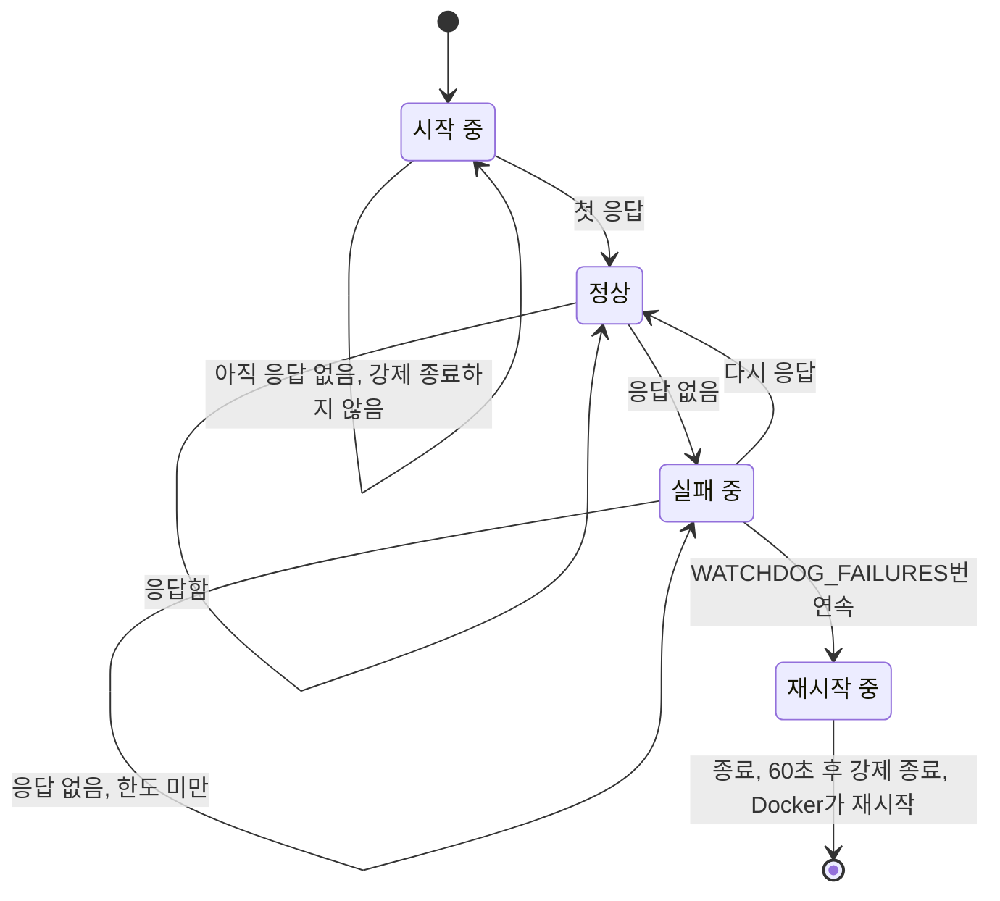
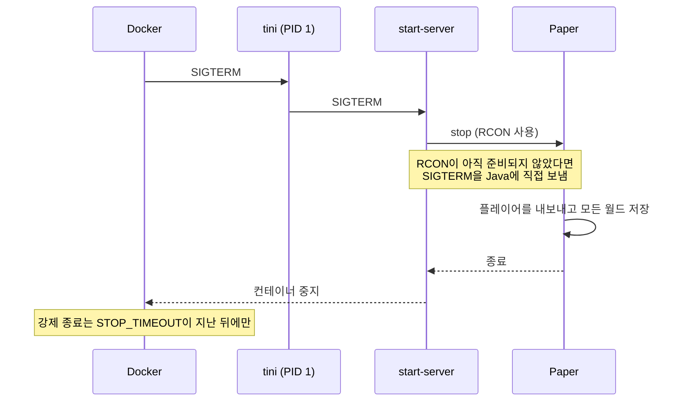

<!-- language-switcher -->
[English](../reliability.md) · [हिन्दी](../hi/reliability.md) · [Español](../es/reliability.md) · [简体中文](../zh-CN/reliability.md) · [Português (BR)](../pt-BR/reliability.md) · [日本語](../ja/reliability.md) · **한국어**

#  안정성

이 페이지는 아무도 지켜보지 않아도 서버를 계속 실행하고 월드를 안전하게 지키는 모든 장치를 설명합니다.

| 장치 | 막아 주는 것 |
|---|---|
| [재시작 정책](#자동-재시작) | 크래시, 메모리 부족 오류, 호스트 재부팅 |
| [헬스 체크](#헬스-체크) | 서버가 실제로 동작하는지 모르는 상태 |
| [멈춤 감지 워치독](#멈춤-감지-워치독) | 실행 중이지만 응답하지 않는 멈춘 서버 |
| [안전한 종료](#안전한-종료) | 멈출 때 월드가 사라지거나 손상되는 것 |
| [메모리 안전](#메모리-안전) | 메모리 부족으로 계속 강제 종료되는 루프 |
| [설정 검증](#설정-검증) | 오타가 크래시 루프가 되거나 기능이 조용히 꺼지는 것 |
| [버전 및 데이터 보호](#버전-및-데이터-보호) | 월드 다운그레이드, 플레이어 데이터 손실 |
| [백업](backups.md) | 그 밖의 모든 것 |

## 자동 재시작

두 컨테이너 모두 `restart: unless-stopped`를 사용합니다. 크래시, 메모리 부족, 워치독, 누군가 `/stop`을 입력한 경우 등 어떤 이유로든 서버 프로세스가 끝나면 Docker가 다시 시작합니다. 호스트를 재부팅해도 Docker가 켜지자마자 돌아옵니다. 멈춘 상태를 유지하는 것은 `make down`(또는 `docker stop`)뿐입니다.

## 헬스 체크

Docker는 30초마다 컨테이너 안에서 `mc-health`를 실행합니다:

1. 게임 포트로 **서버 목록 ping**을 보냅니다. Minecraft 멀티플레이 화면이 보내는 것과 같은 요청입니다.
2. 서버가 서버 목록에서 숨겨져 있어서(`enable-status=false`) 거부되면, RCON `list` 명령으로 대신 확인합니다.

확인이 한 번 통과하면 `make status`에 `healthy`가 표시됩니다. 새 서버에는 월드 생성을 위해 **5분**의 유예가 주어집니다. `backup` 컨테이너는 서버가 healthy가 될 때까지 시작을 기다립니다.

## 멈춤 감지 워치독

프로세스는 살아 있는데 서버가 멈출 수 있습니다. 교착 상태(데드락)나 무한 루프에 빠진 플러그인 같은 경우입니다. Docker는 종료된 프로세스만 재시작하므로, 컨테이너 안의 백그라운드 워치독이 이런 경우를 처리합니다:

- `WATCHDOG_INTERVAL`초(기본 60)마다 헬스 체크를 실행합니다.
- **서버가 한 번 응답한 뒤부터만** 횟수를 세기 때문에, 처음 시작이 느려도 절대 강제 종료되지 않습니다.
- `WATCHDOG_FAILURES`번 연속 실패하면(기본 5번, 약 5분) 일반 종료 신호를 보내고, 60초를 기다린 뒤 강제 종료합니다. 그다음 Docker가 서버를 재시작합니다.




```
[start-server] Watchdog: server not responding (1/5)
...
[start-server] Watchdog: server is hung, killing it
```

Paper에도 멈춘 게임 틱을 감지하는 자체 워치독이 있습니다. 이 워치독은 Paper의 것이 보지 못하는 멈춤도 잡아냅니다. 끄려면 `WATCHDOG_INTERVAL=0`으로 설정하세요.

## 안전한 종료

Minecraft 서버를 프로세스째 강제로 죽이면 마지막 자동 저장 이후의 모든 것이 사라지고, 기록 중이던 청크가 손상될 수 있습니다. 여기서는 모든 종료가 같은 경로를 거칩니다:




1. `tini`(PID 1)가 Docker의 종료 신호를 `start-server`에 전달합니다.
2. `start-server`가 RCON으로 `stop`을 보냅니다. Paper는 플레이어를 내보내고, 모든 월드를 저장한 뒤 종료합니다.
3. RCON이 아직 준비되지 않았다면(예: 시작 중) Java에 일반 종료 신호가 갑니다. 이때도 Paper는 저장합니다.

Docker는 강제 종료하기 전에 최대 `STOP_TIMEOUT`(기본 `2m`)까지 기다립니다. 아주 큰 월드나 느린 디스크라면 늘리세요:

```env
STOP_TIMEOUT=5m
```

## 메모리 안전

| 위험 | 보호 |
|---|---|
| 게임 도중 힙이 커져 호스트 메모리가 부족해짐 | 힙은 시작할 때 고정되고(`-Xms` = `-Xmx` = `MEMORY`) 미리 확보되므로, 메모리 문제는 게임 도중이 아니라 시작할 때 드러납니다 |
| 힙이 컨테이너에 비해 너무 커서 커널이 반복해서 강제 종료함(exit 137) | `MEMORY` + 512M가 `CONTAINER_MEMORY` 안에 들어가지 않으면 시작을 거부합니다. 오류 메시지가 설정할 값을 알려 줍니다. |
| Java 힙이 바닥나 불안정하게 계속 실행됨 | `-XX:+ExitOnOutOfMemoryError`로 깔끔하게 종료되고 Docker가 재시작합니다 |

가비지 컬렉션은 널리 쓰이는 G1용 Aikar's flags를 사용하며, 12 GB 이상에서는 큰 힙용 설정으로 바꿔 멈춤 시간을 짧고 예측 가능하게 유지합니다.

## 설정 검증

무엇이든 시작하기 전에 설정을 확인합니다. 잘못된 값은 크래시 루프나 끝없는 백업 루프, 조용히 꺼지는 기능을 만드는 대신, 설정 이름을 알려 주는 메시지와 함께 시작을 멈춥니다:

| 설정 | 거부되는 값의 예 | 메시지 |
|---|---|---|
| `EULA` | `false` | EULA에 동의해야 함 |
| `RCON_PASSWORD` | 예전 예시 값, 또는 백슬래시가 들어간 값 (비워 두는 것은 괜찮음: 자동으로 만들어짐) | 이유와 만드는 방법을 설명 |
| `MEMORY` | `2GB` | `2G`나 `1536M` 형식이어야 함 |
| `MEMORY` / `CONTAINER_MEMORY` | `3G` 컨테이너에 `4G` | 설정해야 할 `CONTAINER_MEMORY`를 알려 줌 |
| `WATCHDOG_INTERVAL`, `WATCHDOG_FAILURES` | `1m` | 정수여야 함 |
| `PLUGIN_UPDATE_TIME` | `25:00` | `HH:MM`이어야 함 |
| `BACKUP_INTERVAL` | `abc` | `30m`, `6h`, `1d` 형식이어야 함 |
| `BACKUP_KEEP` | `0` | 1 이상이어야 함 |
| `MC_VERSION` | `1.16.5`, `9.9` | 너무 오래되었거나 없는 버전 |
| `PAPER_BUILD` | `MC_VERSION=latest`와 함께 쓴 숫자 | 정확한 버전이 필요함 |

## 버전 및 데이터 보호

- **월드 다운그레이드는 거부되고**, 업그레이드 전에는 백업합니다. [Minecraft 버전](minecraft-versions.md) 참고.
- **온라인/오프라인 모드를 바꿔도 플레이어 데이터가 플레이어를 따라갑니다.** 먼저 백업하며, 마이그레이션이 반쯤 된 상태로 서버가 시작되지 않습니다. [온라인 모드와 오프라인 모드](offline-mode.md) 참고.
- **플러그인 문제가 시작을 막는 일은 없습니다.** 내려받기에 실패하면 설치된 버전이 그대로 남고, 로드할 수 없는 플러그인은 건너뜁니다. [플러그인](plugins.md) 참고.

## 최소 권한과 격리

- 서버는 권한 없는 사용자(`PUID`/`PGID`)로 실행됩니다. root는 시작할 때 파일 소유권을 고치기 위해 잠깐만 사용합니다.
- RCON은 비공개 Compose 네트워크 안에서만 접근할 수 있습니다.
- Docker 로그 순환(컨테이너당 5 × 10 MB) 덕분에 로그가 디스크를 채우지 않습니다.
