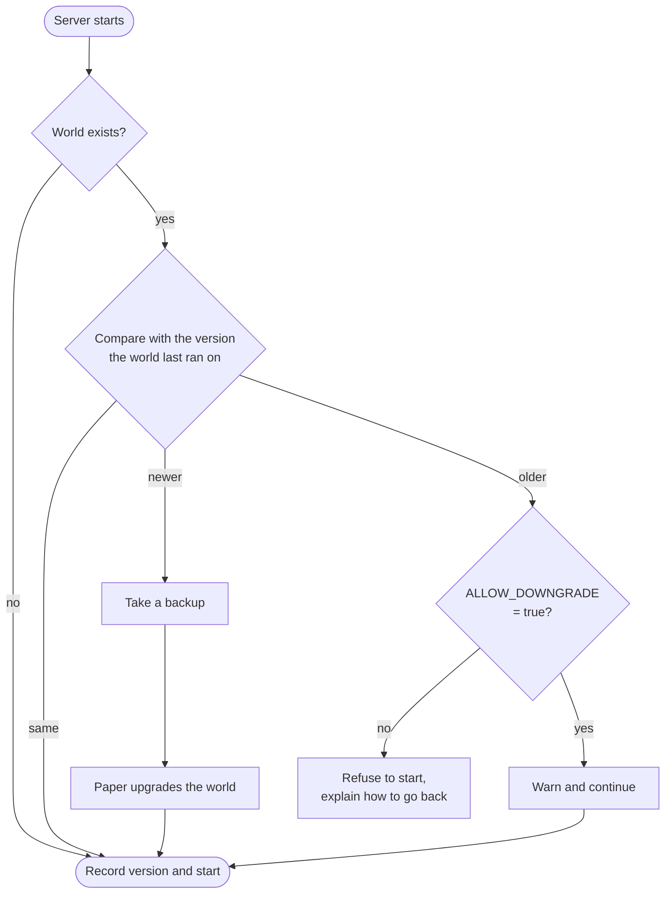

<!-- language-switcher -->
**English** · [हिन्दी](hi/minecraft-versions.md) · [Español](es/minecraft-versions.md) · [简体中文](zh-CN/minecraft-versions.md) · [Português (BR)](pt-BR/minecraft-versions.md) · [日本語](ja/minecraft-versions.md) · [한국어](ko/minecraft-versions.md)

#  Minecraft versions

You can run any Minecraft version from **1.17** to the newest release. The right Java is chosen automatically, and the world is protected when the version changes.

## Choosing a version

Set it in `.env` **before your first `make up`**:

```env
MC_VERSION=1.21.4
```

Valid values:

- `latest`: the newest Minecraft version that has a **stable** Paper build. It is resolved each time the image is built.
- an exact version, such as `1.20.4`, `1.21.4`, or `26.3`

To see what's available:

```bash
make versions
```

```
MINECRAFT  JAVA   PAPER SUPPORT
26.3       25     supported
26.2       25     deprecated
1.21.11    21     unsupported
...
```

The "Paper support" column is PaperMC's own status. "Unsupported" versions still work, but no longer get fixes from PaperMC.

## How Java is chosen

Each Minecraft version needs a minimum Java version. `make` asks the PaperMC API and picks the oldest Java LTS that meets it, because that's what the version was built and tested on:

| Minecraft | Java |
|---|---|
| 1.17 – 1.20.4 | 17 |
| 1.20.5 – 1.21.x | 21 |
| 26.x | 25 |

The image is then built from the official `eclipse-temurin` Java image for that version. `make up` prints the decision:

```
==> Minecraft 1.20.4 (Paper) on Java 17
```

To force a newer Java, for example because a plugin you need was built for Java 21 but you run 1.20.4, set `JAVA_VERSION=21` in `.env`. A Java that's too old for the chosen Minecraft version is refused.

Minecraft **1.16.5 and older** need Java 8 or 11 and aren't supported; `make` refuses them with a clear message.

## What happens when the version changes

On every start, the server compares the Minecraft version with the one the world was last run on:



## Upgrading

1. Take a look at your plugins' support for the new version (optional; they're re-resolved automatically).
2. Change `MC_VERSION` in `.env`.
3. Run `make up`.

On the first start with the new version:

```
[start-server] Upgrading world from Minecraft 1.20.4 to 1.21.4; taking a backup first
[backup] Saved /backups/mc-20261030-195423.tar.gz (51M)
[plugins] plugins.txt, Minecraft or Java changed: resolving plugins for Minecraft 1.21.4 on Java 21
[plugins] ~ WorldEdit 7.3.0 -> 7.4.2
```

- **A backup is taken before Minecraft upgrades the world.** If the upgrade goes wrong, restore it.
- **Plugins are re-resolved** for the new Minecraft and Java version. See [Plugins](plugins.md).

## Downgrading

Minecraft can't safely open a world saved by a newer version; chunks and items may be lost or corrupted. So the server tracks the version each world was last run on, in `/data/.mc-version`, and refuses to start an older one:

```
[start-server] This world was last run on Minecraft 1.21.4, but the server is now 1.20.4.
[start-server] Opening a world in an older version can corrupt it, so the server will not start.
[start-server] Set MC_VERSION=1.21.4 in .env (or restore a backup made on 1.20.4) and run 'make up'.
```

To really go back:

1. Set `MC_VERSION` back to the older version.
2. Restore a backup made **while running that older version** (`make restore FILE=…`), such as the one taken automatically right before the upgrade.

Setting `ALLOW_DOWNGRADE=true` skips the check. Only use it when you know the world is compatible, for example right after an upgrade before anyone joined.

## Staying on a version

`MC_VERSION=latest` jumps to new Minecraft releases whenever the image is rebuilt (`make up` after a change, or `make update`). For a server people rely on, **pin an exact version** once you're happy with it:

```env
MC_VERSION=26.3
```

`make update` then only fetches newer Paper builds (bug and security fixes) of that same Minecraft version.

## Pinning a Paper build

```env
MC_VERSION=1.21.4
PAPER_BUILD=232
```

`PAPER_BUILD` only works with an exact `MC_VERSION`, because build numbers are counted separately for each version. Mostly useful to stay on a known-good build or roll back a bad one.

## Tested versions

Builds and clean starts have been verified on 1.17.1, 1.18.2, and 1.20.4 (Java 17), 1.21.4 (Java 21), and 26.3 (Java 25). The upgrade from 1.20.4 to 1.21.4 and the downgrade guard have also been tested.
