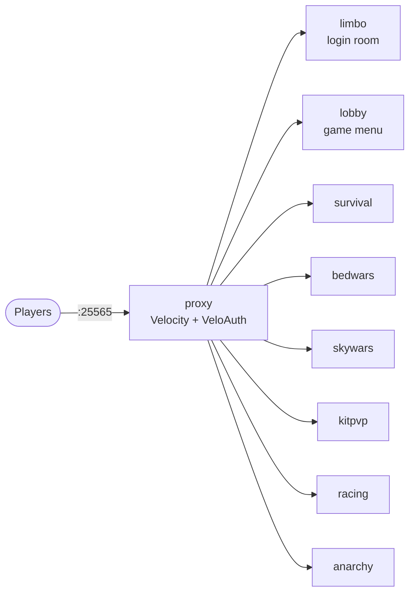

# Lobby network

The [`network/`](../network) folder runs several servers behind one address, the way large public servers do. Players join, log in, land in a lobby, and choose a game from a menu. Each game is its own container, so you can **switch games on and off** to save memory when nobody is playing them.



| Server | Always on | What it is |
|---|---|---|
| `proxy` | yes | [Velocity](https://papermc.io/software/velocity). The only published port. Logs players in and moves them between servers. |
| `limbo` | yes | A tiny Paper server where players wait until they log in. They can't move, chat, or see each other there. |
| `lobby` | yes | The hub. Every player gets a compass (**Game Menu**) that shows each game as *Online* (with player count) or *Switched off*. |
| `survival`, `bedwars`, `skywars`, `kitpvp`, `racing`, `anarchy` | no | Game servers. Each has its own world, `servers/<id>/plugins.txt`, and backups. |

The single-server setup in the repository root is unchanged and separate. The network uses its own images, volumes, and `.env`.

## Start

```bash
cd network
cp .env.example .env       # set EULA=true
make up                    # proxy, limbo and lobby; the first start takes a few minutes
make on GAME=survival      # switch a game on
```

Join `localhost` (or your machine's address) in Minecraft.

## Switching games on and off

| Command | Effect |
|---|---|
| `make games` | Shows each game as `ON`, `starting...`, or `off` |
| `make on GAME=bedwars` | Starts the game and its backups, and waits until it is ready. The menu shows it as Online within 3 seconds. |
| `make off GAME=bedwars` | Sends everyone in that game back to the lobby, saves the world, and stops the container. Its world and settings are kept for next time. |

Players who click a game that is switched off get a message instead of an error. If a game server crashes, its players are moved to the lobby.

## Logins: cracked and premium players

The proxy runs in offline mode with [VeloAuth](https://modrinth.com/plugin/veloauth):

- **Premium (paid) accounts** are verified with Mojang and log in automatically. Their usernames are reserved, so nobody else can take them.
- **Cracked players** type `/register <password> <password>` once, then `/login <password>` each time they join. Passwords are stored as bcrypt hashes in the proxy's data volume.

For premium accounts only, set `PROXY_ONLINE_MODE=true` in `.env` and `make restart S=proxy`.

Each server only accepts logins forwarded by the proxy, checked with `PROXY_SECRET` (`make up` generates it). The game servers publish no ports, so they can't be reached from outside directly.

## Commands

`S=` is `proxy`, `limbo`, `lobby`, or a game id.

| Command | |
|---|---|
| `make up` / `make down` | Start the always-on servers / stop everything (worlds are saved) |
| `make status` / `make logs S=lobby` | Container health / logs (leave out `S` for all) |
| `make console S=survival` / `make cmd S=survival C="op Steve"` | Server console. `make console S=proxy` attaches to Velocity's console (detach with Ctrl-P Ctrl-Q). |
| `make restart S=lobby` | Restart one server |
| `make backup S=survival` / `make backups` / `make restore S=survival FILE=…` | Backups are kept per server in `backups/<id>/` |
| `make plugins S=bedwars` / `make update-plugins S=bedwars` | Show or apply `servers/bedwars/plugins.txt` (`proxy/plugins.txt` for `S=proxy`) |
| `make update` | Rebuild with the newest Paper and Velocity, then restart what is running |

Make yourself an operator: `make cmd S=lobby C="op YourName"`. Do this on each server you want to manage. Ops can build in the lobby after `/gamemode creative`.

## Memory

Each container gets a fixed amount of memory (`PROXY_RAM`, `LOBBY_RAM`, `SURVIVAL_RAM`, … in `.env`), and the Java heap is sized to fit it. The always-on part needs about **3.3 GB**. Each game adds 2–2.5 GB. On Docker Desktop, give Docker enough memory for everything you switch on at once (**Settings → Resources → Memory**). With the default 8 GB, run one or two games at a time.

## Players on other Minecraft versions

Every server runs the same Minecraft version (`MC_VERSION`). ViaVersion and ViaBackwards on each server let players join from other versions. Clients older than 1.13 may not work through the proxy's modern forwarding.

## Changing the games

The game id must be the same in three places:

1. **`games.yml`**: the menu entry (name, icon, slot, description). The proxy also reads this list.
2. **`compose.yaml`**: copy an existing game's two services (`<id>` and `<id>-backup`), rename them, set the profile to `<id>`, and add an `<id>-data` volume.
3. **`servers/<id>/plugins.txt`**: the plugins for that server.

Then `make restart S=proxy` and `make restart S=lobby`. To only change the menu text or icons, edit `games.yml` and `make restart S=lobby`.

## Game plugins

The plugins below are installed on first start. Each minigame still needs its arenas or maps set up in-game by an operator; see the plugin's page.

| Server | Plugins |
|---|---|
| bedwars | [Screaming BedWars](https://modrinth.com/plugin/screamingbedwars), WorldEdit |
| skywars | [RealSkywars](https://modrinth.com/plugin/realskywars), WorldEdit |
| kitpvp | [FFAUtils](https://modrinth.com/plugin/ffautils) (kits, arenas, stats), [OldCombatMechanics](https://hangar.papermc.io/kernitus/OldCombatMechanics) (1.8-style combat), WorldEdit |
| racing | [BoatRacing](https://modrinth.com/plugin/boatracing) (go-kart style ice boat races), WorldEdit |
| survival | [LuckPerms](https://modrinth.com/plugin/luckperms), [GriefPrevention](https://modrinth.com/plugin/griefprevention), WorldEdit. EssentialsX and CoreProtect are listed but commented out until they support the newest Minecraft. |
| anarchy | none (on purpose) |

Every server also has ViaVersion and ViaBackwards. Swap or add plugins in `servers/<id>/plugins.txt`; the [plugin manager](plugins.md) picks versions that work on your Minecraft and Java.

## How it fits together

- **Images.** `local/paper-network` is the same Paper image as the single server, built once and shared by every Paper server. `local/velocity-proxy` holds Velocity, downloaded from PaperMC and checksum-verified.
- **Roles.** The built-in `Network` plugin reads `NETWORK_ROLE`. As `lobby` it runs the menu and protects the lobby (no damage, hunger, building, or item drops for non-ops). As `limbo` it freezes and hides waiting players. As `game` it adds `/lobby` and `/hub`.
- **Status.** The lobby pings each game server directly every 3 seconds; that is how the menu knows what is on.
- **Forwarding.** With `PROXY_SECRET` set, each Paper server turns on Velocity modern forwarding, runs in offline mode behind the proxy, and skips the single-server username rules and player-data migration. The proxy's login plugin handles both.
