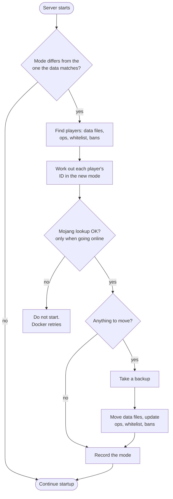

<!-- language-switcher -->
**English** · [हिन्दी](hi/offline-mode.md) · [Español](es/offline-mode.md) · [简体中文](zh-CN/offline-mode.md) · [Português (BR)](pt-BR/offline-mode.md) · [日本語](ja/offline-mode.md) · [한국어](ko/offline-mode.md)

#  Online and offline mode

By default, only players with an official Minecraft account can join. Offline mode lets everyone join, including friends without an account. This page covers how to switch, the risks, and the two features that make offline mode safer: **username rules** and **player data migration**.

## EULA and online mode are different things

| Setting | What it means | Who it concerns |
|---|---|---|
| `EULA=TRUE` | You, the server operator, accept Mojang's EULA. Required to run the server at all. | You |
| `ONLINE_MODE` | Whether players must prove they own an official account | Your players |

Players never see or accept the EULA. Players without an account are blocked by online mode, not by the EULA.

## Switching modes

```env
ONLINE_MODE=false     # anyone can join
ONLINE_MODE=true      # official accounts only
```

Then run `make up`. You can switch back and forth; player data follows (see [below](#player-data-across-modes)).

## The risk: usernames aren't verified

In online mode, Mojang guarantees each player is who their name says. In offline mode, **anyone can type any name**, including yours, and get your operator rights and inventory.

- Make players operators only when needed.
- **A whitelist doesn't protect you**: it matches names, and names can be faked.
- For a public offline server, add a login plugin that makes each player set a password on first join.

## Username rules

Offline mode normally accepts almost any name. The built-in `UsernameRules` plugin applies the same rules as a Mojang account:

| Rule | Rejected example |
|---|---|
| 3–16 characters | `ab`, `ThisNameIsWayTooLong` |
| Only `A–Z`, `a–z`, `0–9`, `_` | `bad name`, `bad-name`, `café`, `x.y` |
| Unique regardless of capitals | `steve` when `Steve` has already played |

The first player to use a name owns that spelling. Others are told:

```
The username Steve is already taken.
If it is yours, log in as exactly "Steve".
```

Rejections are logged. The plugin does nothing in online mode, where Mojang already enforces these rules. Turn it off with `ENFORCE_USERNAME_RULES=false`.

> [!NOTE]
> If you add [Geyser/Floodgate](https://geysermc.org) so Bedrock players can join, their names usually get a prefix such as `.Steve`, which these rules reject. Set `ENFORCE_USERNAME_RULES=false` in that case.

## Player data across modes

Minecraft stores each player's inventory, position, stats, and advancements under an ID (UUID), and the ID differs between modes:

- **Online:** the ID of the Mojang account
- **Offline:** an ID computed from the username

Without help, switching modes would give everyone an empty inventory at spawn. Instead, on the first start after `ONLINE_MODE` changes, the server:



1. Finds every player from their data files and from `ops.json`, `whitelist.json`, and `banned-players.json`.
2. Works out each player's ID in the new mode. For online mode, it looks the name up with Mojang.
3. **Takes a backup.**
4. Moves each player's data files to the new ID and updates operator, whitelist, and ban entries.

```
[migrate-players] move Steve: a762f560-… -> 853c80ef-…
[migrate-players] keep Alex123: no official account with this name, data stays under its offline id
```

| Situation | Result |
|---|---|
| Player has an official account | Data follows them in both directions |
| Player has no account, switching to online | Data stays under the offline ID. They can't join in online mode, but it's all there when you switch back. |
| Player has data under both IDs | The newer file wins. The older one is moved to `player-migration-conflicts/`, never deleted. |
| Mojang unreachable while switching to online | The server doesn't start, so nobody's data ends up split across two IDs. Docker retries automatically. |
| A restore brings back data from the other mode | Migrated on the next start, like a normal switch |

Things to know:

- Players are matched by name. If an offline player used a name that belongs to someone else's account, their data goes to that account when switching to online mode.
- Data that plugins store per player (permissions, economy balances) isn't migrated.
- Set `MIGRATE_PLAYER_DATA=false` to turn migration off.
