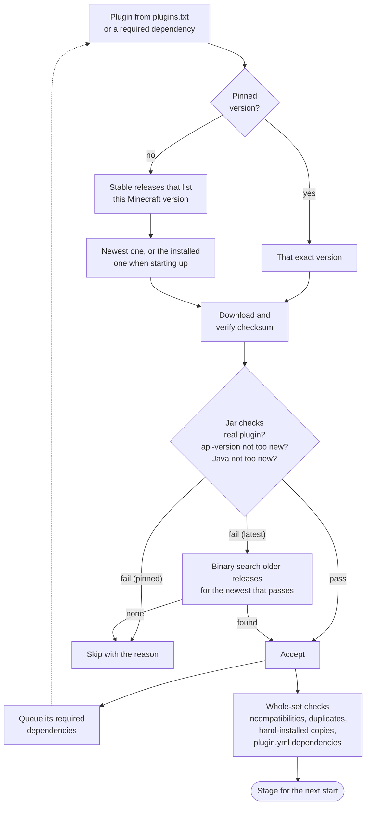

<!-- language-switcher -->
**English** · [हिन्दी](hi/plugins.md) · [Español](es/plugins.md) · [简体中文](zh-CN/plugins.md) · [Português (BR)](pt-BR/plugins.md) · [日本語](ja/plugins.md) · [한국어](ko/plugins.md)

#  Plugins

This server runs **Paper**, so it supports **plugins**: Paper, Spigot, or Bukkit `.jar` files. Plugins run only on the server; players don't install anything. It does not run [mods](#mods).

There are two ways to install plugins:

| Way | Use it for |
|---|---|
| [`plugins/plugins.txt`](#managed-plugins-pluginstxt) (recommended) | Plugins on [Modrinth](https://modrinth.com/plugins) or [Hangar](https://hangar.papermc.io). The right versions and their dependencies are chosen, verified, and kept up to date for you. |
| [By hand](#plugins-from-other-sites) | Anything else. |

## Managed plugins: `plugins.txt`

List the plugins you want, one per line:

```text
# source    project            version
modrinth    luckperms          latest
modrinth    worldguard         latest
hangar      ViaVersion         latest
modrinth    chunky             1.5.3
```

| Field | Meaning |
|---|---|
| `source` | `modrinth` or `hangar` (PaperMC's official plugin site) |
| `project` | The name in the plugin page's address: `modrinth.com/plugin/luckperms` gives `luckperms`, and `hangar.papermc.io/ViaVersion/ViaVersion` gives `ViaVersion` |
| `version` | `latest` for the newest stable version that works on this server, or an exact version name copied from the plugin page |

`#` starts a comment. Blank lines are ignored.

Then run:

```bash
make update-plugins
```

| To… | Do this |
|---|---|
| Add a plugin | Add a line, then `make update-plugins` |
| Update everything | `make update-plugins` |
| Pin or roll back a plugin | Change `latest` to a version, then `make update-plugins` |
| Remove a plugin | Delete its line, then `make update-plugins`. Dependencies it pulled in are removed too. Its settings folder is kept. |
| See what's installed and why | `make plugins` |

```
Minecraft 1.20.4 on Java 17 - plugins managed by plugins.txt:
  WorldGuard               7.0.9                  listed
  WorldEdit                7.3.0                  required by WorldGuard
Other plugin jars (added by hand or built in):
  UsernameRules.jar
```

### What `make update-plugins` does

1. While the server keeps running, it works out the full set of plugin versions (see below) and downloads anything new into a staging folder.
2. If nothing changed, it prints `all plugins are up to date` and stops.
3. Otherwise it takes a backup, warns players, and restarts the server.
4. On startup, the staged plugins are swapped in and removed plugins are deleted.

Plugin files are never replaced while the server is using them.

## How compatible versions are chosen

You list only the plugins you want. For each one, the resolver does the following.



**1. Filter by Minecraft version.** It considers only **stable** releases (no betas) that the plugin site says support your server's Minecraft version.

**2. Check the actual jar.** Plugin sites are sometimes wrong, so each candidate is downloaded and inspected:

| Check | Why |
|---|---|
| Checksum matches the site (SHA-512 Modrinth, SHA-256 Hangar) | The file is exactly what the author published |
| Contains `plugin.yml` or `paper-plugin.yml` | It's really a Paper/Bukkit plugin |
| `api-version` ≤ your Minecraft version | Paper refuses plugins built for a newer Minecraft |
| Compiled for a Java ≤ the server's Java | The most common cause of "plugin won't load"; plugin sites don't record it |

If the newest version fails, the resolver searches back through older releases for the **newest one that passes**. Requirements only go up over time, so a binary search finds it in a few downloads even across 100+ releases:

```
[plugins] WorldEdit: using 7.3.0 because 7.3.9 needs Java 21 (this server runs Java 17)
```

**3. Install dependencies.** Required dependencies declared on Modrinth or Hangar are resolved the same way, recursively. Optional dependencies are not installed.

**4. Read each plugin's own dependency list.** Some plugins list dependencies in `plugin.yml` but not on the site. The resolver looks those up on Hangar and Modrinth by plugin name. It accepts a match only if the downloaded jar really is a plugin with that name, so a lookalike project is never installed by mistake.

**5. Check the set as a whole.**

| Situation | Result |
|---|---|
| Modrinth marks two plugins as incompatible | The dependency (or the one listed later) is skipped, with a warning |
| The same plugin from two sources | The first is kept and the second skipped; Paper refuses duplicates |
| A plugin you also installed by hand | The managed copy is skipped |
| A dependency can't be found anywhere | Warning: "X requires the plugin Y, which could not be found automatically; add it to plugins.txt" |

Example: on a Minecraft 1.20.4 server with four plugins listed, three dependencies were added and an older WorldEdit was chosen for Java 17:

```
[plugins] WorldEdit: using 7.3.0 because 7.3.9 needs Java 21 (this server runs Java 17)
[plugins] + Multiverse-Portals 5.3.0  (listed)
[plugins] + WorldGuard 7.0.9  (listed)
[plugins] + ViaBackwards 5.12.2  (listed)
[plugins] + LuckPerms v5.5.71-bukkit  (listed)
[plugins] + Multiverse-Core 5.8.2  (required by Multiverse-Portals)
[plugins] + WorldEdit 7.3.0  (required by WorldGuard)
[plugins] + ViaVersion 5.12.2  (required by ViaBackwards)
```

### When things change

| Change | What happens |
|---|---|
| You edit `plugins.txt` | Applied by `make update-plugins`, or at the next start |
| You change Minecraft or Java version | All plugins are re-resolved at the next start. A plugin may move up or down to the release that suits the new version. |
| Nothing changed | Starts don't contact Modrinth or Hangar at all |

At startup the resolver prefers the version already installed, as long as it still passes all checks. Only `make update-plugins` (or the daily auto-update) moves plugins to newer versions.

### Pinned versions

A pinned version (`modrinth chunky 1.5.3`) is used as-is, without searching:

- If the plugin site doesn't list your Minecraft version, you get a warning but it is installed anyway.
- If the jar can't work at all (wrong Java, newer API), it's refused.

### Failures never take the server down

| Problem | Result |
|---|---|
| Modrinth or Hangar unreachable, a typo, a deleted project | Warning. The installed version stays, the server starts, and the next start retries. |
| No version works on this server | Warning explaining why, with a `JAVA_VERSION` hint when a newer Java would help. A previously installed version that can't load is removed. |
| Two `update-plugins` at once (manual and scheduled) | The second is refused: "another plugin install/update is already running; try again in a minute" |

## Automatic updates

```env
PLUGIN_AUTO_UPDATE=true
PLUGIN_UPDATE_TIME=04:00
TZ=Asia/Kolkata
```

Every day at `PLUGIN_UPDATE_TIME`:

1. The server checks for plugin updates. If there are none, nothing happens.
2. If there are, players see chat warnings 5 minutes, 1 minute, and 10 seconds before the restart.
3. A backup is taken.
4. The server restarts and applies the updates.

Run `make up` after changing these settings. Automatic updates are **off by default**: plugin updates occasionally change config formats or behave differently. For an important server, run `make update-plugins` when you can watch the result, and pin versions you depend on.

## Plugins from other sites

For plugins that aren't on Modrinth or Hangar, or that Hangar only links to externally:

```bash
docker compose cp SomePlugin.jar mc:/data/plugins/
make restart
```

To remove one:

```bash
docker compose exec mc rm /data/plugins/SomePlugin.jar
make restart
```

Jars you add by hand are never touched by `plugins.txt`, and they count as installed when dependencies are checked.

## Where plugins live

| Path (inside the `mc-data` volume) | Contents |
|---|---|
| `/data/plugins/*.jar` | All plugin jars |
| `/data/plugins/<Name>/` | Each plugin's settings and data |
| `/data/plugins/.managed/lock.tsv` | What `plugins.txt` installed: version, file, checksum, reason |
| `/data/plugins/.managed/pending/` | Updates staged for the next start |

All of this is included in backups (except the staging folder).

## Built-in plugin

`UsernameRules` ships with the image. It enforces Mojang username rules in offline mode (see [Online and offline mode](offline-mode.md#username-rules)) and is controlled by `ENFORCE_USERNAME_RULES`, not by `plugins.txt`.

## Mods

Mods (Fabric, Forge, NeoForge) change the game itself. Paper can't load them, and most content mods must also be installed by **every player**. Running mods would mean building this image on Fabric or NeoForge instead of Paper. Most of this project would carry over (backups, health checks, graceful shutdown, player migration), but Paper plugins wouldn't. "Hybrid" servers that try to run both are not recommended for a reliable server.

## Limits

- Only Modrinth and Hangar are searched automatically.
- Optional dependencies aren't installed; add them to the list if you want them.
- The jar checks catch the common incompatibilities, but a plugin can still pass them and fail at runtime because of internal API changes. The backup taken before every plugin update is the safety net.
- Data that plugins store under player UUIDs is not migrated when switching online and offline mode.
