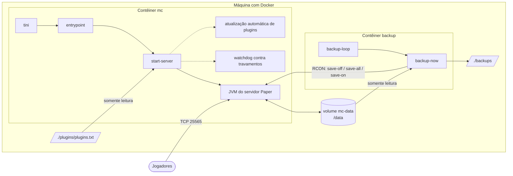
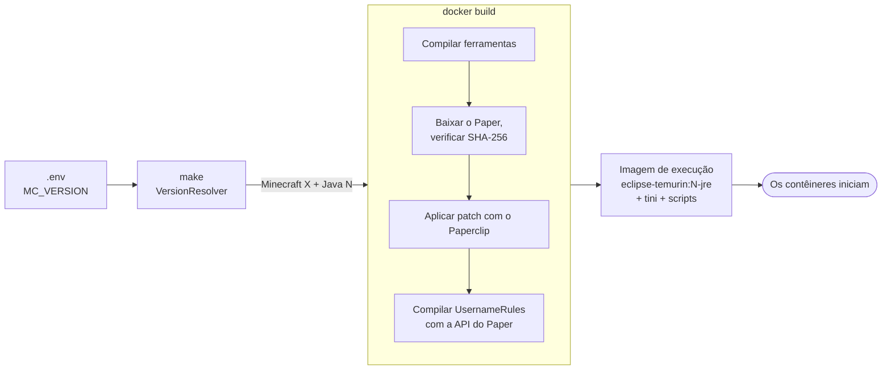
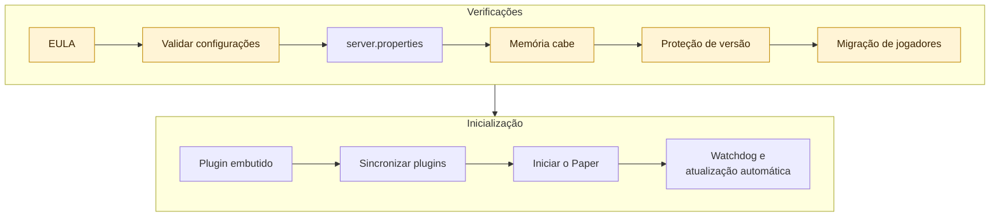

<!-- language-switcher -->
[English](../architecture.md) · [हिन्दी](../hi/architecture.md) · [Español](../es/architecture.md) · [简体中文](../zh-CN/architecture.md) · **Português (BR)** · [日本語](../ja/architecture.md) · [한국어](../ko/architecture.md)

#  Arquitetura

Esta página explica como o projeto é montado: o que roda onde, o que acontece no build e na inicialização, e onde os dados ficam.

## Visão geral



| Peça | O que é |
|---|---|
| **Imagem** `local/paper-server` | Construída localmente a partir do `Dockerfile`. Uma única imagem roda os dois contêineres. |
| **Contêiner `mc`** | O servidor do jogo, mais processos auxiliares (watchdog, atualização automática de plugins opcional). |
| **Contêiner `backup`** | A mesma imagem, iniciada com o comando `backup`. Faz os backups programados. |
| **Volume `mc-data`** | Tudo o que o servidor grava: mundos, configurações, plugins, dados dos jogadores. Sobrevive a rebuilds. |
| **`./backups`** | Os arquivos de backup, na máquina, para você copiar para qualquer lugar. |
| **`./plugins/plugins.txt`** | Sua lista de plugins, montada como somente leitura no servidor. |
| **RCON** | O console remoto do Minecraft. Os scripts o usam para salvar o mundo e enviar comandos. Só é acessível dentro da rede do Compose e nunca é publicado na máquina. |

## Do `make up` ao servidor rodando




### 1. Resolver a versão (na sua máquina)

O `make` roda o `VersionResolver` num contêiner temporário `eclipse-temurin:25-jdk`. Ele pergunta à API da PaperMC qual versão do Paper corresponde ao `MC_VERSION` e qual Java ela precisa, e escolhe o Java LTS correspondente (17, 21 ou 25):

```
==> Minecraft 1.21.4 (Paper) on Java 21
```

O resultado é passado para o build da imagem. Na sua máquina só é preciso ter o Docker.

### 2. Construir a imagem

O `Dockerfile` tem duas etapas.

**Etapa de build** (`eclipse-temurin:25-jdk`):

1. Compila as ferramentas Java do projeto (`tools/*.java`) para Java 17, para que rodem em qualquer Java do servidor.
2. Roda `scripts/fetch-paper.sh`. Ele encontra o build estável mais novo do Paper para a versão escolhida, verifica se o Java escolhido é novo o suficiente, baixa o jar e **verifica o checksum SHA-256**.
3. Deixa o inicializador do Paper (Paperclip) montar o jar completo do servidor. Isso baixa o servidor oficial do Minecraft da Mojang. A etapa é repetida em caso de falha, porque o Paperclip pode terminar com sucesso mesmo quando o download falhou.
4. Compila o plugin embutido `UsernameRules` contra a API exata do Paper daquela versão.

**Etapa de execução** (`eclipse-temurin:<17|21|25>-jre`):

- o jar do Paper verificado, as ferramentas, o plugin embutido e os scripts de `scripts/`
- `tini` como PID 1, para que os sinais cheguem ao servidor e processos zumbis sejam limpos

### 3. Iniciar os contêineres

Todo contêiner inicia com `tini → entrypoint`. O entrypoint:

1. Corrige, se preciso, o dono de `/data` e `/backups` para `PUID:PGID`.
2. Abre mão dos privilégios de root.
3. Roda o modo pedido: `server`, `backup`, `backup-now` ou `restore`.

### 4. Sequência de inicialização do servidor (`start-server`)

Cada etapa roda em ordem. Qualquer falha interrompe a inicialização com uma mensagem clara, em vez de iniciar num estado ruim.




As etapas destacadas podem interromper a inicialização com uma mensagem clara.

| # | Etapa | Detalhes |
|---|---|---|
| 1 | Verificar o EULA | Recusa iniciar a menos que `EULA=TRUE`. |
| 2 | Validar configurações | Senha do RCON, formato de `MEMORY`, números, formatos de hora. Veja [Confiabilidade](reliability.md#validação-da-configuração). |
| 3 | Gravar o `server.properties` | Aplica as configurações de jogo do `.env`. Sempre força a porta, o endereço de escuta e as configurações do RCON. |
| 4 | Verificar se a memória cabe | Recusa um heap que não cabe no limite de memória do contêiner. |
| 5 | Proteção de versão do mundo | Faz backup antes de uma atualização e recusa downgrades. Veja [Versões do Minecraft](minecraft-versions.md). |
| 6 | Migração dos dados dos jogadores | Se o modo online/offline mudou, move os dados dos jogadores para os novos IDs. Veja [Modo online e offline](offline-mode.md). |
| 7 | Plugin embutido | Instala ou remove o `UsernameRules.jar` (`ENFORCE_USERNAME_RULES`). |
| 8 | Sincronizar plugins | Aplica as atualizações de plugins preparadas e resolve o `plugins.txt` de novo se ele, o Minecraft ou o Java mudaram. Nunca impede a inicialização. |
| 9 | Iniciar o Paper | Roda a JVM com as flags ajustadas. |
| 10 | Auxiliares | Inicia o watchdog contra travamentos e, se ativado, o agendador de atualização automática de plugins. |

### 5. Sequência de desligamento

```
docker stop / make down / make restart
  → tini forwards SIGTERM
  → start-server sends "stop" over RCON (or SIGTERM to Java if RCON isn't up yet)
  → Paper saves every world and exits
  → container stops
```

O Docker espera `STOP_TIMEOUT` (padrão de 2 minutos) antes de forçar o encerramento.

## Organização dos dados

Dentro do volume `mc-data` (`/data`):

```
/data
├── world/                     # O mundo (nome vindo de LEVEL_NAME)
├── plugins/
│   ├── *.jar                  # Plugins instalados
│   ├── <Plugin>/              # Configurações de cada plugin
│   └── .managed/
│       ├── lock.tsv           # Quais plugins e versões o plugins.txt instalou
│       └── pending/           # Atualizações preparadas, aplicadas na próxima inicialização
├── server.properties, bukkit.yml, spigot.yml, config/   # Configuração do servidor
├── ops.json, whitelist.json, banned-players.json        # Listas de administração
├── .mc-version                # Versão do Minecraft em que o mundo rodou por último
├── .player-uuid-mode          # Modo online/offline a que os dados dos jogadores correspondem
├── cache/, libraries/, versions/   # Recriados pelo Paper; fora dos backups
└── logs/                      # Logs do servidor; fora dos backups
```

## Serviços externos

| Serviço | Para quê | Quando |
|---|---|---|
| Docker Hub (`eclipse-temurin`) | Imagens do Java | Build |
| API da PaperMC (`fill.papermc.io`) | Versões do Paper, downloads, checksums | Build, `make versions` |
| Mojang (`piston-data.mojang.com`) | Jar oficial do servidor que o Paper modifica | Build, primeira inicialização |
| Mojang (`api.mojang.com`) | Nome de usuário → ID da conta | Só ao mudar para o modo online com jogadores existentes |
| Modrinth, Hangar | Metadados e downloads de plugins | Só na instalação e atualização de plugins |

Nenhuma imagem ou script de servidor de terceiros é usado. O checksum de cada jar de servidor e de plugin baixado é verificado.

## Organização do código

```
Dockerfile, compose.yaml, Makefile, .env.example
scripts/
  entrypoint.sh       Corrigir dono, largar o root, despachar o modo
  start-server.sh     Sequência de inicialização, sinais, watchdog, atualização automática
  fetch-paper.sh      Resolver e verificar o download do Paper (no build)
  backup-now.sh       Um backup consistente, com trava e verificado
  backup-loop.sh      Agendador de backups
  restore-backup.sh   Restauração segura por uma pasta temporária
  plugins, rcon-cli, mc-health   Pequenos atalhos para as ferramentas Java
tools/                Ferramentas Java sem dependências, compiladas em mctool.jar
  McTool.java         Ponto de entrada; cliente RCON e ping de lista de servidores
  VersionResolver.java  Versão do Minecraft → versão do Paper + Java
  PluginManager.java  Resolução, download e verificação do plugins.txt
  PlayerMigrator.java Migração de UUID entre modo online e offline
  Json.java, Yaml.java  Leitores mínimos
plugins/
  plugins.txt         Sua lista de plugins
  username-rules/     Código do plugin embutido
docs/                 Esta documentação
  assets/             Banner e ícones (SVG feitos à mão)
```
