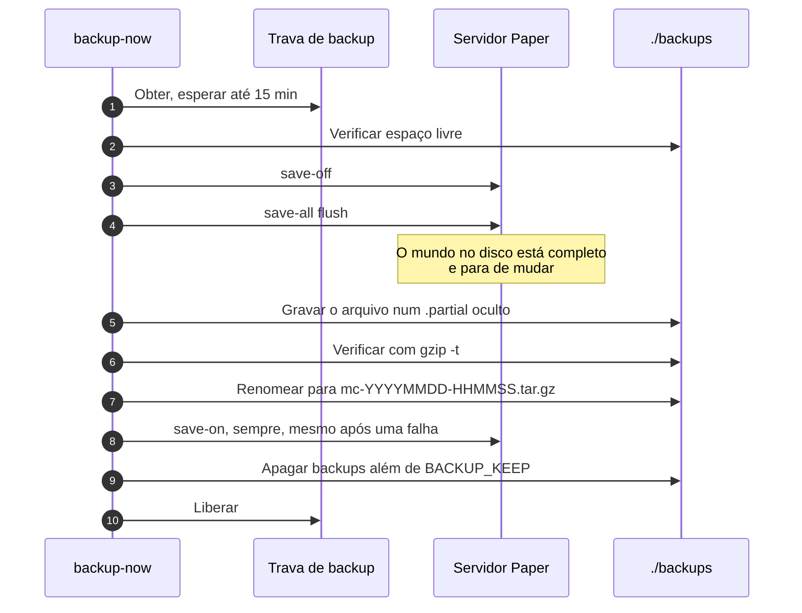
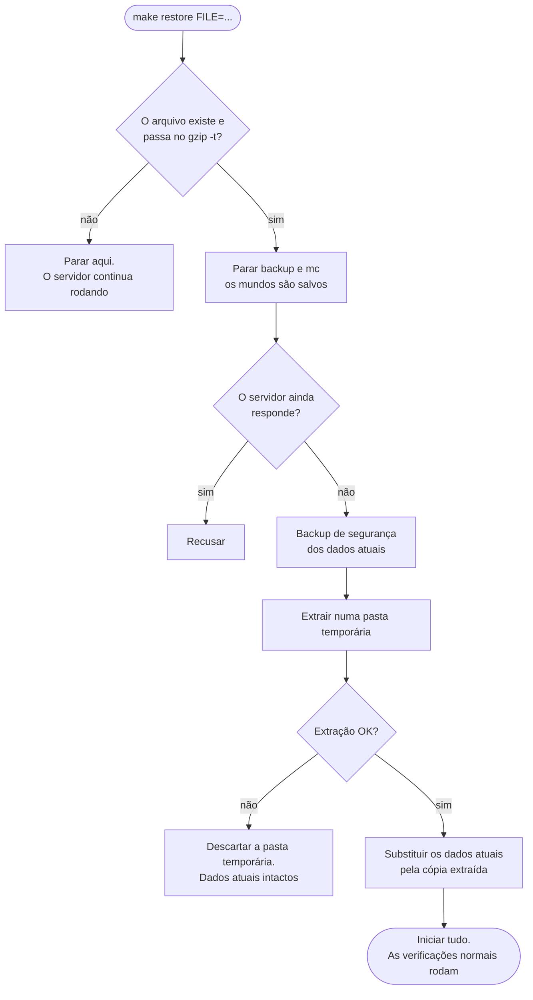

<!-- language-switcher -->
[English](../backups.md) · [हिन्दी](../hi/backups.md) · [Español](../es/backups.md) · [简体中文](../zh-CN/backups.md) · **Português (BR)** · [日本語](../ja/backups.md) · [한국어](../ko/backups.md)

#  Backups e restauração

Os backups rodam automaticamente, são consistentes mesmo com jogadores online e são verificados antes de valerem. As restaurações foram pensadas para que um erro não custe o seu mundo atual.

## Visão geral

| | |
|---|---|
| **Agendamento** | A cada `BACKUP_INTERVAL` (padrão `1h`), pelo contêiner `backup` |
| **Mantidos** | Os `BACKUP_KEEP` mais recentes (padrão `24`) |
| **Onde** | `./backups/` na máquina, como `mc-YYYYMMDD-HHMMSS.tar.gz` (horário UTC) |
| **Manual** | `make backup` |
| **Listar** | `make backups` |
| **Restaurar** | `make restore FILE=mc-….tar.gz` |

Também são feitos backups **automaticamente antes de toda operação arriscada**:

| Antes de… | Feito por |
|---|---|
| Atualizar o mundo para uma versão mais nova do Minecraft | `start-server` |
| Migrar dados dos jogadores entre modo online e offline | `start-server` |
| Aplicar atualizações de plugins (`make update-plugins`, atualização automática) | o comando de atualização |
| Restaurar um backup (um "backup de segurança" do que está sendo substituído) | `restore` |

## O que tem num backup

Tudo o que é preciso para trazer o servidor de volta exatamente como estava: mundos, `server.properties` e outras configurações, plugins e suas configurações, dados dos jogadores, listas de operadores, whitelist e banimentos, e os marcadores de versão.

Fica de fora, porque o Paper recria ou porque é temporário:

| Excluído | Por quê |
|---|---|
| `cache/`, `libraries/`, `versions/` | Baixados ou gerados pelo Paper na inicialização |
| `logs/` | Não são necessários para restaurar; podem ser grandes |
| `plugins/.managed/pending/` | Atualizações de plugins preparadas, recriadas na próxima atualização |
| `plugins/spark/tmp/` | Arquivos temporários do profiler |

## Como um backup fica consistente

Um mundo do Minecraft são milhares de arquivos que o servidor reescreve o tempo todo. Copiá-los no meio da gravação pode capturar um chunk salvo pela metade. Por isso cada backup:



1. **Pega a trava de backup.** Só um backup roda por vez, mesmo entre os contêineres `mc` e `backup`. Senão, um segundo backup poderia religar o salvamento automático enquanto o primeiro ainda está lendo. Um backup espera até 15 minutos pela trava.
2. **Verifica o espaço em disco** (veja abaixo).
3. **Pausa o salvamento automático e descarrega** via RCON: `save-off` e depois `save-all flush`. Tudo o que estava na memória agora está no disco e fica parado.
4. **Arquiva o `/data`** num arquivo oculto `.partial`.
5. **Verifica o arquivo** com `gzip -t`. Um arquivo corrompido é descartado e os backups antigos são mantidos.
6. **Renomeia para o nome final.** Um backup gravado pela metade nunca parece um de verdade.
7. **Retoma o salvamento automático** com `save-on`. Isso acontece também se algo acima falhar.
8. **Apaga os backups mais antigos** além de `BACKUP_KEEP`.

Os jogadores podem continuar jogando o tempo todo; nada é anunciado nem congelado.

Se o RCON não puder ser acessado (por exemplo, com o servidor parado), o backup é feito sem o passo 3 e avisa isso. É seguro quando o servidor não está rodando.

## Segurança do espaço em disco

Um backup que enche o disco também pode impedir o servidor de salvar o mundo, com risco de corrupção. Antes de começar, o backup estima o próprio tamanho (o tamanho do último backup mais 20%, ou 60% do tamanho dos dados no primeiro) e se recusa a rodar a menos que haja livre essa quantidade **mais 512 MB**:

```
ERROR: not enough disk space: about 102M needed plus 512M headroom, 20M free. Lower BACKUP_KEEP or free space.
```

O loop agendado registra a falha e tenta de novo no próximo intervalo.

## Restaurar

```bash
make backups                                   # pick one
make restore FILE=mc-20261030-175220.tar.gz
```

O que acontece, em ordem:



1. **Na sua máquina, antes de mexer em qualquer coisa:** o arquivo precisa existir e passar no `gzip -t`. Um erro de digitação ou arquivo corrompido para aqui, e o servidor continua rodando.
2. Os contêineres `backup` e `mc` são parados (os mundos são salvos).
3. A restauração se recusa a continuar se o servidor ainda responder.
4. É feito um **backup de segurança** do estado atual.
5. O backup é extraído numa **pasta temporária** ao lado dos dados em uso. Se a extração falhar (por exemplo, com o disco cheio), os dados atuais ficam intactos.
6. Só então os dados atuais são substituídos pela cópia extraída.
7. Tudo inicia de novo.

Depois de uma restauração, as verificações normais de inicialização continuam valendo:

- Um backup feito numa versão do Minecraft **mais nova** que a do servidor é recusado pela [proteção contra downgrade](minecraft-versions.md#fazer-downgrade).
- Um backup feito numa versão **mais antiga** é atualizado, com outro backup antes.
- Um backup feito no outro modo (online/offline) tem os dados dos jogadores [migrados](offline-mode.md#dados-dos-jogadores-entre-modos).
- Os plugins são sincronizados de novo com o `plugins.txt`.

O backup de segurança é um backup comum. A rotação normal o apaga quando ele fica mais antigo que os `BACKUP_KEEP` mais recentes, então copie-o para outro lugar se quiser guardá-lo.

## Restaurar numa máquina nova

1. Instale o projeto na máquina nova ([Primeiros passos](getting-started.md)), usando o **mesmo `MC_VERSION`** do backup ou um mais novo.
2. Copie o arquivo de backup para `./backups/`.
3. Rode `make up` uma vez, para que os contêineres e o volume existam.
4. Rode `make restore FILE=…`.

## Cópias externas

Os backups em `./backups` ficam no mesmo disco que o servidor. Eles protegem contra erros e corrupção, mas não contra a perda da máquina. Copie-os para outro lugar com regularidade; veja um exemplo em [Implantação](deployment.md#backups-externos).

## Abrir um backup manualmente

Os backups são arquivos `tar.gz` comuns:

```bash
tar -tzf backups/mc-20261030-175220.tar.gz | head        # list contents
mkdir /tmp/old && tar -xzf backups/mc-….tar.gz -C /tmp/old ./world/
```
