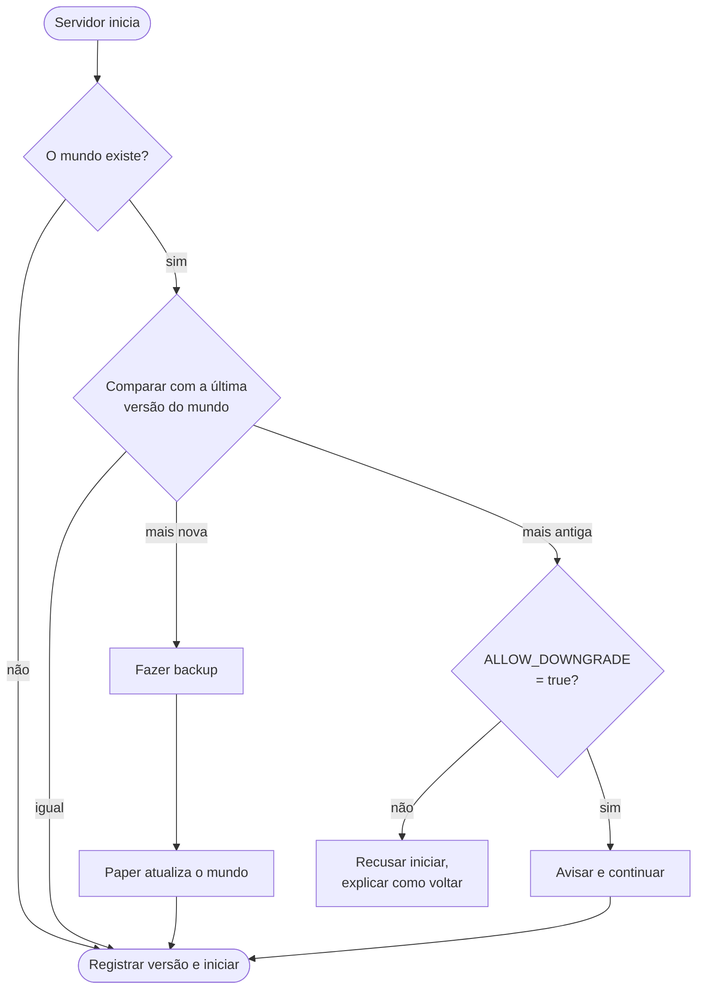

<!-- language-switcher -->
[English](../minecraft-versions.md) · [हिन्दी](../hi/minecraft-versions.md) · [Español](../es/minecraft-versions.md) · [简体中文](../zh-CN/minecraft-versions.md) · **Português (BR)** · [日本語](../ja/minecraft-versions.md) · [한국어](../ko/minecraft-versions.md)

#  Versões do Minecraft

Você pode rodar qualquer versão do Minecraft da **1.17** até a mais recente. O Java certo é escolhido automaticamente e o mundo fica protegido quando a versão muda.

## Escolher uma versão

Defina no `.env` **antes do seu primeiro `make up`**:

```env
MC_VERSION=1.21.4
```

Valores válidos:

- `latest`: a versão mais nova do Minecraft que tenha um build **estável** do Paper. É resolvida toda vez que a imagem é construída.
- uma versão exata, como `1.20.4`, `1.21.4` ou `26.3`

Para ver o que está disponível:

```bash
make versions
```

```
MINECRAFT  JAVA   PAPER SUPPORT
26.3       25     supported
26.2       25     deprecated
1.21.11    21     unsupported
...
```

A coluna "Paper support" é o status informado pela própria PaperMC. Versões "unsupported" ainda funcionam, mas não recebem mais correções da PaperMC.

## Como o Java é escolhido

Cada versão do Minecraft precisa de um Java mínimo. O `make` consulta a API da PaperMC e escolhe o Java LTS mais antigo que atende, porque foi nele que aquela versão foi construída e testada:

| Minecraft | Java |
|---|---|
| 1.17 – 1.20.4 | 17 |
| 1.20.5 – 1.21.x | 21 |
| 26.x | 25 |

Depois, a imagem é construída a partir da imagem oficial de Java `eclipse-temurin` daquela versão. O `make up` mostra a decisão:

```
==> Minecraft 1.20.4 (Paper) on Java 17
```

Para forçar um Java mais novo, por exemplo porque um plugin que você precisa foi compilado para Java 21 mas você roda a 1.20.4, defina `JAVA_VERSION=21` no `.env`. Um Java antigo demais para a versão do Minecraft escolhida é recusado.

O Minecraft **1.16.5 e anteriores** precisam de Java 8 ou 11 e não são suportados; o `make` os recusa com uma mensagem clara.

## O que acontece quando a versão muda

A cada inicialização, o servidor compara a versão do Minecraft com a última em que o mundo rodou:



## Atualizar

1. Veja se seus plugins suportam a nova versão (opcional; eles são resolvidos de novo automaticamente).
2. Mude `MC_VERSION` no `.env`.
3. Rode `make up`.

Na primeira inicialização com a nova versão:

```
[start-server] Upgrading world from Minecraft 1.20.4 to 1.21.4; taking a backup first
[backup] Saved /backups/mc-20261030-195423.tar.gz (51M)
[plugins] plugins.txt, Minecraft or Java changed: resolving plugins for Minecraft 1.21.4 on Java 21
[plugins] ~ WorldEdit 7.3.0 -> 7.4.2
```

- **Um backup é feito antes de o Minecraft atualizar o mundo.** Se a atualização der errado, restaure-o.
- **Os plugins são resolvidos de novo** para a nova versão do Minecraft e do Java. Veja [Plugins](plugins.md).

## Fazer downgrade

O Minecraft não consegue abrir com segurança um mundo salvo por uma versão mais nova; chunks e itens podem ser perdidos ou corrompidos. Por isso o servidor registra em `/data/.mc-version` a última versão em que cada mundo rodou e se recusa a iniciar uma mais antiga:

```
[start-server] This world was last run on Minecraft 1.21.4, but the server is now 1.20.4.
[start-server] Opening a world in an older version can corrupt it, so the server will not start.
[start-server] Set MC_VERSION=1.21.4 in .env (or restore a backup made on 1.20.4) and run 'make up'.
```

Para voltar de verdade:

1. Volte o `MC_VERSION` para a versão antiga.
2. Restaure um backup feito **enquanto aquela versão antiga rodava** (`make restore FILE=…`), como o que foi feito automaticamente logo antes da atualização.

Definir `ALLOW_DOWNGRADE=true` pula a verificação. Use só quando souber que o mundo é compatível, por exemplo logo depois de uma atualização, antes de alguém entrar.

## Ficar numa versão

`MC_VERSION=latest` pula para novas versões do Minecraft sempre que a imagem é reconstruída (`make up` após uma mudança, ou `make update`). Para um servidor do qual as pessoas dependem, **fixe uma versão exata** quando estiver satisfeito:

```env
MC_VERSION=26.3
```

Assim o `make update` só baixa builds mais novos do Paper (correções de bugs e de segurança) da mesma versão do Minecraft.

## Fixar um build do Paper

```env
MC_VERSION=1.21.4
PAPER_BUILD=232
```

`PAPER_BUILD` só funciona com um `MC_VERSION` exato, porque os números de build são contados separadamente para cada versão. Útil principalmente para ficar num build conhecido e bom ou voltar de um build com problema.

## Versões testadas

A construção e a inicialização limpa foram verificadas na 1.17.1, 1.18.2 e 1.20.4 (Java 17), 1.21.4 (Java 21) e 26.3 (Java 25). A atualização da 1.20.4 para a 1.21.4 e a proteção contra downgrade também foram testadas.
