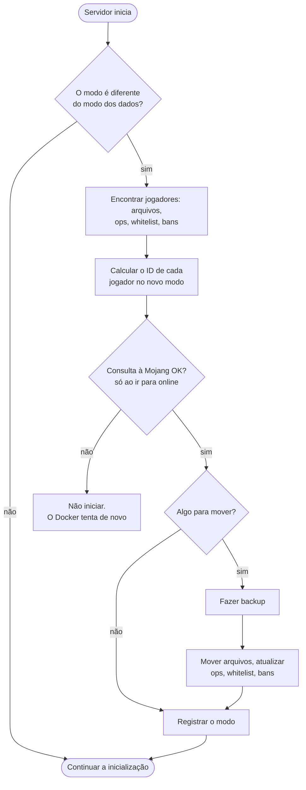

<!-- language-switcher -->
[English](../offline-mode.md) · [हिन्दी](../hi/offline-mode.md) · [Español](../es/offline-mode.md) · [简体中文](../zh-CN/offline-mode.md) · **Português (BR)** · [日本語](../ja/offline-mode.md) · [한국어](../ko/offline-mode.md)

#  Modo online e offline

Por padrão, só entram jogadores com conta oficial do Minecraft. O modo offline deixa todo mundo entrar, inclusive amigos sem conta. Esta página mostra como trocar de modo, os riscos e os dois recursos que deixam o modo offline mais seguro: as **regras de nome de usuário** e a **migração dos dados dos jogadores**.

## EULA e modo online são coisas diferentes

| Configuração | O que significa | A quem diz respeito |
|---|---|---|
| `EULA=TRUE` | Você, o operador do servidor, aceita o EULA da Mojang. Obrigatório para rodar o servidor. | A você |
| `ONLINE_MODE` | Se os jogadores precisam provar que têm uma conta oficial | Aos seus jogadores |

Os jogadores nunca veem nem aceitam o EULA. Quem bloqueia jogadores sem conta é o modo online, não o EULA.

## Trocar de modo

```env
ONLINE_MODE=false     # anyone can join
ONLINE_MODE=true      # official accounts only
```

Depois rode `make up`. Você pode trocar de um para o outro quantas vezes quiser; os dados dos jogadores acompanham (veja [abaixo](#dados-dos-jogadores-entre-modos)).

## O risco: nomes de usuário não são verificados

No modo online, a Mojang garante que cada jogador é quem o nome diz. No modo offline, **qualquer um pode digitar qualquer nome**, inclusive o seu, e ganhar suas permissões de operador e seu inventário.

- Torne jogadores operadores só quando necessário.
- **Uma whitelist não protege você**: ela compara nomes, e nomes podem ser falsificados.
- Para um servidor offline público, adicione um plugin de login que faça cada jogador criar uma senha no primeiro acesso.

## Regras de nome de usuário

O modo offline normalmente aceita quase qualquer nome. O plugin embutido `UsernameRules` aplica as mesmas regras de uma conta da Mojang:

| Regra | Exemplo recusado |
|---|---|
| De 3 a 16 caracteres | `ab`, `ThisNameIsWayTooLong` |
| Só `A–Z`, `a–z`, `0–9`, `_` | `bad name`, `bad-name`, `café`, `x.y` |
| Único, sem diferenciar maiúsculas | `steve` quando `Steve` já jogou |

O primeiro jogador a usar um nome fica com aquela grafia. Os outros veem:

```
The username Steve is already taken.
If it is yours, log in as exactly "Steve".
```

As recusas ficam registradas no log. O plugin não faz nada no modo online, onde a Mojang já aplica essas regras. Desative com `ENFORCE_USERNAME_RULES=false`.

> [!NOTE]
> Se você adicionar [Geyser/Floodgate](https://geysermc.org) para jogadores do Bedrock entrarem, os nomes deles costumam ganhar um prefixo como `.Steve`, que essas regras recusam. Nesse caso, defina `ENFORCE_USERNAME_RULES=false`.

## Dados dos jogadores entre modos

O Minecraft guarda o inventário, a posição, as estatísticas e os avanços de cada jogador sob um ID (UUID), e o ID muda de um modo para o outro:

- **Online:** o ID da conta da Mojang
- **Offline:** um ID calculado a partir do nome de usuário

Sem ajuda, trocar de modo deixaria todo mundo com o inventário vazio no spawn. Em vez disso, na primeira inicialização depois de mudar `ONLINE_MODE`, o servidor:



1. Encontra todos os jogadores pelos arquivos de dados e por `ops.json`, `whitelist.json` e `banned-players.json`.
2. Calcula o ID de cada jogador no novo modo. Para o modo online, consulta o nome na Mojang.
3. **Faz um backup.**
4. Move os arquivos de dados de cada jogador para o novo ID e atualiza as entradas de operador, whitelist e banimento.

```
[migrate-players] move Steve: a762f560-… -> 853c80ef-…
[migrate-players] keep Alex123: no official account with this name, data stays under its offline id
```

| Situação | Resultado |
|---|---|
| O jogador tem conta oficial | Os dados o acompanham nas duas direções |
| O jogador não tem conta e você muda para online | Os dados ficam sob o ID offline. Ele não consegue entrar no modo online, mas está tudo lá quando você voltar. |
| O jogador tem dados sob os dois IDs | O arquivo mais novo vence. O mais antigo vai para `player-migration-conflicts/`, nunca é apagado. |
| Mojang inacessível ao mudar para online | O servidor não inicia, para que os dados de ninguém fiquem divididos entre dois IDs. O Docker tenta de novo automaticamente. |
| Uma restauração traz dados do outro modo | São migrados na próxima inicialização, como uma troca normal |

Bom saber:

- Os jogadores são associados pelo nome. Se um jogador offline usou um nome que pertence à conta de outra pessoa, os dados dele vão para essa conta ao mudar para online.
- Os dados que os plugins guardam por jogador (permissões, saldos de economia) não são migrados.
- Defina `MIGRATE_PLAYER_DATA=false` para desativar a migração.
