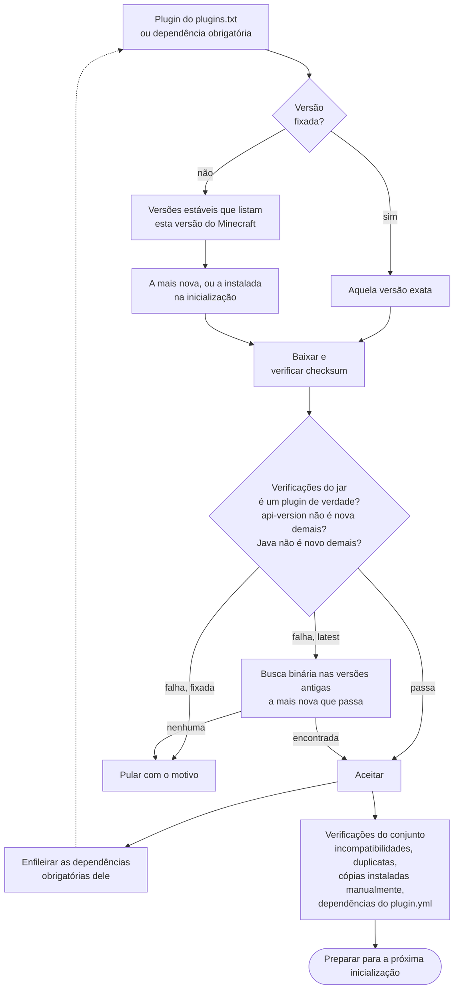

<!-- language-switcher -->
[English](../plugins.md) · [हिन्दी](../hi/plugins.md) · [Español](../es/plugins.md) · [简体中文](../zh-CN/plugins.md) · **Português (BR)** · [日本語](../ja/plugins.md) · [한국어](../ko/plugins.md)

#  Plugins

Este servidor roda **Paper**, então ele aceita **plugins**: arquivos `.jar` de Paper, Spigot ou Bukkit. Os plugins rodam só no servidor; os jogadores não instalam nada. Ele não roda [mods](#mods).

Há dois jeitos de instalar plugins:

| Jeito | Use para |
|---|---|
| [`plugins/plugins.txt`](#plugins-gerenciados-pluginstxt) (recomendado) | Plugins no [Modrinth](https://modrinth.com/plugins) ou no [Hangar](https://hangar.papermc.io). As versões certas e suas dependências são escolhidas, verificadas e mantidas atualizadas para você. |
| [Manualmente](#plugins-de-outros-sites) | Todo o resto. |

## Plugins gerenciados: `plugins.txt`

Liste os plugins que você quer, um por linha:

```text
# source    project            version
modrinth    luckperms          latest
modrinth    worldguard         latest
hangar      ViaVersion         latest
modrinth    chunky             1.5.3
```

| Campo | Significado |
|---|---|
| `source` | `modrinth` ou `hangar` (o site oficial de plugins da PaperMC) |
| `project` | O nome no endereço da página do plugin: `modrinth.com/plugin/luckperms` dá `luckperms`, e `hangar.papermc.io/ViaVersion/ViaVersion` dá `ViaVersion` |
| `version` | `latest` para a versão estável mais nova que funciona neste servidor, ou um nome de versão exato copiado da página do plugin |

`#` começa um comentário. Linhas em branco são ignoradas.

Depois rode:

```bash
make update-plugins
```

| Para… | Faça isto |
|---|---|
| Adicionar um plugin | Adicione uma linha e rode `make update-plugins` |
| Atualizar tudo | `make update-plugins` |
| Fixar ou voltar a versão de um plugin | Troque `latest` por uma versão e rode `make update-plugins` |
| Remover um plugin | Apague a linha dele e rode `make update-plugins`. As dependências que ele trouxe também são removidas. A pasta de configurações dele é mantida. |
| Ver o que está instalado e por quê | `make plugins` |

```
Minecraft 1.20.4 on Java 17 - plugins managed by plugins.txt:
  WorldGuard               7.0.9                  listed
  WorldEdit                7.3.0                  required by WorldGuard
Other plugin jars (added by hand or built in):
  UsernameRules.jar
```

### O que o `make update-plugins` faz

1. Com o servidor rodando, ele calcula o conjunto completo de versões de plugins (veja abaixo) e baixa o que for novo numa pasta temporária.
2. Se nada mudou, ele mostra `all plugins are up to date` e para.
3. Senão, faz um backup, avisa os jogadores e reinicia o servidor.
4. Na inicialização, os plugins preparados entram no lugar e os plugins removidos são apagados.

Os arquivos de plugins nunca são trocados enquanto o servidor está usando.

## Como as versões compatíveis são escolhidas

Você lista só os plugins que quer. Para cada um, o resolvedor faz o seguinte.



**1. Filtrar pela versão do Minecraft.** Só considera versões **estáveis** (sem betas) que, segundo o site do plugin, suportam a versão do Minecraft do seu servidor.

**2. Verificar o jar de verdade.** Os sites de plugins às vezes erram, então cada candidato é baixado e inspecionado:

| Verificação | Por quê |
|---|---|
| O checksum bate com o do site (SHA-512 no Modrinth, SHA-256 no Hangar) | O arquivo é exatamente o que o autor publicou |
| Contém `plugin.yml` ou `paper-plugin.yml` | É mesmo um plugin de Paper/Bukkit |
| `api-version` ≤ sua versão do Minecraft | O Paper recusa plugins feitos para um Minecraft mais novo |
| Compilado para um Java ≤ o Java do servidor | A causa mais comum de "o plugin não carrega"; os sites de plugins não registram isso |

Se a versão mais nova falhar, o resolvedor volta pelas versões antigas procurando **a mais nova que passa**. Os requisitos só aumentam com o tempo, então uma busca binária a encontra com poucos downloads, mesmo entre mais de 100 versões:

```
[plugins] WorldEdit: using 7.3.0 because 7.3.9 needs Java 21 (this server runs Java 17)
```

**3. Instalar dependências.** As dependências obrigatórias declaradas no Modrinth ou no Hangar são resolvidas do mesmo jeito, recursivamente. Dependências opcionais não são instaladas.

**4. Ler a lista de dependências de cada plugin.** Alguns plugins listam dependências no `plugin.yml`, mas não no site. O resolvedor as procura pelo nome do plugin no Hangar e no Modrinth. Ele só aceita uma correspondência se o jar baixado for mesmo um plugin com esse nome, para que um projeto parecido nunca seja instalado por engano.

**5. Verificar o conjunto todo.**

| Situação | Resultado |
|---|---|
| O Modrinth marca dois plugins como incompatíveis | A dependência (ou o listado depois) é pulada, com um aviso |
| O mesmo plugin vindo de duas fontes | O primeiro é mantido e o segundo pulado; o Paper recusa duplicatas |
| Um plugin que você também instalou manualmente | A cópia gerenciada é pulada |
| Uma dependência não é encontrada em lugar nenhum | Aviso: "X requires the plugin Y, which could not be found automatically; add it to plugins.txt" |

Exemplo: num servidor de Minecraft 1.20.4 com quatro plugins listados, três dependências foram adicionadas e um WorldEdit mais antigo foi escolhido para o Java 17:

```
[plugins] WorldEdit: using 7.3.0 because 7.3.9 needs Java 21 (this server runs Java 17)
[plugins] + Multiverse-Portals 5.3.0  (listed)
[plugins] + WorldGuard 7.0.9  (listed)
[plugins] + ViaBackwards 5.12.2  (listed)
[plugins] + LuckPerms v5.5.71-bukkit  (listed)
[plugins] + Multiverse-Core 5.8.2  (required by Multiverse-Portals)
[plugins] + WorldEdit 7.3.0  (required by WorldGuard)
[plugins] + ViaVersion 5.12.2  (required by ViaBackwards)
```

### Quando algo muda

| Mudança | O que acontece |
|---|---|
| Você edita o `plugins.txt` | Aplicado pelo `make update-plugins`, ou na próxima inicialização |
| Você muda a versão do Minecraft ou do Java | Todos os plugins são resolvidos de novo na próxima inicialização. Um plugin pode subir ou descer para a versão que combina com a nova. |
| Nada mudou | As inicializações nem contatam o Modrinth ou o Hangar |

Na inicialização, o resolvedor prefere a versão já instalada, desde que ela continue passando em todas as verificações. Só o `make update-plugins` (ou a atualização automática diária) leva os plugins para versões mais novas.

### Versões fixadas

Uma versão fixada (`modrinth chunky 1.5.3`) é usada como está, sem busca:

- Se o site do plugin não lista sua versão do Minecraft, você recebe um aviso, mas ela é instalada mesmo assim.
- Se o jar não pode funcionar de jeito nenhum (Java errado, API mais nova), ele é recusado.

### Falhas nunca derrubam o servidor

| Problema | Resultado |
|---|---|
| Modrinth ou Hangar inacessíveis, um erro de digitação, um projeto apagado | Aviso. A versão instalada continua, o servidor inicia, e a próxima inicialização tenta de novo. |
| Nenhuma versão funciona neste servidor | Aviso explicando o motivo, com uma dica sobre `JAVA_VERSION` quando um Java mais novo ajudaria. Uma versão instalada antes que não carrega é removida. |
| Dois `update-plugins` ao mesmo tempo (manual e programado) | O segundo é recusado: "another plugin install/update is already running; try again in a minute" |

## Atualizações automáticas

```env
PLUGIN_AUTO_UPDATE=true
PLUGIN_UPDATE_TIME=04:00
TZ=America/Sao_Paulo
```

Todo dia no horário `PLUGIN_UPDATE_TIME`:

1. O servidor procura atualizações de plugins. Se não houver, nada acontece.
2. Se houver, os jogadores veem avisos no chat 5 minutos, 1 minuto e 10 segundos antes do reinício.
3. Um backup é feito.
4. O servidor reinicia e aplica as atualizações.

Rode `make up` depois de mudar essas configurações. As atualizações automáticas ficam **desligadas por padrão**: atualizações de plugins às vezes mudam o formato da configuração ou o comportamento. Num servidor importante, rode `make update-plugins` quando puder acompanhar o resultado, e fixe as versões das quais você depende.

## Plugins de outros sites

Para plugins que não estão no Modrinth nem no Hangar, ou que o Hangar só aponta com link externo:

```bash
docker compose cp SomePlugin.jar mc:/data/plugins/
make restart
```

Para remover um:

```bash
docker compose exec mc rm /data/plugins/SomePlugin.jar
make restart
```

O `plugins.txt` nunca mexe nos jars que você adiciona manualmente, e eles contam como instalados na verificação de dependências.

## Onde os plugins ficam

| Caminho (dentro do volume `mc-data`) | Conteúdo |
|---|---|
| `/data/plugins/*.jar` | Todos os jars de plugins |
| `/data/plugins/<Name>/` | Configurações e dados de cada plugin |
| `/data/plugins/.managed/lock.tsv` | O que o `plugins.txt` instalou: versão, arquivo, checksum, motivo |
| `/data/plugins/.managed/pending/` | Atualizações preparadas para a próxima inicialização |

Tudo isso entra nos backups (menos a pasta temporária).

## Plugin embutido

O `UsernameRules` vem com a imagem. Ele aplica as regras de nome de usuário da Mojang no modo offline (veja [Modo online e offline](offline-mode.md#regras-de-nome-de-usuário)) e é controlado por `ENFORCE_USERNAME_RULES`, não pelo `plugins.txt`.

## Mods

Mods (Fabric, Forge, NeoForge) mudam o próprio jogo. O Paper não consegue carregá-los, e a maioria dos mods de conteúdo também precisa ser instalada por **todos os jogadores**. Rodar mods significaria construir esta imagem sobre Fabric ou NeoForge em vez de Paper. A maior parte deste projeto continuaria valendo (backups, verificações de saúde, desligamento seguro, migração de jogadores), mas os plugins do Paper não. Servidores "híbridos" que tentam rodar os dois não são recomendados para um servidor confiável.

## Limites

- Só Modrinth e Hangar são pesquisados automaticamente.
- Dependências opcionais não são instaladas; adicione-as à lista se quiser.
- As verificações do jar pegam as incompatibilidades comuns, mas um plugin ainda pode passar nelas e falhar durante a execução por mudanças internas na API. O backup feito antes de cada atualização de plugins é a rede de segurança.
- Os dados que os plugins guardam sob UUIDs de jogadores não são migrados ao trocar entre modo online e offline.
