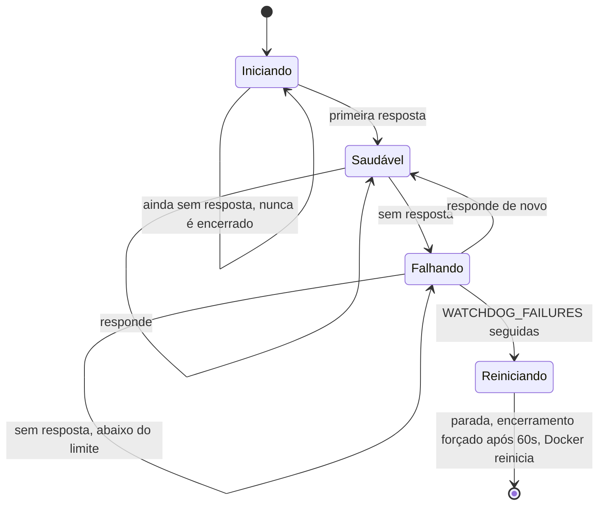
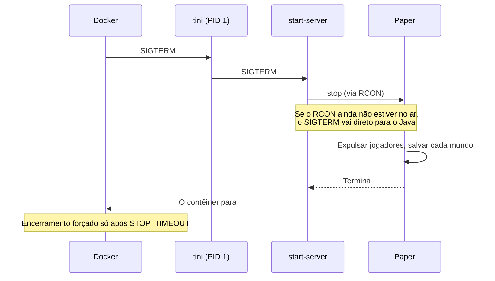

<!-- language-switcher -->
[English](../reliability.md) · [हिन्दी](../hi/reliability.md) · [Español](../es/reliability.md) · [简体中文](../zh-CN/reliability.md) · **Português (BR)** · [日本語](../ja/reliability.md) · [한국어](../ko/reliability.md)

#  Confiabilidade

Esta página explica tudo o que mantém o servidor no ar e o mundo seguro sem ninguém olhando.

| Mecanismo | Protege contra |
|---|---|
| [Política de reinício](#reinício-automático) | Travamentos, erros de falta de memória, reinicializações da máquina |
| [Verificação de saúde](#verificação-de-saúde) | Não saber se o servidor está funcionando de verdade |
| [Watchdog contra travamentos](#watchdog-contra-travamentos) | Um servidor congelado que está rodando mas não responde |
| [Desligamento seguro](#desligamento-seguro) | Perder ou corromper o mundo ao parar |
| [Segurança de memória](#segurança-de-memória) | Loops de encerramento por falta de memória |
| [Validação da configuração](#validação-da-configuração) | Erros de digitação virando loops de travamento ou recursos desativados em silêncio |
| [Proteções de versão e de dados](#proteções-de-versão-e-de-dados) | Downgrade do mundo, perda dos dados dos jogadores |
| [Backups](backups.md) | Todo o resto |

## Reinício automático

Os dois contêineres usam `restart: unless-stopped`. Sempre que o processo do servidor termina, seja por travamento, falta de memória, o watchdog ou alguém digitando `/stop`, o Docker o inicia de novo. Depois que a máquina reinicia, ele volta assim que o Docker volta. Só `make down` (ou `docker stop`) o mantém parado.

## Verificação de saúde

A cada 30 segundos o Docker roda `mc-health` dentro do contêiner:

1. Ele envia um **ping de lista de servidores**, a mesma requisição que a tela de multijogador do Minecraft faz, para a porta do jogo.
2. Se for recusado porque o servidor está oculto das listas (`enable-status=false`), ele usa um comando `list` via RCON.

O `make status` mostra `healthy` assim que uma verificação passa. Servidores novos têm **5 minutos** de folga para gerar o mundo. O contêiner `backup` espera o servidor ficar saudável antes de iniciar.

## Watchdog contra travamentos

Um servidor pode congelar com o processo ainda vivo: um deadlock, ou um plugin preso num loop infinito. O Docker só reinicia processos que terminam, então um watchdog em segundo plano no contêiner cuida disso:

- A cada `WATCHDOG_INTERVAL` segundos (padrão 60) ele roda a verificação de saúde.
- Ele só começa a contar **depois que o servidor respondeu uma vez**, então inicializações lentas nunca são encerradas.
- Depois de `WATCHDOG_FAILURES` falhas seguidas (padrão 5, cerca de 5 minutos), ele envia um sinal de parada normal, espera 60 segundos e então força o encerramento. Em seguida o Docker reinicia o servidor.




```
[start-server] Watchdog: server not responding (1/5)
...
[start-server] Watchdog: server is hung, killing it
```

O Paper tem seu próprio watchdog para ticks de jogo congelados. Este também pega congelamentos que o do Paper não enxerga. Defina `WATCHDOG_INTERVAL=0` para desativá-lo.

## Desligamento seguro

Parar um servidor de Minecraft matando o processo perde tudo desde o último salvamento automático e pode corromper chunks que estavam sendo gravados. Aqui toda parada segue o mesmo caminho:




1. O `tini` (PID 1) repassa o sinal de parada do Docker para o `start-server`.
2. O `start-server` envia `stop` via RCON. O Paper expulsa os jogadores, salva cada mundo e termina.
3. Se o RCON ainda não estiver no ar (por exemplo, durante a inicialização), o Java recebe um sinal de parada normal. O Paper também salva nesse caso.

O Docker espera até `STOP_TIMEOUT` (padrão `2m`) antes de forçar o encerramento. Para mundos muito grandes ou discos lentos, aumente:

```env
STOP_TIMEOUT=5m
```

## Segurança de memória

| Risco | Proteção |
|---|---|
| O heap cresce no meio do jogo e a máquina fica sem memória | O heap é fixado na inicialização (`-Xms` = `-Xmx` = `MEMORY`) e reservado de antemão, então problemas de memória aparecem ao iniciar, não durante o jogo |
| Heap grande demais para o contêiner, e o kernel o encerra (exit 137) em loop | A inicialização é recusada a menos que `MEMORY` + 512M caiba em `CONTAINER_MEMORY`. O erro diz o que configurar. |
| O Java fica sem heap e segue capengando | `-XX:+ExitOnOutOfMemoryError` faz ele sair de forma limpa, e o Docker o reinicia |

A coleta de lixo usa as conhecidas flags do Aikar para o G1, mudando para a variante de heap grande a partir de 12 GB, para pausas curtas e previsíveis.

## Validação da configuração

As configurações são verificadas antes de qualquer coisa iniciar. Um valor ruim interrompe a inicialização com uma mensagem que cita a configuração, em vez de causar um loop de travamento, um loop infinito de backups ou um recurso que se desliga em silêncio:

| Configuração | Exemplo de valor recusado | Mensagem |
|---|---|---|
| `EULA` | `false` | é preciso aceitar o EULA |
| `RCON_PASSWORD` | o antigo valor de exemplo, ou um com barra invertida (vazio não tem problema: uma é gerada) | explica o motivo e como gerar uma |
| `MEMORY` | `2GB` | precisa ser como `2G` ou `1536M` |
| `MEMORY` / `CONTAINER_MEMORY` | `4G` num contêiner de `3G` | diz qual `CONTAINER_MEMORY` definir |
| `WATCHDOG_INTERVAL`, `WATCHDOG_FAILURES` | `1m` | precisa ser um número inteiro |
| `PLUGIN_UPDATE_TIME` | `25:00` | precisa ser `HH:MM` |
| `BACKUP_INTERVAL` | `abc` | precisa ser como `30m`, `6h`, `1d` |
| `BACKUP_KEEP` | `0` | precisa ser 1 ou mais |
| `MC_VERSION` | `1.16.5`, `9.9` | antiga demais, ou indisponível |
| `PAPER_BUILD` | um número com `MC_VERSION=latest` | precisa de uma versão exata |

## Proteções de versão e de dados

- **Downgrades do mundo são recusados**, e antes de cada atualização é feito um backup. Veja [Versões do Minecraft](minecraft-versions.md).
- **Os dados dos jogadores acompanham os jogadores** ao trocar entre modo online e offline. Um backup é feito antes, e o servidor não inicia com a migração pela metade. Veja [Modo online e offline](offline-mode.md).
- **Problemas de plugins nunca impedem a inicialização.** Falhas de download mantêm a versão instalada, e plugins que não conseguem carregar são pulados. Veja [Plugins](plugins.md).

## Privilégio mínimo e isolamento

- O servidor roda como um usuário sem privilégios (`PUID`/`PGID`). O root só é usado por um instante na inicialização para corrigir o dono dos arquivos.
- O RCON só é acessível na rede privada do Compose.
- A rotação de logs do Docker (5 × 10 MB por contêiner) impede que os logs encham o disco.
