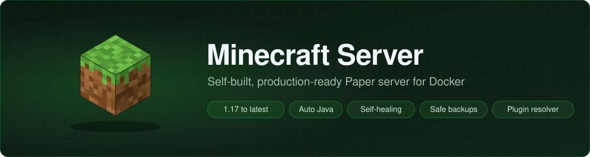

<div align="center">



[](../es/minecraft-versions.md)
[](https://papermc.io)
[-orange?logo=openjdk&logoColor=white)](../es/minecraft-versions.md#cómo-se-elige-java)
[](https://docs.docker.com/compose/)
[](../es/deployment.md)

[Inicio rápido](#inicio-rápido) ·
[Características](#características) ·
[Documentación](../es/README.md) ·
[Solución de problemas](../es/troubleshooting.md)

<!-- language-switcher -->
[English](../../README.md) · [हिन्दी](README.hi.md) · **Español** · [简体中文](README.zh-CN.md) · [Português (BR)](README.pt-BR.md) · [日本語](README.ja.md) · [한국어](README.ko.md)

</div>

---

Ejecuta cualquier versión de Minecraft: Java Edition, desde la 1.17 hasta la más reciente, sobre [Paper](https://papermc.io), con un solo comando. El servidor se reinicia solo, guarda el mundo correctamente, hace copias de seguridad programadas, mantiene los plugins compatibles y rechaza configuraciones que lo romperían.

Todo está construido desde cero: sin imágenes ni scripts de servidor de terceros. Las únicas fuentes son las imágenes oficiales de Java `eclipse-temurin` y los servicios oficiales de descarga de PaperMC, Mojang, Modrinth y Hangar. Se verifica el checksum de cada jar de servidor y de plugin.

## Inicio rápido

### Imagen lista para usar

Sin construir nada: Minecraft 26.3 (última estable) con Java 25, sin plugins, para Intel/AMD y ARM.

```bash
docker run -d --name minecraft --restart unless-stopped \
  -p 25565:25565 -e EULA=TRUE -e MEMORY=2G \
  -v minecraft-data:/data \
  agrawalchaitany/minecraft-server:26.3
```

Poner `EULA=TRUE` significa aceptar el [EULA de Minecraft](https://aka.ms/MinecraftEULA). Conéctate a `localhost:25565`; abre la consola con `docker exec -it minecraft rcon-cli`. La misma imagen está en GitHub Packages como `ghcr.io/agrawalchaitany/minecraft-server`.

Con copias de seguridad programadas (en `./backups`), usa el [archivo compose](../../quickstart/compose.yaml) listo para usar:

```bash
mkdir minecraft && cd minecraft
curl -fsSLO https://raw.githubusercontent.com/agrawalchaitany/minecraft-server/main/quickstart/compose.yaml
echo EULA=TRUE > .env
docker compose up -d
```

### Construir desde el código

Para elegir la versión de Minecraft, añadir plugins o cambiar cualquier otra cosa, constrúyelo tú mismo:

```bash
cp .env.example .env
```

Edita `.env`:

```env
EULA=TRUE                         # accept https://aka.ms/MinecraftEULA
RCON_PASSWORD=                    # optional; generated automatically if empty
MC_VERSION=latest                 # or an exact version, e.g. 1.21.4 (see: make versions)
```

Arráncalo:

```bash
make up
make status        # wait for (healthy), then connect to localhost:25565
```

Guía completa: **[Primeros pasos](../es/getting-started.md)**.

## Características

| Área | Qué obtienes |
|---|---|
|  **Cualquier versión** | Minecraft 1.17 hasta la más reciente. El Java adecuado (17, 21 o 25) se elige automáticamente. Antes de actualizar se hace una copia del mundo; se rechazan las bajadas de versión que lo dañarían. [Más](../es/minecraft-versions.md) |
|  **Autorreparación** | Se reinicia tras fallos y errores de memoria. Una comprobación de salud y un watchdog que reinicia un servidor congelado. [Más](../es/reliability.md) |
|  **Apagado seguro** | Cada parada guarda primero todos los mundos a través de la consola del servidor. [Más](../es/reliability.md#apagado-seguro) |
|  **Copias de seguridad** | Programadas y consistentes aunque haya jugadores conectados, con bloqueo para que nunca se solapen, verificadas, con control de espacio en disco y rotación. Se hacen automáticamente antes de actualizaciones, migraciones, actualizaciones de plugins y restauraciones. [Más](../es/backups.md) |
|  **Restauración segura** | Un comando. Primero comprueba el archivo, hace una copia de seguridad de seguridad y extrae en una carpeta temporal, para que un fallo no pueda hacerte perder el mundo actual. [Más](../es/backups.md#restaurar) |
|  **Gestor de plugins** | Lista los plugins en `plugins.txt`. Para cada uno se elige la versión más reciente que realmente funciona con tu Minecraft y tu Java, inspeccionando el propio jar. Se instalan las dependencias necesarias. Se detectan conflictos y duplicados. Actualizaciones bajo demanda o diarias. [Más](../es/plugins.md) |
|  **Modo sin conexión** | Permite entrar a jugadores sin cuenta oficial, aplicando las reglas de nombres de usuario de Mojang y conservando sus inventarios al cambiar de modo. [Más](../es/offline-mode.md) |
|  **Protecciones** | Cada ajuste se valida al arrancar con un mensaje claro. Nada de bucles de fallos por erratas. [Más](../es/reliability.md#validación-de-la-configuración) |
|  **Mínimos privilegios** | Se ejecuta con un usuario sin privilegios de root. La consola remota nunca se expone fuera de Docker. Los logs se rotan. |

## Comandos del día a día

| Comando | |
|---|---|
| `make up` | Arrancar, o aplicar cambios de `.env` |
| `make down` | Detener (los mundos se guardan) |
| `make status` / `make logs` | Estado y logs |
| `make console` / `make cmd C="op Steve"` | Consola del servidor |
| `make backup` / `make restore FILE=…` | Copia de seguridad y restauración |
| `make update-plugins` / `make plugins` | Aplicar `plugins.txt` y ver los plugins instalados |
| `make versions` / `make update` | Listar versiones de Minecraft; actualizar Paper |

Todos los comandos: [Operaciones](../es/operations.md).

## Documentación

| | Guía | |
|:-:|---|---|
|  | [Primeros pasos](../es/getting-started.md) | Funcionando en cinco minutos |
|  | [Arquitectura](../es/architecture.md) | Cómo funciona, desde `make up` hasta un servidor en marcha |
|  | [Configuración](../es/configuration.md) | Cada ajuste de `.env` |
|  | [Operaciones](../es/operations.md) | Tareas del día a día |
|  | [Versiones de Minecraft](../es/minecraft-versions.md) | Versiones, Java, actualizaciones y bajadas de versión |
|  | [Plugins](../es/plugins.md) | `plugins.txt`, resolución de compatibilidad, actualizaciones automáticas, mods |
|  | [Copias de seguridad y restauración](../es/backups.md) | Cómo las copias se mantienen consistentes y las restauraciones seguras |
|  | [Fiabilidad](../es/reliability.md) | Comprobación de salud, watchdog, apagado, memoria, validación |
|  | [Modo con y sin conexión](../es/offline-mode.md) | Jugadores sin cuenta, reglas de nombres, datos de jugadores |
|  | [Despliegue](../es/deployment.md) | Servidores Linux, macOS, firewalls, copias fuera del servidor |
|  | [Casos límite](../es/edge-cases.md) | Situaciones inusuales y cómo se gestionan |
|  | [Solución de problemas](../es/troubleshooting.md) | Síntomas y soluciones |

## Requisitos

- Docker Desktop (macOS/Windows) o Docker Engine 24+ con el plugin Compose (Linux)
- `make`
- Unos 3 GB de memoria libre con la configuración por defecto

## Estructura del proyecto

```
Dockerfile, compose.yaml, Makefile, .env.example
scripts/     startup, backup, restore, and helper scripts
tools/       dependency-free Java tools (RCON, versions, plugins, player migration)
plugins/     plugins.txt and the built-in username-rules plugin
docs/        documentation
```

## Aviso legal

Sin afiliación con Mojang Studios, Microsoft ni PaperMC. Minecraft es una marca registrada de Mojang Studios. Para ejecutar el servidor es necesario aceptar el [EULA de Minecraft](https://aka.ms/MinecraftEULA).
