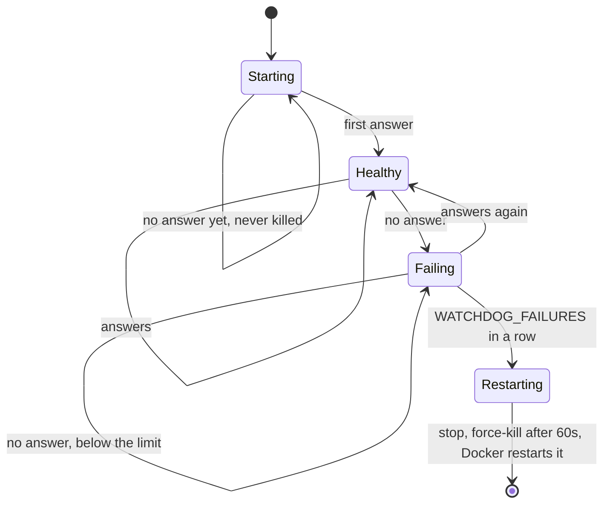
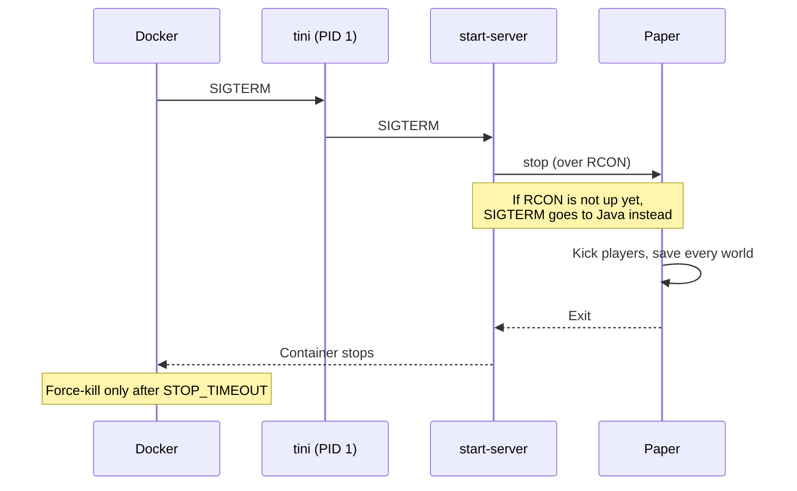

<!-- language-switcher -->
**English** · [हिन्दी](hi/reliability.md) · [Español](es/reliability.md) · [简体中文](zh-CN/reliability.md) · [Português (BR)](pt-BR/reliability.md) · [日本語](ja/reliability.md) · [한국어](ko/reliability.md)

#  Reliability

This page explains everything that keeps the server up and the world safe without anyone watching.

| Mechanism | Protects against |
|---|---|
| [Restart policy](#automatic-restart) | Crashes, out-of-memory errors, host reboots |
| [Health check](#health-check) | Not knowing whether the server actually works |
| [Hang watchdog](#hang-watchdog) | A frozen server that's running but not responding |
| [Graceful shutdown](#graceful-shutdown) | Losing or corrupting the world when stopping |
| [Memory safety](#memory-safety) | Out-of-memory kill loops |
| [Configuration validation](#configuration-validation) | Typos turning into crash loops or silently disabled features |
| [Version and data guards](#version-and-data-guards) | World downgrades, player data loss |
| [Backups](backups.md) | Everything else |

## Automatic restart

Both containers use `restart: unless-stopped`. Whenever the server process exits, whether from a crash, an out-of-memory error, the watchdog, or someone typing `/stop`, Docker starts it again. After a host reboot, it comes back as soon as Docker does. Only `make down` (or `docker stop`) keeps it stopped.

## Health check

Every 30 seconds Docker runs `mc-health` inside the container:

1. It sends a **server list ping**, the same request the Minecraft multiplayer screen makes, to the game port.
2. If that's refused because the server is hidden from server lists (`enable-status=false`), it falls back to an RCON `list` command.

`make status` shows `healthy` once a check passes. New servers get **5 minutes** of grace for world generation. The `backup` container waits until the server is healthy before it starts.

## Hang watchdog

A server can freeze while its process stays alive: a deadlock, or a plugin stuck in an infinite loop. Docker only restarts processes that exit, so a background watchdog in the container covers this:

- Every `WATCHDOG_INTERVAL` seconds (default 60) it runs the health check.
- It only starts counting **after the server has answered once**, so slow first starts are never killed.
- After `WATCHDOG_FAILURES` failures in a row (default 5, so about 5 minutes), it sends a normal stop signal, waits 60 seconds, then force-kills. Docker then restarts the server.




```
[start-server] Watchdog: server not responding (1/5)
...
[start-server] Watchdog: server is hung, killing it
```

Paper has its own watchdog for frozen game ticks. This one also catches freezes Paper's can't see. Set `WATCHDOG_INTERVAL=0` to disable it.

## Graceful shutdown

Stopping a Minecraft server by killing it loses everything since the last autosave and can corrupt chunks being written. Every stop here goes through the same path:




1. `tini` (PID 1) passes Docker's stop signal to `start-server`.
2. `start-server` sends `stop` over RCON. Paper kicks players, saves every world, and exits.
3. If RCON isn't up yet (for example, during startup), Java gets a normal stop signal instead. Paper still saves on that.

Docker waits up to `STOP_TIMEOUT` (default `2m`) before force-killing. For very large worlds or slow disks, raise it:

```env
STOP_TIMEOUT=5m
```

## Memory safety

| Risk | Protection |
|---|---|
| The heap grows mid-game and the host runs out | The heap is fixed at startup (`-Xms` = `-Xmx` = `MEMORY`) and pre-touched, so memory problems show up at start, not during play |
| Heap too big for the container, so the kernel kills it (exit 137) in a loop | The start is refused unless `MEMORY` + 512M fits in `CONTAINER_MEMORY`. The error says what to set. |
| Java runs out of heap and limps along | `-XX:+ExitOnOutOfMemoryError` makes it exit cleanly, and Docker restarts it |

Garbage collection uses the widely used Aikar's flags for G1, switching to the large-heap variant at 12 GB and above, for short and predictable pauses.

## Configuration validation

Settings are checked before anything starts. A bad value stops the start with a message naming the setting, instead of causing a crash loop, an endless backup loop, or a feature that quietly turns itself off:

| Setting | Example of a rejected value | Message |
|---|---|---|
| `EULA` | `false` | must accept the EULA |
| `RCON_PASSWORD` | the placeholder, or a value with a backslash | explains why and how to generate one |
| `MEMORY` | `2GB` | must look like `2G` or `1536M` |
| `MEMORY` / `CONTAINER_MEMORY` | `4G` in a `3G` container | says which `CONTAINER_MEMORY` to set |
| `WATCHDOG_INTERVAL`, `WATCHDOG_FAILURES` | `1m` | must be a whole number |
| `PLUGIN_UPDATE_TIME` | `25:00` | must be `HH:MM` |
| `BACKUP_INTERVAL` | `abc` | must look like `30m`, `6h`, `1d` |
| `BACKUP_KEEP` | `0` | must be 1 or more |
| `MC_VERSION` | `1.16.5`, `9.9` | too old, or not available |
| `PAPER_BUILD` | a number with `MC_VERSION=latest` | needs an exact version |

## Version and data guards

- **World downgrades are refused**, and upgrades are backed up first. See [Minecraft versions](minecraft-versions.md).
- **Player data follows players** when switching online/offline mode. A backup is taken first, and the server won't start half-migrated. See [Online and offline mode](offline-mode.md).
- **Plugin problems never block startup.** Download failures keep the installed version, and plugins that can't load are skipped. See [Plugins](plugins.md).

## Least privilege and isolation

- The server runs as an unprivileged user (`PUID`/`PGID`). Root is used only for a moment at startup to fix file ownership.
- RCON is only reachable on the private Compose network.
- Docker log rotation (5 × 10 MB per container) keeps logs from filling the disk.
