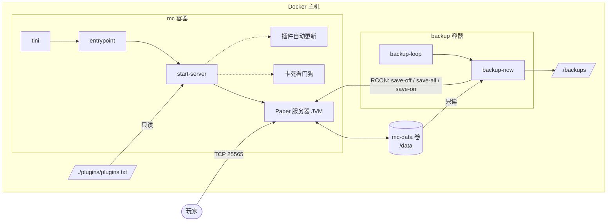
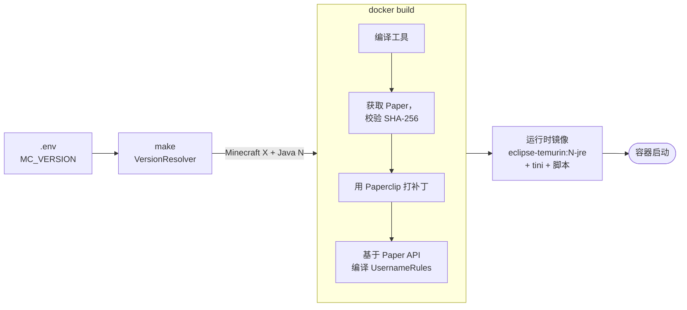
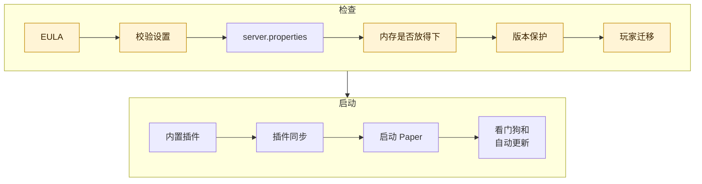

<!-- language-switcher -->
[English](../architecture.md) · [हिन्दी](../hi/architecture.md) · [Español](../es/architecture.md) · **简体中文** · [Português (BR)](../pt-BR/architecture.md) · [日本語](../ja/architecture.md) · [한국어](../ko/architecture.md)

#  架构

本页介绍项目是如何组织的：什么在哪里运行、构建和启动时会发生什么，以及数据存放在哪里。

## 整体结构



| 组成部分 | 是什么 |
|---|---|
| **镜像** `local/paper-server` | 基于 `Dockerfile` 在本地构建。同一个镜像运行两个容器。 |
| **`mc` 容器** | 游戏服务器，以及辅助进程（看门狗、可选的插件自动更新）。 |
| **`backup` 容器** | 同一个镜像，用 `backup` 命令启动。负责定时备份。 |
| **`mc-data` 卷** | 服务器写入的一切：世界、配置、插件、玩家数据。重新构建后依然保留。 |
| **`./backups`** | 备份归档，位于主机上，方便你复制到任何地方。 |
| **`./plugins/plugins.txt`** | 你的插件列表，以只读方式挂载进服务器。 |
| **RCON** | Minecraft 的远程控制台。脚本用它来保存世界和发送命令。只能在 Compose 网络内部访问，从不发布到主机。 |

## 从 `make up` 到服务器运行




### 1. 解析版本（在你的机器上）

`make` 会在一个临时的 `eclipse-temurin:25-jdk` 容器中运行 `VersionResolver`。它向 PaperMC API 查询哪个 Paper 版本对应 `MC_VERSION`、该版本需要哪个 Java，然后选择匹配的 Java LTS（17、21 或 25）：

```
==> Minecraft 1.21.4 (Paper) on Java 21
```

结果会传给镜像构建。你的机器上只需要 Docker。

### 2. 构建镜像

`Dockerfile` 分为两个阶段。

**构建阶段**（`eclipse-temurin:25-jdk`）：

1. 把项目的 Java 工具（`tools/*.java`）编译为 Java 17 目标，使它们能在任何服务器 Java 上运行。
2. 运行 `scripts/fetch-paper.sh`。它为所选版本找到最新的稳定 Paper 构建，检查所选 Java 是否足够新，下载 jar，并**校验其 SHA-256 checksum**。
3. 让 Paper 的启动器（Paperclip）构建完整的服务器 jar。这一步会从 Mojang 下载官方 Minecraft 服务器。该步骤会重试，因为即使下载失败，Paperclip 也可能正常退出。
4. 基于该版本的确切 Paper API 编译内置的 `UsernameRules` 插件。

**运行阶段**（`eclipse-temurin:<17|21|25>-jre`）：

- 经过校验的 Paper jar、工具、内置插件以及 `scripts/` 中的脚本
- 作为 PID 1 的 `tini`，让信号能传到服务器，并清理僵尸进程

### 3. 启动容器

每个容器都以 `tini → entrypoint` 启动。entrypoint 会：

1. 按需把 `/data` 和 `/backups` 的所有权修正为 `PUID:PGID`。
2. 放弃 root 权限。
3. 运行指定的模式：`server`、`backup`、`backup-now` 或 `restore`。

### 4. 服务器启动顺序（`start-server`）

每一步按顺序执行。任何失败都会以清楚的提示停止启动，而不是在错误状态下启动。




高亮的步骤可能会以清楚的提示停止启动。

| # | 步骤 | 详情 |
|---|---|---|
| 1 | 检查 EULA | 除非 `EULA=TRUE`，否则拒绝启动。 |
| 2 | 校验设置 | RCON 密码、`MEMORY` 格式、数字、时间格式。参见 [可靠性](reliability.md#配置校验)。 |
| 3 | 写入 `server.properties` | 应用 `.env` 中的游戏设置。始终强制设置端口、监听地址和 RCON 设置。 |
| 4 | 检查内存是否放得下 | 拒绝放不进容器内存上限的堆大小。 |
| 5 | 世界版本保护 | 升级前先备份，并拒绝降级。参见 [Minecraft 版本](minecraft-versions.md)。 |
| 6 | 玩家数据迁移 | 如果在线/离线模式改变了，把玩家数据迁移到新的 ID。参见 [在线与离线模式](offline-mode.md)。 |
| 7 | 内置插件 | 安装或移除 `UsernameRules.jar`（`ENFORCE_USERNAME_RULES`）。 |
| 8 | 插件同步 | 应用暂存的插件更新；如果 `plugins.txt`、Minecraft 或 Java 有变化，就重新解析。永远不会阻止启动。 |
| 9 | 启动 Paper | 用调优过的参数运行 JVM。 |
| 10 | 辅助进程 | 启动卡死看门狗；如已启用，还会启动插件自动更新调度器。 |

### 5. 关闭顺序

```
docker stop / make down / make restart
  → tini forwards SIGTERM
  → start-server sends "stop" over RCON (or SIGTERM to Java if RCON isn't up yet)
  → Paper saves every world and exits
  → container stops
```

Docker 会等待 `STOP_TIMEOUT`（默认 2 分钟）后才强制终止。

## 数据布局

在 `mc-data` 卷（`/data`）中：

```
/data
├── world/                     # 世界（名称来自 LEVEL_NAME）
├── plugins/
│   ├── *.jar                  # 已安装的插件
│   ├── <Plugin>/              # 每个插件自己的设置
│   └── .managed/
│       ├── lock.tsv           # plugins.txt 安装了哪些插件及版本
│       └── pending/           # 暂存的插件更新，下次启动时应用
├── server.properties, bukkit.yml, spigot.yml, config/   # 服务器配置
├── ops.json, whitelist.json, banned-players.json        # 管理列表
├── .mc-version                # 世界上次运行的 Minecraft 版本
├── .player-uuid-mode          # 玩家数据对应的在线/离线模式
├── cache/, libraries/, versions/   # 由 Paper 重新生成；不进入备份
└── logs/                      # 服务器日志；不进入备份
```

## 外部服务

| 服务 | 用途 | 时机 |
|---|---|---|
| Docker Hub（`eclipse-temurin`） | Java 镜像 | 构建 |
| PaperMC API（`fill.papermc.io`） | Paper 版本、下载、checksum | 构建、`make versions` |
| Mojang（`piston-data.mojang.com`） | Paper 打补丁所用的官方服务器 jar | 构建、首次启动 |
| Mojang（`api.mojang.com`） | 用户名 → 账号 ID | 仅在已有玩家时切换到在线模式 |
| Modrinth、Hangar | 插件元数据和下载 | 仅在安装和更新插件时 |

不使用任何第三方服务器镜像或脚本。每个下载的服务器和插件 jar 都会校验 checksum。

## 源码结构

```
Dockerfile, compose.yaml, Makefile, .env.example
scripts/
  entrypoint.sh       修正所有权、放弃 root、分派模式
  start-server.sh     启动顺序、信号处理、看门狗、自动更新
  fetch-paper.sh      解析并校验 Paper 下载（构建时）
  backup-now.sh       一次一致、加锁、经过校验的备份
  backup-loop.sh      备份调度器
  restore-backup.sh   通过暂存目录安全恢复
  plugins, rcon-cli, mc-health   Java 工具的轻量包装
tools/                无依赖的 Java 工具，编译为 mctool.jar
  McTool.java         入口；RCON 客户端和服务器列表 ping
  VersionResolver.java  Minecraft 版本 → Paper 版本 + Java
  PluginManager.java  plugins.txt 解析、下载与校验
  PlayerMigrator.java 在线/离线 UUID 迁移
  Json.java, Yaml.java  极简解析器
plugins/
  plugins.txt         你的插件列表
  username-rules/     内置插件源码
docs/                 本文档
  assets/             横幅和图标（手工制作的 SVG）
```
