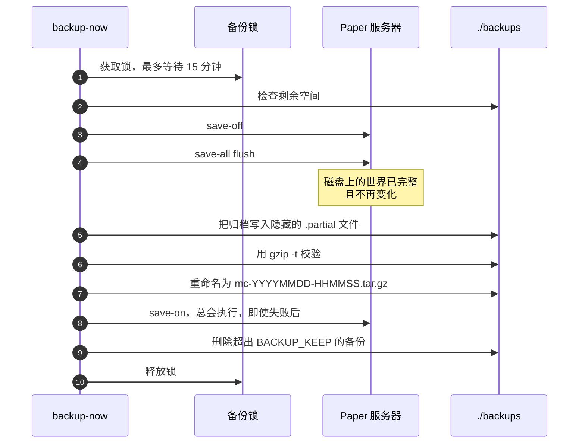
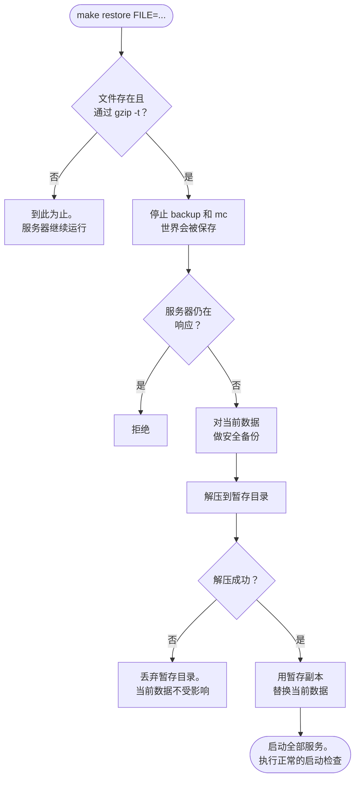

<!-- language-switcher -->
[English](../backups.md) · [हिन्दी](../hi/backups.md) · [Español](../es/backups.md) · **简体中文** · [Português (BR)](../pt-BR/backups.md) · [日本語](../ja/backups.md) · [한국어](../ko/backups.md)

#  备份与恢复

备份会自动执行，即使玩家在线也能保持一致，并在被计入之前经过校验。恢复的设计保证一次失误不会让你失去当前的世界。

## 概览

| | |
|---|---|
| **计划** | 每隔 `BACKUP_INTERVAL`（默认 `1h`），由 `backup` 容器执行 |
| **保留** | 最新的 `BACKUP_KEEP` 个（默认 `24`） |
| **位置** | 主机上的 `./backups/`，文件名为 `mc-YYYYMMDD-HHMMSS.tar.gz`（UTC 时间） |
| **手动** | `make backup` |
| **列表** | `make backups` |
| **恢复** | `make restore FILE=mc-….tar.gz` |

**每次有风险的操作之前也会自动备份**：

| 在……之前 | 由谁执行 |
|---|---|
| 把世界升级到更新的 Minecraft 版本 | `start-server` |
| 在在线与离线模式之间迁移玩家数据 | `start-server` |
| 应用插件更新（`make update-plugins`、自动更新） | 更新命令 |
| 恢复备份（对将被替换内容做一次"安全备份"） | `restore` |

## 备份包含什么

让服务器恢复原样所需的一切：世界、`server.properties` 及其他配置、插件及其设置、玩家数据、管理员/白名单/封禁列表，以及版本标记。

以下内容会被排除，因为 Paper 会重新生成它们，或者它们只是临时文件：

| 排除的内容 | 原因 |
|---|---|
| `cache/`、`libraries/`、`versions/` | 由 Paper 在启动时下载或生成 |
| `logs/` | 恢复时不需要；可能很大 |
| `plugins/.managed/pending/` | 暂存的插件更新，下次更新时会重新生成 |
| `plugins/spark/tmp/` | 性能分析器的临时文件 |

## 备份如何保持一致

Minecraft 世界由成千上万个文件组成，服务器会不断重写它们。在写入过程中复制，可能会拿到只保存了一半的区块。因此每次备份都会：



1. **获取备份锁。**同一时间只运行一个备份，即使跨越 `mc` 和 `backup` 两个容器也是如此。否则第二个备份可能会在第一个还在读取时重新打开自动保存。备份最多等待 15 分钟获取锁。
2. **检查磁盘空间**（见下文）。
3. **通过 RCON 暂停自动保存并刷写**：先 `save-off`，再 `save-all flush`。内存中的一切现在都已写到磁盘上，并保持不变。
4. **把 `/data` 归档**到一个隐藏的 `.partial` 文件。
5. **用 `gzip -t` 校验归档。**损坏的归档会被丢弃，旧的备份保留。
6. **重命名到正式位置。**写了一半的备份永远不会看起来像真正的备份。
7. **用 `save-on` 恢复自动保存。**即使上面任何一步失败也会执行。
8. **删除超出 `BACKUP_KEEP` 的最旧备份。**

玩家可以一直正常游戏；不会有任何公告或冻结。

如果无法连接 RCON（例如服务器已停止），备份会跳过第 3 步并说明这一点。服务器没在运行时这样做是安全的。

## 磁盘空间安全

占满磁盘的备份还可能导致服务器无法保存世界，从而有损坏风险。开始之前，备份会估算自己的大小（上一次备份的大小再加 20%，首次备份则按数据大小的 60%），除非剩余空间不少于这个数**再加 512 MB**，否则拒绝运行：

```
ERROR: not enough disk space: about 102M needed plus 512M headroom, 20M free. Lower BACKUP_KEEP or free space.
```

定时循环会记录失败，并在下一个间隔再次尝试。

## 恢复

```bash
make backups                                   # pick one
make restore FILE=mc-20261030-175220.tar.gz
```

按顺序会发生：



1. **在动任何东西之前，先在你的机器上检查：**文件必须存在并通过 `gzip -t`。拼写错误或损坏的文件会在这里被拦下，服务器继续运行。
2. 停止 `backup` 和 `mc` 容器（世界会被保存）。
3. 如果服务器仍在响应，恢复会拒绝继续。
4. 对当前状态做一次**安全备份**。
5. 备份会被解压到正在使用的数据旁边的**暂存目录**中。如果解压失败（例如磁盘已满），当前数据不受影响。
6. 只有这时才用暂存副本替换当前数据。
7. 所有服务重新启动。

恢复之后，正常的启动检查仍然有效：

- 在比服务器**更新**的 Minecraft 版本上制作的备份，会被[降级保护](minecraft-versions.md#降级)拒绝。
- 在**更旧**版本上制作的备份会被升级，升级前会再做一次备份。
- 在另一种在线/离线模式下制作的备份，其玩家数据会被[迁移](offline-mode.md#跨模式的玩家数据)。
- 插件会重新与 `plugins.txt` 同步。

安全备份就是普通备份。当它比最新的 `BACKUP_KEEP` 个备份还旧时，正常轮换会把它删除；如果想保留它，请复制到别处。

## 在新机器上恢复

1. 在新机器上设置项目（[入门指南](getting-started.md)），使用与备份**相同的 `MC_VERSION`** 或更新的版本。
2. 把备份文件复制到 `./backups/`。
3. 运行一次 `make up`，让容器和卷存在。
4. 运行 `make restore FILE=…`。

## 异地副本

`./backups` 中的备份和服务器在同一块磁盘上。它们能防范失误和损坏，但防不了整台机器的丢失。请定期把它们复制到别处；示例参见 [部署](deployment.md#异地备份)。

## 手动打开备份

备份是普通的 `tar.gz` 归档：

```bash
tar -tzf backups/mc-20261030-175220.tar.gz | head        # list contents
mkdir /tmp/old && tar -xzf backups/mc-….tar.gz -C /tmp/old ./world/
```
