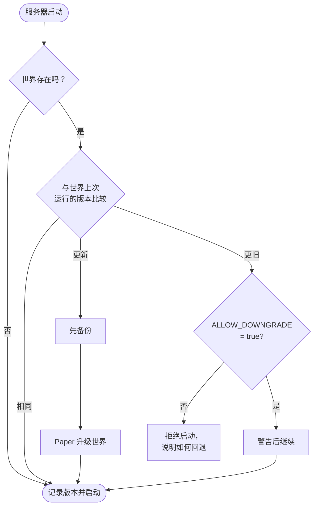

<!-- language-switcher -->
[English](../minecraft-versions.md) · [हिन्दी](../hi/minecraft-versions.md) · [Español](../es/minecraft-versions.md) · **简体中文** · [Português (BR)](../pt-BR/minecraft-versions.md) · [日本語](../ja/minecraft-versions.md) · [한국어](../ko/minecraft-versions.md)

#  Minecraft 版本

你可以运行从 **1.17** 到最新发布的任意 Minecraft 版本。系统会自动选择合适的 Java，并在版本变化时保护你的世界。

## 选择版本

在**第一次 `make up` 之前**在 `.env` 中设置：

```env
MC_VERSION=1.21.4
```

有效值：

- `latest`：拥有**稳定** Paper 构建的最新 Minecraft 版本。每次构建镜像时都会重新解析。
- 一个确切的版本，例如 `1.20.4`、`1.21.4` 或 `26.3`

查看可用版本：

```bash
make versions
```

```
MINECRAFT  JAVA   PAPER SUPPORT
26.3       25     supported
26.2       25     deprecated
1.21.11    21     unsupported
...
```

"Paper support" 一列是 PaperMC 自己给出的状态。"unsupported" 的版本仍然可以运行，但不再获得 PaperMC 的修复。

## 如何选择 Java

每个 Minecraft 版本都需要一个最低 Java 版本。`make` 会查询 PaperMC API，并选择满足要求的最旧 Java LTS，因为该 Minecraft 版本正是基于它构建和测试的：

| Minecraft | Java |
|---|---|
| 1.17 – 1.20.4 | 17 |
| 1.20.5 – 1.21.x | 21 |
| 26.x | 25 |

然后基于该版本的官方 `eclipse-temurin` Java 镜像构建镜像。`make up` 会显示选择结果：

```
==> Minecraft 1.20.4 (Paper) on Java 17
```

如果想强制使用更新的 Java，例如你需要的某个插件是为 Java 21 编译的，而你运行的是 1.20.4，就在 `.env` 中设置 `JAVA_VERSION=21`。对所选 Minecraft 版本来说过旧的 Java 会被拒绝。

Minecraft **1.16.5 及更早版本**需要 Java 8 或 11，不受支持；`make` 会给出清晰提示并拒绝。

## 版本变化时会发生什么

每次启动时，服务器都会把当前 Minecraft 版本与世界上次运行的版本进行比较：



## 升级

1. 先看看你的插件是否支持新版本（可选；插件会被自动重新解析）。
2. 修改 `.env` 中的 `MC_VERSION`。
3. 运行 `make up`。

使用新版本首次启动时：

```
[start-server] Upgrading world from Minecraft 1.20.4 to 1.21.4; taking a backup first
[backup] Saved /backups/mc-20261030-195423.tar.gz (51M)
[plugins] plugins.txt, Minecraft or Java changed: resolving plugins for Minecraft 1.21.4 on Java 21
[plugins] ~ WorldEdit 7.3.0 -> 7.4.2
```

- **在 Minecraft 升级世界之前会先备份。**如果升级出了问题，就恢复这个备份。
- **插件会针对新的 Minecraft 和 Java 版本重新解析。**参见 [插件](plugins.md)。

## 降级

Minecraft 无法安全地打开由更新版本保存的世界；区块和物品可能丢失或损坏。因此服务器会在 `/data/.mc-version` 中记录每个世界上次运行的版本，并拒绝用更旧的版本启动：

```
[start-server] This world was last run on Minecraft 1.21.4, but the server is now 1.20.4.
[start-server] Opening a world in an older version can corrupt it, so the server will not start.
[start-server] Set MC_VERSION=1.21.4 in .env (or restore a backup made on 1.20.4) and run 'make up'.
```

真正回退的方法：

1. 把 `MC_VERSION` 改回旧版本。
2. 恢复一个**在该旧版本运行时**制作的备份（`make restore FILE=…`），例如升级前自动生成的那个备份。

设置 `ALLOW_DOWNGRADE=true` 会跳过这项检查。只有在你确定世界兼容时才使用，例如刚升级完、还没有任何人进入的时候。

## 固定在某个版本

`MC_VERSION=latest` 会在每次重建镜像时（修改后执行 `make up`，或执行 `make update`）跳到新的 Minecraft 版本。对于大家依赖的服务器，在你满意之后请**固定为确切版本**：

```env
MC_VERSION=26.3
```

之后 `make update` 只会获取同一 Minecraft 版本的更新 Paper 构建（错误和安全修复）。

## 固定 Paper 构建

```env
MC_VERSION=1.21.4
PAPER_BUILD=232
```

`PAPER_BUILD` 只能与确切的 `MC_VERSION` 一起使用，因为每个版本的构建编号是单独计数的。主要用于停留在已知可靠的构建，或从有问题的构建回退。

## 已测试的版本

已在 1.17.1、1.18.2 和 1.20.4（Java 17）、1.21.4（Java 21）以及 26.3（Java 25）上验证了构建和干净启动。从 1.20.4 升级到 1.21.4 以及降级保护也已测试。
