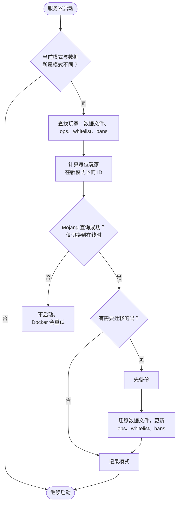

<!-- language-switcher -->
[English](../offline-mode.md) · [हिन्दी](../hi/offline-mode.md) · [Español](../es/offline-mode.md) · **简体中文** · [Português (BR)](../pt-BR/offline-mode.md) · [日本語](../ja/offline-mode.md) · [한국어](../ko/offline-mode.md)

#  在线与离线模式

默认情况下，只有拥有正版 Minecraft 账号的玩家才能加入。离线模式允许所有人加入，包括没有账号的朋友。本页介绍如何切换、存在的风险，以及让离线模式更安全的两项功能：**用户名规则**和**玩家数据迁移**。

## EULA 和在线模式是两回事

| 设置 | 含义 | 涉及谁 |
|---|---|---|
| `EULA=TRUE` | 你作为服务器运营者，接受 Mojang 的 EULA。运行服务器必须设置。 | 你 |
| `ONLINE_MODE` | 玩家是否必须证明自己拥有正版账号 | 你的玩家 |

玩家永远不会看到或接受 EULA。阻止无账号玩家的是在线模式，而不是 EULA。

## 切换模式

```env
ONLINE_MODE=false     # anyone can join
ONLINE_MODE=true      # official accounts only
```

然后运行 `make up`。你可以来回切换，玩家数据会跟着走（见[下文](#跨模式的玩家数据)）。

## 风险：用户名不会被验证

在线模式下，Mojang 保证每个玩家就是其名字所代表的人。离线模式下，**任何人都可以输入任何名字**，包括你的名字，从而获得你的管理员权限和物品栏。

- 只在必要时给玩家管理员权限。
- **白名单无法保护你**：它只匹配名字，而名字可以伪造。
- 对于公开的离线服务器，请添加登录插件，让每位玩家在首次加入时设置密码。

## 用户名规则

离线模式通常几乎接受任何名字。内置的 `UsernameRules` 插件会应用与 Mojang 账号相同的规则：

| 规则 | 被拒绝的例子 |
|---|---|
| 3–16 个字符 | `ab`、`ThisNameIsWayTooLong` |
| 只能包含 `A–Z`、`a–z`、`0–9`、`_` | `bad name`、`bad-name`、`café`、`x.y` |
| 不区分大小写时必须唯一 | `Steve` 已经玩过时的 `steve` |

第一个使用某个名字的玩家拥有这个拼写。其他人会看到：

```
The username Steve is already taken.
If it is yours, log in as exactly "Steve".
```

拒绝会记录在日志中。在线模式下该插件不做任何事，因为 Mojang 已经执行这些规则。用 `ENFORCE_USERNAME_RULES=false` 关闭它。

> [!NOTE]
> 如果你添加了 [Geyser/Floodgate](https://geysermc.org) 让基岩版玩家加入，他们的名字通常带有 `.Steve` 这样的前缀，会被这些规则拒绝。这种情况下请设置 `ENFORCE_USERNAME_RULES=false`。

## 跨模式的玩家数据

Minecraft 把每位玩家的物品栏、位置、统计和进度保存在一个 ID（UUID）下，而这个 ID 在两种模式下不同：

- **在线：**Mojang 账号的 ID
- **离线：**根据用户名计算出的 ID

如果不做处理，切换模式会让所有人在出生点拿到空的物品栏。实际上，在 `ONLINE_MODE` 改变后的第一次启动时，服务器会：



1. 从数据文件以及 `ops.json`、`whitelist.json`、`banned-players.json` 中找出所有玩家。
2. 计算每位玩家在新模式下的 ID。对于在线模式，会向 Mojang 查询名字。
3. **先备份。**
4. 把每位玩家的数据文件迁移到新 ID，并更新管理员、白名单和封禁条目。

```
[migrate-players] move Steve: a762f560-… -> 853c80ef-…
[migrate-players] keep Alex123: no official account with this name, data stays under its offline id
```

| 情况 | 结果 |
|---|---|
| 玩家有正版账号 | 数据在两个方向上都跟着他走 |
| 玩家没有账号，切换到在线模式 | 数据保留在离线 ID 下。在线模式下他无法加入，但切回来时一切都还在。 |
| 玩家在两个 ID 下都有数据 | 较新的文件胜出。较旧的文件被移到 `player-migration-conflicts/`，绝不删除。 |
| 切换到在线模式时无法访问 Mojang | 服务器不会启动，以免任何人的数据被拆分到两个 ID 下。Docker 会自动重试。 |
| 恢复带回了另一种模式下的数据 | 在下一次启动时像正常切换一样迁移 |

需要注意：

- 玩家按名字匹配。如果某个离线玩家使用了属于别人账号的名字，切换到在线模式时他的数据会归到那个账号下。
- 插件按玩家存储的数据（权限、经济余额）不会迁移。
- 设置 `MIGRATE_PLAYER_DATA=false` 可关闭迁移。
