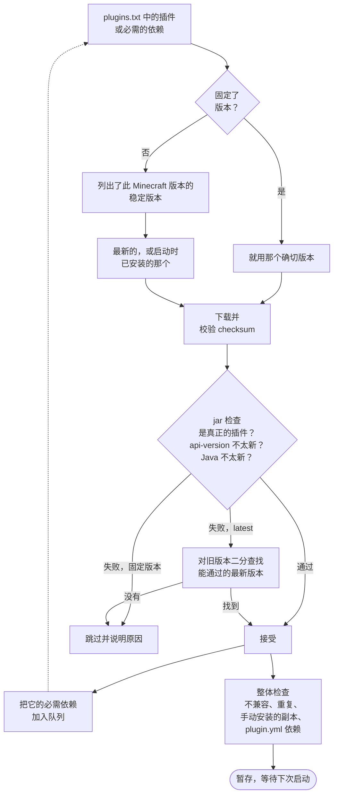

<!-- language-switcher -->
[English](../plugins.md) · [हिन्दी](../hi/plugins.md) · [Español](../es/plugins.md) · **简体中文** · [Português (BR)](../pt-BR/plugins.md) · [日本語](../ja/plugins.md) · [한국어](../ko/plugins.md)

#  插件

本服务器运行的是 **Paper**，因此支持**插件**：Paper、Spigot 或 Bukkit 的 `.jar` 文件。插件只在服务器上运行，玩家无需安装任何东西。它不运行[模组](#模组)。

安装插件有两种方式：

| 方式 | 适用于 |
|---|---|
| [`plugins/plugins.txt`](#受管理的插件pluginstxt)（推荐） | [Modrinth](https://modrinth.com/plugins) 或 [Hangar](https://hangar.papermc.io) 上的插件。会为你选择合适的版本及其依赖，进行校验并保持更新。 |
| [手动安装](#来自其他网站的插件) | 其他所有插件。 |

## 受管理的插件：`plugins.txt`

列出你想要的插件，每行一个：

```text
# source    project            version
modrinth    luckperms          latest
modrinth    worldguard         latest
hangar      ViaVersion         latest
modrinth    chunky             1.5.3
```

| 字段 | 含义 |
|---|---|
| `source` | `modrinth` 或 `hangar`（PaperMC 官方插件网站） |
| `project` | 插件页面地址中的名字：`modrinth.com/plugin/luckperms` 对应 `luckperms`，`hangar.papermc.io/ViaVersion/ViaVersion` 对应 `ViaVersion` |
| `version` | `latest` 表示能在本服务器运行的最新稳定版本，或者从插件页面复制的确切版本名 |

`#` 开始一行注释。空行会被忽略。

然后运行：

```bash
make update-plugins
```

| 想要…… | 这样做 |
|---|---|
| 添加插件 | 添加一行，然后 `make update-plugins` |
| 更新全部 | `make update-plugins` |
| 固定或回退某个插件 | 把 `latest` 改成具体版本，然后 `make update-plugins` |
| 移除插件 | 删除对应的行，然后 `make update-plugins`。它引入的依赖也会被移除。它的设置目录会保留。 |
| 查看安装了什么以及原因 | `make plugins` |

```
Minecraft 1.20.4 on Java 17 - plugins managed by plugins.txt:
  WorldGuard               7.0.9                  listed
  WorldEdit                7.3.0                  required by WorldGuard
Other plugin jars (added by hand or built in):
  UsernameRules.jar
```

### `make update-plugins` 做了什么

1. 在服务器保持运行的同时，计算出完整的插件版本组合（见下文），并把新内容下载到暂存目录。
2. 如果没有任何变化，就输出 `all plugins are up to date` 并停止。
3. 否则先备份，提醒玩家，然后重启服务器。
4. 启动时换上暂存的插件，并删除已移除的插件。

服务器正在使用的插件文件永远不会被替换。

## 如何选择兼容的版本

你只需列出想要的插件。对于每一个，解析器会这样做：



**1. 按 Minecraft 版本筛选。**只考虑插件网站声明支持你服务器 Minecraft 版本的**稳定**版本（不含 beta）。

**2. 检查实际的 jar。**插件网站有时会出错，所以每个候选版本都会被下载并检查：

| 检查 | 原因 |
|---|---|
| checksum 与网站一致（Modrinth 用 SHA-512，Hangar 用 SHA-256） | 文件与作者发布的完全相同 |
| 包含 `plugin.yml` 或 `paper-plugin.yml` | 它确实是 Paper/Bukkit 插件 |
| `api-version` ≤ 你的 Minecraft 版本 | Paper 会拒绝为更新 Minecraft 构建的插件 |
| 编译目标 Java ≤ 服务器的 Java | 这是"插件无法加载"最常见的原因；插件网站不会记录这一点 |

如果最新版本没有通过，解析器会在更旧的版本中回溯，找到**能通过的最新版本**。要求只会随时间升高，所以即使有 100 多个版本，二分查找也只需几次下载就能找到：

```
[plugins] WorldEdit: using 7.3.0 because 7.3.9 needs Java 21 (this server runs Java 17)
```

**3. 安装依赖。**在 Modrinth 或 Hangar 上声明的必需依赖会以同样的方式递归解析。可选依赖不会安装。

**4. 读取每个插件自己的依赖列表。**有些插件在 `plugin.yml` 中写了依赖，但网站上没有。解析器会按插件名在 Hangar 和 Modrinth 上查找它们。只有当下载的 jar 确实是同名插件时才接受，所以永远不会误装名字相似的项目。

**5. 检查整体组合。**

| 情况 | 结果 |
|---|---|
| Modrinth 标记两个插件互不兼容 | 跳过依赖项（或后列出的那个），并给出警告 |
| 同一个插件来自两个来源 | 保留第一个，跳过第二个；Paper 不接受重复 |
| 你也手动安装了的插件 | 跳过受管理的副本 |
| 某个依赖在任何地方都找不到 | 警告："X requires the plugin Y, which could not be found automatically; add it to plugins.txt" |

示例：在一台列出了四个插件的 Minecraft 1.20.4 服务器上，自动添加了三个依赖，并为 Java 17 选择了较旧的 WorldEdit：

```
[plugins] WorldEdit: using 7.3.0 because 7.3.9 needs Java 21 (this server runs Java 17)
[plugins] + Multiverse-Portals 5.3.0  (listed)
[plugins] + WorldGuard 7.0.9  (listed)
[plugins] + ViaBackwards 5.12.2  (listed)
[plugins] + LuckPerms v5.5.71-bukkit  (listed)
[plugins] + Multiverse-Core 5.8.2  (required by Multiverse-Portals)
[plugins] + WorldEdit 7.3.0  (required by WorldGuard)
[plugins] + ViaVersion 5.12.2  (required by ViaBackwards)
```

### 发生变化时

| 变化 | 会发生什么 |
|---|---|
| 你编辑了 `plugins.txt` | 由 `make update-plugins` 应用，或在下次启动时应用 |
| 你更改了 Minecraft 或 Java 版本 | 下次启动时重新解析所有插件。某个插件可能会升级或降级到适合新版本的发布。 |
| 什么都没变 | 启动时完全不会联系 Modrinth 或 Hangar |

启动时，解析器会优先使用已安装的版本，只要它仍能通过所有检查。只有 `make update-plugins`（或每日自动更新）才会把插件升级到更新的版本。

### 固定版本

固定的版本（`modrinth chunky 1.5.3`）会原样使用，不做搜索：

- 如果插件网站没有列出你的 Minecraft 版本，会给出警告，但仍然安装。
- 如果 jar 根本无法运行（Java 不对、API 太新），则会被拒绝。

### 失败永远不会拖垮服务器

| 问题 | 结果 |
|---|---|
| 无法访问 Modrinth 或 Hangar、拼写错误、项目已删除 | 警告。已安装的版本保留，服务器正常启动，下次启动时重试。 |
| 没有任何版本能在这台服务器上运行 | 警告并说明原因；如果更新的 Java 有帮助，会附带 `JAVA_VERSION` 提示。无法加载的先前已安装版本会被移除。 |
| 同时运行两个 `update-plugins`（手动和定时） | 第二个被拒绝："another plugin install/update is already running; try again in a minute" |

## 自动更新

```env
PLUGIN_AUTO_UPDATE=true
PLUGIN_UPDATE_TIME=04:00
TZ=Asia/Shanghai
```

每天在 `PLUGIN_UPDATE_TIME`：

1. 服务器检查插件更新。如果没有，什么也不做。
2. 如果有，玩家会在重启前 5 分钟、1 分钟和 10 秒看到聊天提醒。
3. 进行备份。
4. 服务器重启并应用更新。

修改这些设置后请运行 `make up`。自动更新**默认关闭**：插件更新偶尔会改变配置格式或行为。对于重要的服务器，请在你能查看结果的时候运行 `make update-plugins`，并固定你依赖的版本。

## 来自其他网站的插件

对于不在 Modrinth 或 Hangar 上的插件，或者 Hangar 只提供外部链接的插件：

```bash
docker compose cp SomePlugin.jar mc:/data/plugins/
make restart
```

移除一个：

```bash
docker compose exec mc rm /data/plugins/SomePlugin.jar
make restart
```

`plugins.txt` 永远不会动你手动添加的 jar，并且在检查依赖时它们会被视为已安装。

## 插件存放位置

| 路径（在 `mc-data` 卷内） | 内容 |
|---|---|
| `/data/plugins/*.jar` | 所有插件 jar |
| `/data/plugins/<Name>/` | 每个插件的设置和数据 |
| `/data/plugins/.managed/lock.tsv` | `plugins.txt` 安装了什么：版本、文件、checksum、原因 |
| `/data/plugins/.managed/pending/` | 为下次启动暂存的更新 |

以上全部都包含在备份中（暂存目录除外）。

## 内置插件

`UsernameRules` 随镜像提供。它在离线模式下执行 Mojang 的用户名规则（参见 [在线与离线模式](offline-mode.md#用户名规则)），由 `ENFORCE_USERNAME_RULES` 控制，而不是 `plugins.txt`。

## 模组

模组（Fabric、Forge、NeoForge）会改变游戏本身。Paper 无法加载它们，而且大多数内容模组还需要**每个玩家**都安装。运行模组意味着要把这个镜像改为基于 Fabric 或 NeoForge 而不是 Paper 构建。本项目的大部分功能都能沿用（备份、健康检查、安全关闭、玩家迁移），但 Paper 插件不能。对于追求可靠的服务器，不推荐尝试同时运行两者的"混合"服务器。

## 限制

- 只会自动搜索 Modrinth 和 Hangar。
- 不会安装可选依赖；如果需要，请把它们加入列表。
- jar 检查能发现常见的不兼容问题，但插件仍可能通过检查后因内部 API 变化而在运行时出错。每次插件更新前进行的备份就是安全网。
- 插件按玩家 UUID 保存的数据在切换在线和离线模式时不会迁移。
