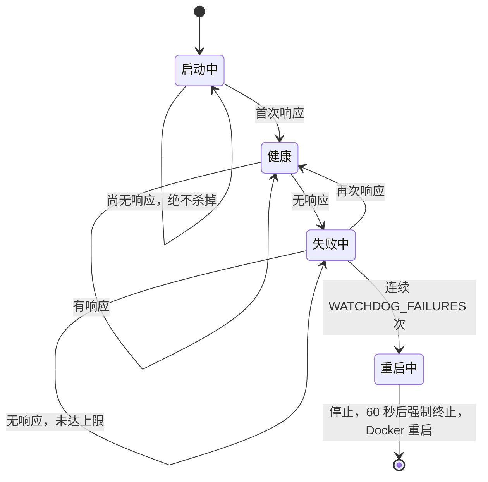
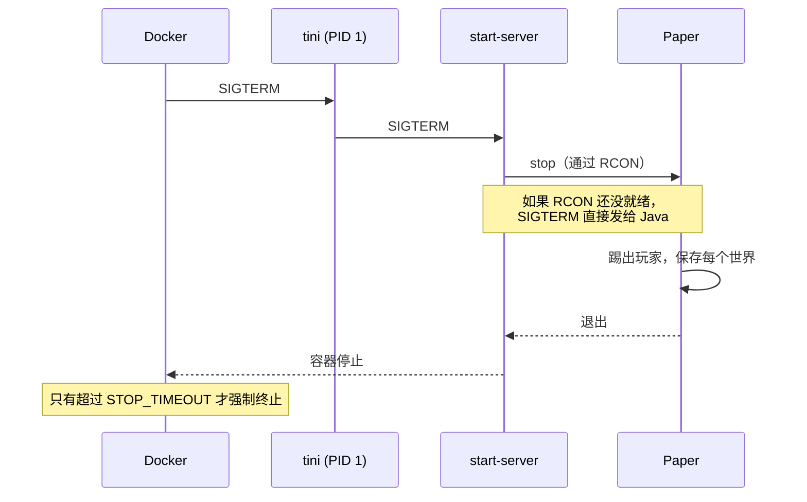

<!-- language-switcher -->
[English](../reliability.md) · [हिन्दी](../hi/reliability.md) · [Español](../es/reliability.md) · **简体中文** · [Português (BR)](../pt-BR/reliability.md) · [日本語](../ja/reliability.md) · [한국어](../ko/reliability.md)

#  可靠性

本页介绍在无人值守的情况下，保持服务器运行、保护世界安全的所有机制。

| 机制 | 防范的问题 |
|---|---|
| [重启策略](#自动重启) | 崩溃、内存不足错误、主机重启 |
| [健康检查](#健康检查) | 不知道服务器是否真正在工作 |
| [卡死看门狗](#卡死看门狗) | 进程还在运行但已不再响应的卡死服务器 |
| [安全关闭](#安全关闭) | 停止时丢失或损坏世界 |
| [内存安全](#内存安全) | 因内存不足被反复杀掉的循环 |
| [配置校验](#配置校验) | 拼写错误导致崩溃循环或功能被悄悄关闭 |
| [版本与数据保护](#版本与数据保护) | 世界降级、玩家数据丢失 |
| [备份](backups.md) | 其他一切 |

## 自动重启

两个容器都使用 `restart: unless-stopped`。无论服务器进程因崩溃、内存不足、看门狗，还是有人输入 `/stop` 而退出，Docker 都会重新启动它。主机重启后，Docker 一启动它就会恢复。只有 `make down`（或 `docker stop`）才会让它保持停止。

## 健康检查

Docker 每 30 秒在容器内运行一次 `mc-health`：

1. 向游戏端口发送一次**服务器列表 ping**，也就是 Minecraft 多人游戏界面发出的同样请求。
2. 如果因为服务器在列表中被隐藏（`enable-status=false`）而被拒绝，就改用 RCON 的 `list` 命令。

只要有一次检查通过，`make status` 就会显示 `healthy`。新服务器有 **5 分钟**的宽限时间用于生成世界。`backup` 容器会等服务器变为健康后才启动。

## 卡死看门狗

服务器可能在进程仍然存活的情况下卡死：例如死锁，或某个插件陷入无限循环。Docker 只会重启已退出的进程，所以容器中有一个后台看门狗专门处理这种情况：

- 每隔 `WATCHDOG_INTERVAL` 秒（默认 60）运行一次健康检查。
- 只有在**服务器至少响应过一次之后**才开始计数，所以首次启动较慢时永远不会被杀掉。
- 连续 `WATCHDOG_FAILURES` 次失败后（默认 5 次，约 5 分钟），先发送普通停止信号，等待 60 秒，再强制终止。随后 Docker 会重启服务器。




```
[start-server] Watchdog: server not responding (1/5)
...
[start-server] Watchdog: server is hung, killing it
```

Paper 自带一个针对游戏 tick 卡死的看门狗。这个看门狗还能发现 Paper 自带看门狗看不到的卡死。设置 `WATCHDOG_INTERVAL=0` 可将其关闭。

## 安全关闭

直接杀掉 Minecraft 服务器会丢失上次自动保存以来的所有内容，还可能损坏正在写入的区块。这里的每次停止都走同一条路径：




1. `tini`（PID 1）把 Docker 的停止信号转交给 `start-server`。
2. `start-server` 通过 RCON 发送 `stop`。Paper 踢出玩家、保存每个世界，然后退出。
3. 如果 RCON 还没就绪（例如在启动过程中），Java 会收到普通的停止信号。Paper 收到它时同样会保存。

Docker 最多等待 `STOP_TIMEOUT`（默认 `2m`）后才强制终止。世界非常大或磁盘较慢时，请调高它：

```env
STOP_TIMEOUT=5m
```

## 内存安全

| 风险 | 保护措施 |
|---|---|
| 游戏中途堆增长，主机内存耗尽 | 堆大小在启动时固定（`-Xms` = `-Xmx` = `MEMORY`）并预先占用，所以内存问题会在启动时暴露，而不是在游戏中 |
| 堆对容器来说太大，内核反复杀掉它（退出码 137） | 除非 `MEMORY` + 512M 能放进 `CONTAINER_MEMORY`，否则拒绝启动。错误信息会告诉你该设置什么。 |
| Java 堆耗尽后半死不活地运行 | `-XX:+ExitOnOutOfMemoryError` 让它干净地退出，再由 Docker 重启 |

垃圾回收使用广泛采用的 G1 Aikar 参数，在 12 GB 及以上时切换到大堆版本，使停顿短且可预测。

## 配置校验

任何东西启动之前都会先检查设置。错误的值会让启动停止，并给出包含设置名称的提示，而不是造成崩溃循环、无休止的备份循环，或悄悄关闭某项功能：

| 设置 | 被拒绝的值示例 | 提示 |
|---|---|---|
| `EULA` | `false` | 必须接受 EULA |
| `RCON_PASSWORD` | 占位值，或包含反斜杠的值 | 说明原因以及如何生成 |
| `MEMORY` | `2GB` | 必须形如 `2G` 或 `1536M` |
| `MEMORY` / `CONTAINER_MEMORY` | `3G` 容器中设置 `4G` | 告诉你该设置多少 `CONTAINER_MEMORY` |
| `WATCHDOG_INTERVAL`、`WATCHDOG_FAILURES` | `1m` | 必须是整数 |
| `PLUGIN_UPDATE_TIME` | `25:00` | 必须是 `HH:MM` |
| `BACKUP_INTERVAL` | `abc` | 必须形如 `30m`、`6h`、`1d` |
| `BACKUP_KEEP` | `0` | 必须大于等于 1 |
| `MC_VERSION` | `1.16.5`、`9.9` | 版本过旧，或不可用 |
| `PAPER_BUILD` | 搭配 `MC_VERSION=latest` 的数字 | 需要确切的版本 |

## 版本与数据保护

- **拒绝世界降级**，升级前会先备份。参见 [Minecraft 版本](minecraft-versions.md)。
- **切换在线/离线模式时，玩家数据跟着玩家走。**会先备份，并且服务器不会在迁移到一半时启动。参见 [在线与离线模式](offline-mode.md)。
- **插件问题永远不会阻止启动。**下载失败时保留已安装的版本，无法加载的插件会被跳过。参见 [插件](plugins.md)。

## 最小权限与隔离

- 服务器以无特权用户（`PUID`/`PGID`）运行。只在启动时短暂使用 root 来修正文件所有权。
- RCON 只能在私有的 Compose 网络中访问。
- Docker 日志轮换（每个容器 5 × 10 MB）防止日志占满磁盘。
